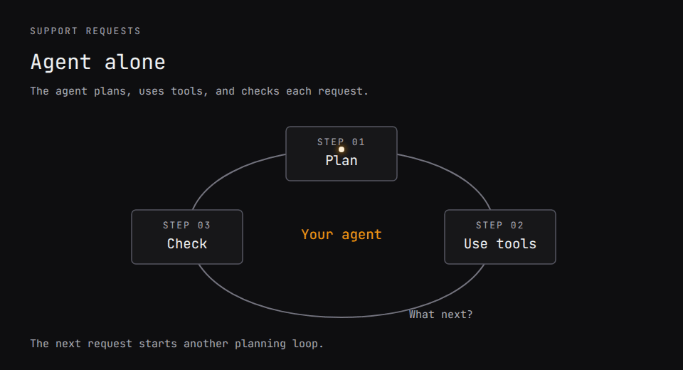

# AgentRun

Open-source packages for your pi agent. Install the ones you need.

This repository holds the AgentRun harness: the workflow DSL and the pi extensions around it.

**pi-vision** lets a pi agent answer questions about documents, images and video, and show the page, second or region each answer rests on. Try it free, with no key (the models are scripted): `npm run demo:vision -- examples/document-check`. It needs ffmpeg, ffprobe, pdftoppm and pdftotext (`brew install ffmpeg poppler`, or `sudo apt-get install ffmpeg poppler-utils`). See [pi-vision](packages/pi-vision/README.md).

[Quickstart](#quickstart) · [Packages](#use-one-piece-or-all-of-it) · [Documentation](docs/guide.md) · [Examples](docs/examples.md) · [Pi extension](#use-it-in-pi) · [Agent instructions](docs/agent-instructions.md)



[View the static diagram](docs/assets/support-workflow.svg) · [Run this example](#run-the-support-example)

The support example below follows this workflow with scripted tools and model responses.

## Quickstart

The DSL defines repeatable steps, uses [Jev](https://docs.typesafe.ai/) for focused decisions, and calls an agent when the work needs investigation. Your application keeps its tools, model access, permissions and budgets.

Requires Node 22.19+ and npm. In your project:

```sh
npm install @parcha/agentrun-dsl@beta
npx @parcha/agentrun-dsl@beta demo
```

This ticket-routing demo uses scripted decisions and needs no API key. Next, [run and change a workflow in your own app](examples/starter/README.md). To run the support workflow shown above, use the checkout below. To build workflows with your agent, [install the Pi extension](#use-it-in-pi).

### Run the support example

To run the workflow in the animation, clone the examples and build:

```sh
git clone --branch main --single-branch https://github.com/Parcha-ai/agentrun.git
cd agentrun
# With nvm: nvm install && nvm use
npm ci --ignore-scripts
npm run build
npm run demo:support
```

This runs the interpreter with scripted tools, Jev answers, and agent responses. It needs no API key and sends no customer replies.

The command prints a report for each case:

| Request | Agent calls | Decision calls | Result |
| --- | ---: | ---: | --- |
| Reset a password | 0 | 1 | Return the help answer |
| Find an invoice | 0 | 1 | Return the help answer |
| Investigate a failed payment | 1 | 2 | Return the investigation answer |
| Payment still unresolved | 1 | 2 | Escalate for review |

```sh
npm run demo:support -- payment
npm run test:support
```

Try `npm run demo:support -- unresolved` to see an escalation. It exits with code `2`. The responses are scripted; changing a prompt does not change them.

[Connect live Jev and your agent](docs/support-quickstart.md), or [give these instructions to your coding agent](docs/agent-instructions.md).

## Use one piece, or all of it

### Use one piece

Each package works on its own. [Pi](https://pi.dev) is an open-source coding agent; pi-durable is
Pi's runtime that commits each turn and tool call to storage; chord is the plugin and service runtime pi-durable is built
on; [Archil](https://archil.com) is a network disk you mount on any Linux host.

| Package | What it does | What it needs | First command with no key | Status |
| --- | --- | --- | --- | --- |
| [`@parcha/agentrun-dsl`](packages/dsl/README.md) | Define, validate, inspect and run workflows | Node 22.19+ | `npx @parcha/agentrun-dsl@beta demo` | published (`@beta`) |
| [`@parcha/agentrun-jev`](packages/jev/README.md) | Jev typed decisions as a workflow's `runJudge` | the DSL; `TYPESAFE_API_KEY` for live calls | its README's [offline test](packages/jev/README.md#offline-tests) | published (`@beta`) |
| [`@parcha/agentrun-pi`](packages/pi/README.md) | The `/agentrun` Pi extension and a Pi-backed node runner | Pi 1.0.4 to below 1.4 (CI tests 1.0.4, 1.1.0, 1.2.0 and 1.3.0); a model for live runs; pi-durable for its `./durable` entry | `/agentrun demo` in Pi (scripted, no model calls) | published (`@beta`) |
| [`@parcha/pi-durable-disk`](packages/pi-durable-disk/README.md) | Run a pi-durable agent on a network disk: one owner per run, a fence, a supervisor | pi-durable and chord; an Archil account, a disk and an API key | none yet | published (`@beta`) |
| [`@parcha/pi-browser`](packages/pi-browser/README.md) | Gives a pi agent a browser, and keeps each page it reads as evidence with its SHA-256 | pi-durable and chord; a provider (a local Chrome needs no key, Browserbase needs its key) | its README's [no-key command](packages/pi-browser/README.md#try-it-without-a-key-or-a-chrome) | published (`@beta`) |
| [`@parcha/pi-vision`](packages/pi-vision/README.md) | Lets a pi agent read documents, images, scans and video within the model's limits, and keeps a priced record of every look | nothing for a document's text; Photon or sharp for images; a pi-durable host (pi-durable, chord and pi-ai); a model that looks, for questions about a file | [`examples/vision-agent`](examples/vision-agent/README.md) (one agent that answers questions about files: `npm run demo:vision -- examples/document-check` runs on fakes, no key; it needs ffmpeg and poppler), then its README's [first read](packages/pi-vision/README.md#a-first-read-with-no-key) | published (`@beta`) |
| [`@parcha/pi-transport`](packages/pi-transport/README.md) | Boxes for pi agents: one interface over a directory, a container, a sandbox or a VM | pi-durable and chord; Docker for the Docker provider | the "A box" example in its README (needs Docker) | held, not published |
| [`@parcha/agentrun-harness`](packages/harness/README.md) | A reference harness: the host we use to run AgentRun demos and tests, meant to be read and forked | pi-durable, chord, pi-ai, pi-codemode and typebox; pi-transport only for a demo with boxes | its README's [first demo](packages/harness/README.md#run-a-demo-from-an-install-with-no-key) | held, not published |

A held package is built, tested and verified with the others, and its manifest says `"private": true`; it installs from
a packed tarball, not from npm.

### Use all of it

One program puts the packages together and runs a job end to end on pi-durable: a durable run, the recovery driver, the
node runner, the browser and vision. It uses a scripted model and a fake browser, needs no key, and prints the record
and the receipts it cites.

```sh
npm ci --ignore-scripts
npm run build
npm run demo:reference
```

[`examples/reference/`](examples/reference/) has the job; the host is the package [`@parcha/agentrun-harness`](packages/harness/README.md). [What a host supplies](docs/reference-host.md)
lists the seven functions the packages ask a host for, the install order and why, and what the example does not do yet.

## What a workflow looks like

The [support workflow](examples/support-answer.mjs) requires answer text and a source reference. Jev must also answer `yes` with confidence of at least `0.8`. Otherwise, the workflow allows one agent attempt and checks again. If the answer still fails those checks, it escalates for review. You choose the criteria and thresholds for your task.

These are the search and decision nodes from that workflow:

```js
{
  node: 'call', label: 'find-answer', via: 'tool',
  tool: 'help.search', args: { request: '{request}' },
  out: 'Candidate', as: 'answer', deadline_s: 10,
},
{
  node: 'judge', label: 'check-existing-answer',
  state: { request: '{request}', answer: '{answer}' },
  out: 'Fit', as: 'fit',
}
```

`Candidate` and `Fit` refer to schemas in the workflow. `Fit` defines the question and its `yes`, `no`, and `uncertain` criteria. Code reads the decision and its confidence to choose the next step. [Read the complete definition, including the agent and review path](examples/support-answer.mjs).

Write workflows as JSON or use the [TypeScript builder and Zod contracts](docs/authoring.md). The builder infers input and output types. The interpreter checks intermediate state paths at runtime. Workflows can call other workflows, map work in parallel, and run bounded loops.

## Connect your application

Install the core and Jev adapter in your application with `npm install @parcha/agentrun-dsl@beta @parcha/agentrun-jev@beta`. Then:

1. **Supply adapters.** Connect tools through `runEffect`, your existing agent through `runNode`, and Jev decisions through `createJevRunner()` as `runJudge`.
2. **Define and test the workflow.** Write its schemas, steps, thresholds, and review path. Start with fixtures, then evaluate real decisions on labeled cases from your task.
3. **Give your agent a workflow tool.** Register a function that calls `runWorkflow` as one of your agent's tools. Handle the workflow's output, escalation, and errors.

The [support integration guide](docs/support-quickstart.md) has a config template and live command. Live Jev calls need `TYPESAFE_API_KEY` from the [TypeSafe dashboard](https://console.typesafe.ai/keys), separate from your coding-agent login. Workflows without Jev decisions do not need that key. See [host integration](docs/host-integration.md) for permissions, cancellation, and recovery.

## Use it in Pi

With [Pi installed](packages/pi/README.md#install) (1.0.4 to below 1.4; CI tests 1.0.4, 1.1.0, 1.2.0 and 1.3.0), run these commands in your project:

```sh
pi install npm:@parcha/agentrun-pi@beta -l
pi --offline
```

`-l` installs in this project; `--offline` skips startup downloads. Pi asks whether you trust the project before loading its extension. No AgentRun checkout is needed.

- `/agentrun demo` loads the scripted research example; `/agentrun run` repeats it without model calls.
- `/agentrun demo live` uses your configured Pi model and Jev.
- `/agentrun status` checks setup; `/agentrun` shows the graph; `/agentrun stop` requests cancellation.

Once Pi has model access, ask it to build a workflow:

```text
/agentrun Research how this repository handles cancellation. Investigate the runtime and tests separately, then report gaps with file references.
```

Pi uses the packaged skill to build, inspect, and run the workflow. Run `/reload` if you install into an open Pi session. Use `/agentrun save <name>` and `/agentrun load <name>` for project-local definition revisions. Saves contain neither run input nor execution permission. [Pi setup and limits](packages/pi/README.md).

## More examples

| Example | What it demonstrates |
| --- | --- |
| [Support answers](docs/support-quickstart.md) | Search, Jev checks, optional investigation, review fallback |
| [Research a decision](examples/typed-research.ts) | Nested workflows, parallel research, evidence selection, report writing |
| [Rank a list](examples/rank-candidates.mjs) | A reusable workflow: Jev scores, code sorts and applies quotas, duplicates are dropped, long lists split themselves |
| [Standalone TypeScript starter](examples/starter/README.md) | Install the packages in your own app; search and screen evidence |

<a id="run-it"></a>

### Research demo

From the built checkout, run a scripted research workflow: "Should our team move its docs from a wiki into the code repository?"

```sh
npm run demo
npm run eval:research
```

It plans subquestions, researches them in parallel, screens evidence, and writes a report. The evaluation checks six labeled cases with scripted responses. [Connect real Jev and Pi models](docs/live-research.md).

## Packages, status, and contributing

| Package | Responsibility |
| --- | --- |
| [`@parcha/agentrun-dsl`](packages/dsl/README.md) | Define, validate, inspect, and execute workflows |
| [`@parcha/agentrun-jev`](packages/jev/README.md) | Connect Jev typed decisions |
| [`@parcha/agentrun-pi`](packages/pi/README.md) | Pi extension and agent runner |
| [`@parcha/pi-durable-disk`](packages/pi-durable-disk/README.md) | Run pi-durable agents on a network disk (Archil): one owner per run, a fence, and a supervisor |
| [`@parcha/pi-browser`](packages/pi-browser/README.md) | Gives a pi agent a browser, and keeps each page it reads as evidence with its SHA-256 |
| [`@parcha/pi-vision`](packages/pi-vision/README.md) | Lets a pi agent read documents, images, scans and video within the model's limits; it says when it cannot read something, and keeps a priced record of every look; start at [`examples/vision-agent`](examples/vision-agent/README.md) (`npm run demo:vision -- examples/document-check`, free, no key) |
| [`@parcha/pi-transport`](packages/pi-transport/README.md) | Boxes for pi agents: one small interface over a directory, a container, a sandbox or a VM, providers for this machine and Docker, a strict config, and a conformance suite a vendor can run |
| [`@parcha/agentrun-harness`](packages/harness/README.md) | A reference harness: the host we use to run AgentRun demos and tests, meant to be read and forked |

Every published package is at one version under npm's `beta` dist-tag; `npm view @parcha/agentrun-dsl dist-tags` prints it. The status column of [Use one piece](#use-one-piece) says which packages are published. See the [changelog](CHANGELOG.md) and [contracts and limits](docs/guide.md#contracts-and-limits).

Ordinary functions may be enough for a fixed sequence. AgentRun stores the steps in a workflow document that you can inspect, rerun, or call from an agent. Code nodes execute JavaScript with process privileges; untrusted workflow authors require a host-controlled sandbox. Typed decisions and validated output shapes do not prove that an answer is factually correct.

For development setup and checks, see [Contributing](CONTRIBUTING.md). [Open an issue](https://github.com/Parcha-ai/agentrun/issues) for bugs or proposals.

Code and documentation use [Apache-2.0](LICENSE). Copyright 2026 Parcha Labs, Inc. Dependencies retain their own licenses. Built by [Grep.ai](https://grep.ai).
