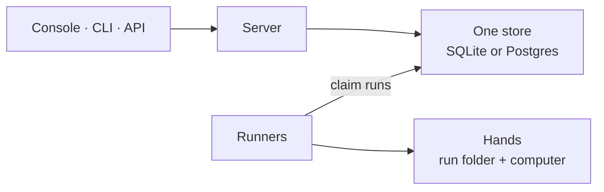
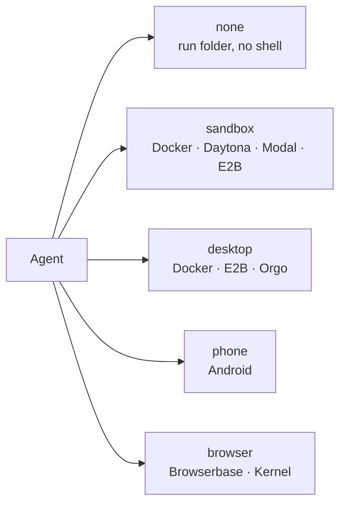
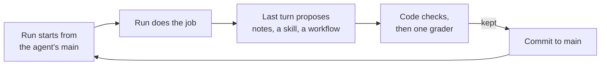

# AgentRun

**AgentRun is an open-source server for AI agents. Agents on it keep running through restarts, work on real computers,
and learn from every run.**

You bring the harness, the agent loop that talks to the model and calls tools: Claude Code, Codex, OpenCode or pi.
AgentRun does everything around it. It keeps every run in one store, so a crash doesn't lose it. It gives the agent a
computer to work on, holds it to your approvals and a spend cap, and keeps what it learned in a git folder that the
next run starts from. Run it on your laptop with one command, in one container, or as a server with runners.
Apache-2.0.

[](https://render.com/deploy?repo=https://github.com/Parcha-ai/agentrun)

## Start in three steps

You need Node 24.11 or newer, on macOS or Linux.

1. Start the server:

   ```sh
   npx @parcha/agentrun
   ```

   It starts the server and one runner on port 7340 (or the next free one), keeps everything in `~/.agentrun`, and
   opens the console in your browser.

2. In the console, set a password, then add one model key under **Settings → Model keys**. One `OPENROUTER_API_KEY`
   gives every harness a model. An Anthropic key runs pi and Claude Code; an OpenAI key runs pi, Codex and OpenCode.

3. Open **Templates**, apply one, and start a run. Or choose **New agent** and write your own instructions.

Rather have your coding agent do it? Tell it: `Read agentrun.ai/SKILL.md and set up AgentRun for me`.

If Docker is running on your machine, new agents get a Docker sandbox with a shell. Its image builds on first use,
which takes a few minutes, and the console says when it's ready. Without Docker, agents still read and write files,
but get no shell.

## What you get

- **Runs that survive.** Every agent, revision, run and step lives in one store. Stop the server mid-run and start it
  again, and the run carries on. With several runners, another runner picks up a dead runner's runs once their
  30-second lease runs out. A finished step is never run again; a write a crash cut off mid-call is marked interrupted
  rather than retried, so you can check it.
- **A computer for each agent.** Pick a kind: a sandbox, a Linux desktop, an Android phone or a browser. The agent gets
  the tools for that kind and nothing else.
- **Agents that learn.** At the end of a run the agent proposes notes, a skill or a workflow. AgentRun checks them,
  grades them, and commits the keepers to the agent's own git folder. The next run starts from there.
- **Workflows.** Write repeatable work as a typed workflow: tool calls, model steps and fast yes/no decisions, with an
  agent to fall back on when a case is unclear.
- **Approvals.** Each tool is allowed, asks you first, or is denied. A call that asks waits on the run's page until you
  answer. "Never ask" lets an agent run unattended, and a deny set on the server still holds over it.
- **Spend caps.** Give a run a cap and it pauses there instead of failing, and tells you the least it needs to go on.
  A cost AgentRun can't price reads "unknown", never $0.
- **Triggers.** Schedules, signed webhooks and GitHub pull request events start capped runs on their own.
- **Templates.** Five ready-made agents you can apply in one screen and measure with their own eval cases.
- **A console.** Mission Control opens first: what needs you, what failed in the last day, what's running, and what it
  cost. Each run has a live Timeline, its files and, for a browser, a screen you can take over.

**Harnesses.** An agent runs on Claude Code, Codex, OpenCode or pi. Name one in the agent's definition with
`harness` (`claude-agent`, `codex`, `opencode` or `pi`). Approvals, caps, computers, triggers and learning work the
same on each. Claude Code and Codex install themselves on first use; OpenCode needs its `opencode-ai` package beside
the server, and AgentRun prints the line that installs it. `npx @parcha/agentrun server capabilities` says which
harnesses your server runs.

## How it fits together



- **Server.** Serves the API at `/v2` and the console. It writes runs and commands to the store and reads it back for
  you. It runs no agent loop itself when you start it with `--no-runner`.
- **Store.** Agents, revisions, runs and every run's journal, in one place. SQLite in the data folder by default, or
  Postgres with `AGENTRUN_STORE_URL`.
- **Runners.** Each runner claims runs from the store and runs many at once. Every approval check, cap and model call happens
  here. Add runners to scale out.
- **Hands.** Where the agent's tools act. Each run has a run folder for its files. A sandbox mounts that folder at
  `/workspace` and the tools run inside it; a desktop, phone or browser leaves the folder on the runner.

## A first run from the terminal

`npx @parcha/agentrun` is also the server's CLI. Run these in a second terminal while the server is up; the CLI finds
it and its token by itself. The script makes an agent, starts a run capped at $1, lets the agent ask you a question,
answers it, and reads the file the agent wrote. With Docker on, the first run waits for the sandbox image.

```sh
# 1. Make an agent that can write files and ask you things.
cat > agent.json <<'EOF'
{"definition": {"id": "notes", "version": 1, "name": "Notes",
  "instructions": "Do what you are asked, and write what you make to a file.",
  "skills": [], "tools": ["write", "ask_person"]}}
EOF
npx @parcha/agentrun agents create --body @agent.json

# 2. Start a capped run and wait. It stops to ask you which region (exit code 8: it waits on you).
npx @parcha/agentrun runs start notes --max-cost-usd 1 --wait \
  --body '{"input": {"content": "Ask me which region to cover, then write region.md about it."}}' > out.json

# 3. Answer, wait for it to finish, and read what it wrote.
run=$(node -p 'require("./out.json").run_id')
npx @parcha/agentrun runs message "$run" --content "Europe"
npx @parcha/agentrun runs wait "$run" > out.json
npx @parcha/agentrun runs read-file "$run" region.md
```

`runs wait` exits 0 when the run completed, 1 when it failed, and 8 when it waits on you: a question, its cap, or an
approval. `runs timeline RUN_ID --follow` streams each step as it happens, and every run carries a `console_url` to its
page. `npx @parcha/agentrun help` lists every command; `npx @parcha/agentrun skill install --claude` (or `--codex`)
teaches your coding agent the CLI.

From code, the same run with the TypeScript client (`npm install @parcha/agentrun-client`, no dependencies). The
client reads its server and token from the environment; the server prints both when it starts (with
`npx @parcha/agentrun`, the token is in `~/.agentrun/.token`, and the address is normally `http://127.0.0.1:7340`):

```sh
export AGENTRUN_BASE_URL=http://127.0.0.1:7340/v2
export AGENTRUN_API_KEY=$(cat ~/.agentrun/.token)
```

```ts
import { AgentRun } from "@parcha/agentrun-client";

const client = new AgentRun(); // AGENTRUN_BASE_URL and AGENTRUN_API_KEY
const started = await client.runs.start("notes", { input: { content: "Ask me which region to cover, then write region.md about it." }, max_cost_usd: 1 });
let run = await client.runs.wait(started.run_id);
if (run.pending?.kind === "question") await client.runs.message(run.run_id, { content: "Europe" });
run = await client.runs.wait(run.run_id);
console.log(run.status, run.cost.usd);
```

The Python client is `pip install parcha-agentrun`, with the same methods
([TypeScript client](packages/client/README.md), [Python client](python/README.md)).

## Templates

Each template is one folder: the agent's instructions, its skills, its rules and its eval cases. **Templates → Apply**
grants nothing until you tick each MCP tool yourself.

| Template | What it does |
| --- | --- |
| `code-review` | Reviews a pull request or a diff, checks each finding against the code, and returns the findings as JSON. It sets up its own GitHub trigger |
| `kyb` | Due diligence on one company: registries, owners, sanctions lists, dated adverse media, and a verdict with every claim cited |
| `market-monitor` | Every Monday, a digest of what changed at the companies you watch, each item dated and linked |
| `inbound-lead` | Researches each lead a webhook sends and scores it 0 to 100 against your ideal customer profile |
| `release-notes` | Turns the pull requests merged since the last release into release notes, left as a draft issue for a person |

`npx @parcha/agentrun template eval DIR` runs a template's eval cases as real runs on a throwaway server and grades
them. [Template packages](packages/serve/templates/README.md) has the folder format.

## Computers

An agent gets a computer with one setting. It gets the tools for that kind and nothing else, and changing the computer
changes nothing else about the agent.

```yaml
computer:
  kind: sandbox        # none, sandbox, desktop, phone or browser
  provider: daytona    # one you connected in Settings → Computers (none takes no provider)
```



| Kind | What the agent can do | Providers |
| --- | --- | --- |
| `none` | Read and write files in its run folder; no shell (with Archil, commands run on Archil's exec) | none needed |
| `sandbox` | Run code, install packages, keep processes in the background, on Linux | Docker, Daytona, Modal, E2B |
| `desktop` | See a Linux screen, move the mouse, type | Orgo, E2B, Docker (your own image with an X server) |
| `phone` | Tap, swipe, type, open apps and read the screen on Android | phone harness (a rented cloud Android) |
| `browser` | Browse the web, and hand the controls to you at any point | Browserbase, Kernel |

Every kind but `none` names its provider. An agent with no computer setting gets the Docker sandbox where the server
has Docker, and no computer otherwise.

- **Keys.** Add a vendor's key once in **Settings → Computers**. Your server seals it and shows it only as set or
  missing; it never enters the agent's computer. **Test connection** makes one read at the vendor and starts nothing.
- **The run's files.** By default a run's folder lives on your server and the Docker sandbox mounts it. Turn on an
  Archil disk in Settings and the folder lives there instead, so a Daytona, Modal or E2B sandbox mounts the same folder.
  Those three run only with an Archil disk, and with Archil on the Docker sandbox is refused.
- **Watching and taking over.** A browser run streams to the run's **Screen** tab through your own server, never
  through a vendor link. Take the controls, then hand them back. The agent can also stop and ask you to take over, for
  a login or a captcha.
- **Proof.** Each provider has a conformance suite for its kind. Run it against the vendor yourself, from a checkout
  after `npm ci && npm run build`:
  `npm run conformance -w @parcha/agentrun-computer -- --provider docker --kind sandbox`.

Remote computers bill through your own account with the vendor. [`@parcha/agentrun-computer`](packages/computer/README.md)
is the protocol underneath: one small daemon in every computer and one provider per vendor.

## Workflows

A workflow is a JSON document of typed steps. AgentRun runs it as an agent's revision, under the agent's tool
permissions and a cap like any run, and a trigger can start one.

```json
{
  "v": 2, "name": "read-site",
  "schemas": {
    "In":   { "type": "object", "required": ["website"], "properties": { "website": { "type": "string" } } },
    "Page": { "type": "object", "required": ["ok"], "properties": { "ok": { "type": "boolean" } } }
  },
  "input":  { "schemaId": "In" },
  "output": { "schemaId": "Page", "path": "home" },
  "root": { "node": "chain", "steps": [
    { "node": "call", "label": "Read the home page", "via": "tool", "tool": "web_fetch",
      "args": { "url": "{website}" }, "out": "Page", "as": "home", "deadline_s": 60 }
  ] }
}
```

Steps can call tools, run a model, ask a fast typed question (yes or no, pick one, a score, each with its
confidence), branch on the answer, map over a list in parallel, loop a bounded number of times, call other workflows,
or hand the hard case to an agent. Save one as an agent's `workflow` field; `npx @parcha/agentrun workflows validate`
checks it first. The [workflow language](packages/dsl/README.md) also runs on its own inside your app, with a
[TypeScript builder](docs/authoring.md).

## Learning

Turn it on with `"learning": true` in an agent's definition.



Each agent has a learning folder: plain git with one branch, `main`. A run reads the index of active notes in its
instructions and gets the learned skills beside its own. When the run ends, it gets one more turn to say what it would
keep. Code checks the proposal first (no secrets, no files outside the folder, size limits). Then one grader judges
what it says, and AgentRun commits what passes. A risky rule waits for your OK.

- **Notes** are short markdown files, one fact each, in Claude Code's memory format.
- **Skills** are how to do a job again, and only a run that finished the job can write one.
- **Learned workflows** run as one tool call on any harness, under the run's own cap and tool permissions.

The agent's **Learning** tab shows every note, skill and workflow and the log of changes, and each run shows which
notes it was given and opened. Retire anything there, or with `npx @parcha/agentrun learning retire` and the note's ETag. Git keeps the
history, so a retired note can come back.

## Security

Every saved secret (model and tool keys, MCP credentials, sign-ins, webhook signing secrets) is sealed under one key,
`AGENTRUN_SEAL_KEY`; keep it, because losing it loses what it sealed. Secrets are write-only: the console shows each one
as set or missing, and only the console can paste, replace or remove one (your signed-in session, or the launcher's console on
loopback when accounts are off). A key set where the server starts wins over a pasted one. The API token can't write
a secret or approve a tool call. A run gets only the keys its own model and tools need, and nothing a run learns
can keep a secret it was handed. [SECURITY.md](SECURITY.md) says how to report a vulnerability.

## Deploy it

**Render.** The button above deploys [`render.yaml`](render.yaml): one 1 CPU / 2 GB instance with a 10 GB disk, the
published image (no build), and the token and seal key generated for you. It needs a card on your Render workspace: about $25 a
month for the instance and $2.50 for the disk, at Render's prices when this was written. In Render's form, paste
`OPENROUTER_API_KEY`. We recommend an OpenRouter key with a dollar cap and an expiration date. Do not share this key with anyone.
When it's live, open its URL and paste `AGENTRUN_TOKEN` from the service's Environment tab to set your password.

**Docker Compose: a server and two runners.** On a Linux machine with Docker:

```sh
git clone https://github.com/Parcha-ai/agentrun && cd agentrun/deploy
printf 'AGENTRUN_SEAL_KEY=%s\n' "$(openssl rand -base64 32)" > .env && chmod 600 .env
echo 'OPENROUTER_API_KEY=...' >> .env
docker compose up -d --build
docker compose logs server     # the console's link, the first visit's setup code and, the first time, the token
```

The port is published on this machine's loopback only; put a TLS proxy in front before you open it to anyone else.
A server in a container has no Docker sandbox yet, so agents there get file tools and `web_fetch` but no shell; for a
sandbox, run the server on the host, or use a Daytona or E2B computer with workspaces on Archil.

**Runners on Postgres.** Set `AGENTRUN_STORE_URL` to a `postgres://` URL on the server and every runner (the compose
file's `pg` profile runs one), start the server with `--no-runner`, and start each runner from the same image with
`runner --data /data --name <name>`. Give every process the same `AGENTRUN_SEAL_KEY`. Runners still share the `/data`
volume in this release.

[Deploying AgentRun](deploy/README.md) covers runners, health checks and upgrades.

## Docs

- [AgentRun Server](packages/serve/README.md): the API, models, tools, MCP servers, triggers, spend caps, learning and
  safety, in full
- [Quickstart on agentrun.ai](https://agentrun.ai/docs/quickstart) and the [docs](https://agentrun.ai/docs)
- [The CLI's skill](packages/agentrun/skills/agentrun-cli/SKILL.md) and [every command](packages/agentrun/skills/agentrun-cli/references/commands.md)
- [Deploying](deploy/README.md), [computers](packages/computer/README.md), [templates](packages/serve/templates/README.md)
- [The workflow language](packages/dsl/README.md), [authoring](docs/authoring.md), [the guide](docs/guide.md)
- [Changelog](CHANGELOG.md) and [contributing](CONTRIBUTING.md)

## Coming next

- A computer chosen per call, not only per agent
- First-party computers
- iPhone, macOS and Windows computers
- Watching and taking over a desktop or phone run, as a browser run does today
- Composio as a tool catalog
- Harnesses over the Agent Client Protocol
- A Slack trigger and a Parallel monitor trigger

## License and thanks

Apache-2.0. Copyright 2026 Parcha Labs, Inc. Built by [Grep.ai](https://grep.ai).

AgentRun builds on [pi](https://github.com/earendil-works/pi) by Earendil Works (MIT), the agent loop and durable
runtime under it; [Stagehand](https://github.com/browserbase/stagehand) and the
[Browserbase Node SDK](https://github.com/browserbase/sdk-node); the
[TypeSafe JavaScript SDK](https://github.com/typesafe-ai/typesafe-sdk-js); Archil's
[disk SDK](https://github.com/archil-data/archil-sdk); and
[vercel-labs/durable-harness](https://github.com/vercel-labs/durable-harness) (Apache-2.0), whose ideas and code the
durable harnesses build on. Each keeps its own license; each package's NOTICE lists what it carries.
