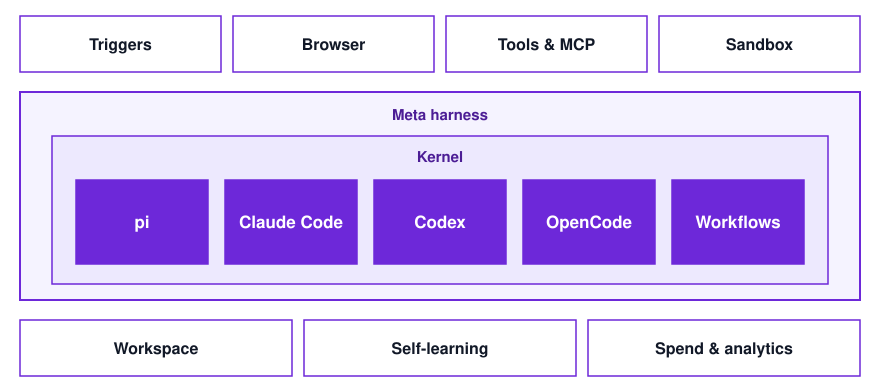
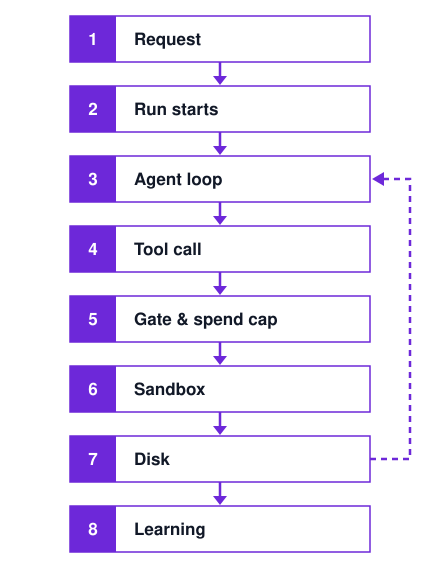
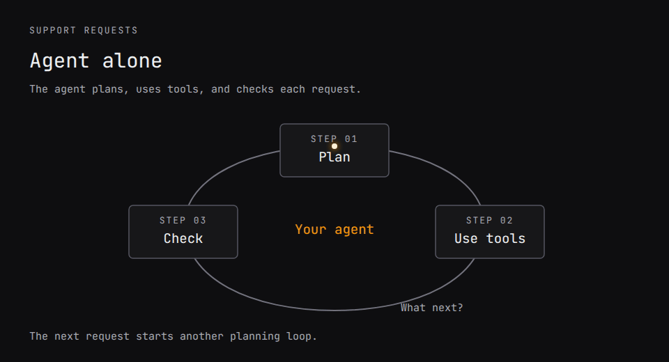

<h1 align="center">AgentRun</h1>

<p align="center">
  <b>The open-source managed agent platform.<br>Bring your harness. AgentRun gives it everything else.</b>
</p>

<p align="center">
  <a href="#quickstart">Quickstart</a> ·
  <a href="#architecture">Architecture</a> ·
  <a href="#the-life-of-a-request">Life of a request</a> ·
  <a href="packages/serve/README.md">Server docs</a> ·
  <a href="#open-protocols">Protocols</a> ·
  <a href="#roadmap">Roadmap</a> ·
  <a href="LICENSE">Apache-2.0</a>
</p>

Pick pi, Claude Code, Codex or OpenCode. Your agent gets the same sandbox, tools, permission gate, spend cap and
self-learning on every one of them. The whole platform is one server and a folder of SQLite files. No Postgres, no queue, no workers.

| Install it yourself | Or let your coding agent install it |
| --- | --- |
| 1. `npx @parcha/agentrun` on macOS or Linux with Node 22.19+. It prints its address and opens the console. | 1. Paste into Claude Code or Codex: `Read https://raw.githubusercontent.com/Parcha-ai/agentrun/main/docs/SKILL.md and set up AgentRun for me` |
| 2. Set your password on the first visit. | 2. It checks Node and Docker, starts AgentRun and asks you before each step that changes your machine. |
| 3. Add a model key under Settings → Model keys. | 3. You add the model key yourself. It never sees one. |
| 4. New agent, Start a run. | 4. It makes your first agent from the CLI and gives you the run's link. |

Running Claude Code or Codex agents? On today's npm release the start line names their packages. See
[Quickstart](#quickstart).

## Why AgentRun

- **Superpowers on any harness.** pi, Claude Code, Codex and OpenCode get the same tools, sandbox, gate, spend cap and
  learning. Switching is one field in the agent's definition.
- **A browser that stays signed in.** Sign in once at Browserbase or Kernel, and every later run of that agent starts
  signed in. The cookies stay at the vendor and the model never sees them.
- **A persistent workspace.** Every run keeps its folder, and a follow-up message picks the run up where it stopped.
  Every agent keeps a home across runs with what it learned and its sign-ins.
- **Spend you can see and cap.** A run's `max_cost_usd` is checked before every model request, paid tool call and
  browser minute. At the cap the run pauses until you raise it. A cost nobody can price is refused, never booked as $0.
- **Analytics across every agent and harness.** Mission Control shows what's running and what needs you. `/v2/stats`
  and `/v2/usage` break down runs, tokens, cost and tools by agent, harness, effort and day.
- **Agents that learn.** After each run the agent writes down what it learned. A grader keeps what's worth keeping in
  the agent's own git repo, and the next run starts from it.
- **APIs, MCP, tools.** Shell, files, web search and fetch, a hosted browser and monid's paid data APIs, every call
  through one allow, ask or deny gate. Save remote MCP servers with their credentials sealed. Drive the whole thing
  from Claude Code or Codex over AgentRun's own MCP endpoint.
- **Run anywhere.** Your machine, a Docker container per run, or Daytona and Modal sandboxes. One image for your cloud.

## Quickstart

```sh
npx @parcha/agentrun
```

That starts AgentRun on `127.0.0.1:7340`, keeps everything in `~/.agentrun` and opens the console (Node 22.19+, macOS or
Linux). Where Docker answers, every new agent gets a shell in a Docker box of its own. The first start builds the box
image, 5 to 10 minutes; you can make agents while it does, and a run started early waits for it.

**Claude Code and Codex agents.** They need their harness beside the server. On what npm serves today (`@parcha/agentrun`
0.3.6, server 0.1.0-beta.31) start with it named:

```sh
# Claude Code agents
npx -y -p @parcha/agentrun@0.3.6 -p @parcha/agentrun-serve@0.1.0-beta.31 -p @anthropic-ai/claude-agent-sdk@0.3.286 agentrun --data ~/.agentrun
# Codex agents
npx -y -p @parcha/agentrun@0.3.6 -p @parcha/agentrun-serve@0.1.0-beta.31 -p @openai/codex@0.164.0 agentrun --data ~/.agentrun
```

Both `-p` flags on one line run all three harnesses. The plain `npx @parcha/agentrun` is enough for pi agents, and for
Claude Code from beta.32 on, which installs Claude Code on first use. Codex keeps its `-p`. A run on a harness the
server doesn't have is refused (`409 agent_not_runnable`) with the exact line to restart with.

**Model keys.** `ANTHROPIC_API_KEY` runs pi and Claude Code. Codex needs `OPENAI_API_KEY` or `OPENROUTER_API_KEY`. One
`OPENROUTER_API_KEY` covers all three. Set the key where AgentRun starts, or add it under Settings → Model keys, which
takes effect at once with no restart. A Claude subscription sign-in is not an API key; make one at console.anthropic.com.

**Your first agent, from the CLI.** The body is `{definition, skills}`: `definition` holds `name`, `instructions`,
`harness` (`pi`, `claude-agent` or `codex`), `learning`, `tools`, `tool_settings` and the names of its `skills`; `skills`
holds each one's `<name>/SKILL.md`. Leave `tools` out and the agent gets a shell in the Docker box where Docker answers.
Save this as `agent.json`:

```json
{
  "definition": {
    "id": "engineer",
    "name": "Engineer",
    "harness": "claude-agent",
    "learning": true,
    "instructions": "You are an engineering agent. Do the task in your shell and report what you found.",
    "skills": ["report-format"]
  },
  "skills": {
    "report-format/SKILL.md": "---\nname: report-format\ndescription: How to write a report for this team\n---\n\nStart with STATUS: OK or STATUS: FAIL, keep it to five lines, end with a line that starts with Next: and names one action.\n"
  }
}
```

```sh
npx @parcha/agentrun agents create --body @agent.json
npx @parcha/agentrun runs start engineer --body '{"input":{"content":"Install httpx in your box and tell me its version."},"max_cost_usd":1}'
npx @parcha/agentrun runs get <run_id>     # status, result.final_answer, learning.state
```

The CLI finds the local server and its token on its own. The run's page is `http://localhost:<port>/#/runs/<run_id>`
(the API doesn't return that link yet). Every edit is a revision: `PUT /v2/agents/engineer/definition` makes revision 2
current, and every run records the revision it ran.

Rather have your coding agent drive it?

```sh
export AGENTRUN_BASE_URL=http://127.0.0.1:7340/v2 AGENTRUN_API_KEY=$(cat ~/.agentrun/.token)
claude mcp add --transport http agentrun "$AGENTRUN_BASE_URL/mcp" --header "Authorization: Bearer $AGENTRUN_API_KEY"
```

The same with curl, and the full API: [AgentRun Server](packages/serve/README.md#quick-start-no-key-no-network). OpenAPI at
`GET /v2/openapi.json`.

## Architecture



- **Harnesses are peers.** An agent names one: `pi` (the default), `claude-agent`, `codex` or `opencode`. A workflow
  agent runs typed steps with no agent loop at all. An agent never falls back to another harness behind your back.
- **The kernel** makes them interchangeable. Claude Code, Codex and OpenCode plug in through one adapter that hands the
  CLI AgentRun's tools as its only tools, routes its model calls through a proxy that prices each one, and journals
  every step. pi runs natively on pi-durable under the same gate and cap.
- **The meta harness** is the loop around any harness: start, steer, stop, resume after a crash, the permission gate,
  the spend cap, the end-of-run learning turn. A feature written here works on every harness the day it lands.
- **The layers** plug into the meta harness. Each has a section [below](#whats-in-it).

### Where your agent lives


Two kinds of data, two places.

- **The control plane** keeps one database, `store.sqlite`: every agent, revision, run and cost. Only the server
  writes it, and no sandbox ever mounts it.
- **Your disk** keeps everything the agents make. One disk per owner: a folder on your machine, or your own
  [Archil](https://archil.com) disk when sandboxes run on other machines.

```text
disk/
└── agents/<agent>/
    ├── learning/                 a git repo of what the agent learned
    └── runs/<run>/
        ├── store/run.sqlite      the run's journal: every turn, tool call and cost
        └── work/                 /workspace
```

A run mounts its own folder and nothing above it. A box that only runs tools mounts `work/`. A box that runs the agent
loop too mounts the whole run folder, with the journal and the tools under different users. Nothing is copied in or out.

Live views read the run's SQLite straight off the disk. The run writes its journal in WAL mode and never rewrites the
database file mid-run; the control plane opens it read-only, lock-free, on every poll. SQLite's checksummed WAL frames
mean a reader on another machine always lands on the last complete commit. No message bus, no streaming, about 100 ms
behind a run on a remote sandbox.

### Durable by default

A run is a process with a folder. Every turn and tool call is committed to `run.sqlite` before the next step starts.
Kill the process, restart the server, reboot the machine. The next start finds the run, reopens its folder and carries on
from the last commit. Stopping the server gives a busy run a few seconds to finish its turn, and a turn that gets cut
off resumes at the next start.

### Simplicity is the point

One Node process and one folder. No Postgres, no Redis, no queue, no worker fleet, no event bus between the server and
its runs. A full server says `429` with a `retry-after` instead of queueing. Want to know exactly what a run did?

```sh
sqlite3 disk/agents/<agent>/runs/<run>/store/run.sqlite
```

## The life of a request

<p align="center"></p>

1. **Request.** `POST /v2/agents/{id}/runs`, from you, the console, a schedule or a signed webhook.
2. **Run starts.** The server pins the agent's current revision, makes `runs/<id>/` and starts the run's own process.
3. **Agent loop.** The harness runs the agent's instructions, skills, learned notes and tools. Every model request is
   priced before it's sent, and the run's cap is checked first.
4. **Tool call.** The model asks for a shell command, a file, a page, a browser action or a paid API.
5. **Gate & spend cap.** Each tool is allow, ask or deny, set per server or per agent. An ask pauses the run until you
   answer in the console. A call the cap can't cover pauses the run for a raise.
6. **Sandbox.** Shell commands run in the run's box. No key ever enters it.
7. **Disk.** Files land in `work/`. The turn, the call and its cost land in `run.sqlite`. Then the loop goes again.
8. **Learning.** When the run ends, the agent gets one more turn to write down what it learned. A grader keeps the good
   notes, and the next run starts from them.

The same run from the server's side: [a run's life](packages/serve/README.md#a-runs-life).

## Self-learning and workflows

Not everything is an agent. A support flow, a document check or a ranking has fixed steps and a few judgment calls.
The workflow harness runs typed workflows with no agent loop: steps as JSON or a TypeScript builder, decisions on
[Jev](https://docs.typesafe.ai/) with typed answers and their probabilities, and an agent only where the work needs
investigating. The console draws a workflow run's graph live, every decision with its receipt.



Run it yourself, with scripted models and no key ([definition](examples/support-answer.mjs),
[static diagram](docs/assets/support-workflow.svg)):

```sh
git clone https://github.com/Parcha-ai/agentrun.git && cd agentrun
npm ci --ignore-scripts && npm run build
npm run demo:support
```

Self-learning is how an agent turns into a workflow. Turn it on with `"learning": true`. After each run the agent
proposes notes, skills and, when it keeps repeating the same steps, a workflow draft. One grader with one rubric
decides what to keep, and kept items merge as one commit into the agent's learning repo, in Claude Code's auto-memory
format. A risky rule ("trust this site", "skip that check") waits for your OK whatever the grader said. The next run
starts from what was learned on any harness, and a learned workflow runs as a single `learned_workflow` tool call.

When a run ends, a learning chip on its page names what it kept. The agent's Learning tab shows every note, the run it
was learned in, which runs read it, what was dropped and why, and what learning changed: median time and cost per run
before and after the agent's first note. A held note sits under "Waiting for your OK" until the owner, signed in to the
console with the password, approves it; no API token can. [Learning](packages/serve/README.md#learning).

## What's in it

### Harnesses

pi, Claude Code (the Claude Agent SDK), Codex (its app-server) and OpenCode, plus the workflow harness.
`GET /v2/capabilities` says which harnesses a server runs, and why not when it doesn't. When Claude Code or Codex
isn't installed, AgentRun prints the one `npx` line that adds it.
[Harnesses](packages/serve/README.md#harnesses) · [Models](packages/serve/README.md#models)

### Sandboxes

Where Docker answers, a new agent gets a shell in a Docker container made for each run; `AGENTRUN_BOXES=none` turns
that off. The box binds the run's `work/` and nothing else, holds no key, and reaches only the package registries and
GitHub. Daytona and Modal sandboxes run the same tools on someone else's machine. Background processes (a dev server, a
long build) outlive a single tool call. [Sandbox in 60 seconds](packages/serve/README.md#sandbox-in-60-seconds) ·
[Sandbox](packages/serve/README.md#sandbox)

### Browser

The `browser` tool is a hosted session at Browserbase or Kernel. Sign-ins are saved per agent, never shared between
agents, and sealed on the server. Every page the agent reads is filed under `work/evidence/`, and browser minutes
count against the run's cap. [Saved sign-ins](packages/serve/README.md#saved-sign-ins)

### Tools, MCP and the gate

Agents pick tools from one closed table: `read`, `write`, `edit`, `bash` and its background family, `ask_person`,
`web_search`, `web_fetch`, `browser` and [monid](https://monid.ai)'s paid data APIs. `web_search` works with no key: the
harness's own search where it has one, else keyless Exa. Add `PARALLEL_API_KEY` for Parallel and `MONID_API_KEY` for
monid's paid tools under Settings → Tool keys, where each key is checked against its provider before it's kept. Every
call goes through the same gate, on every harness: built-in tools allow by default, catalog tools ask, and an ask is a
card in the console. Remote MCP servers are saved once, with
their credential sealed and their tools listed before you keep them, and agents on pi and Claude Code call those tools
through the same gate and the same spend cap. A tool that runs other actions by name (a "meta tool" like
`MULTI_EXECUTE`) can't be granted: a grant has to name the real action, so the gate and the price mean something.
[Tools](packages/serve/README.md#tools) · [MCP servers](packages/serve/README.md#mcp-servers) ·
[For coding agents](packages/serve/README.md#for-coding-agents)

### Triggers

Schedules start runs with nobody watching: a cron line in a time zone, a single time, or every N seconds, with catch-up
after downtime and auto-pause after five failures in a row. Webhook triggers fire on a signed `POST /v2/hooks/{id}`.
No trigger starts an uncapped run. Outbound webhooks tell your URL when a run needs you and when it ends.
[Schedules](packages/serve/README.md#schedules) · [Webhooks](packages/serve/README.md#webhooks)

### Spend and analytics

The cap counts what the run spent, plus every request in flight at its worst case, plus the next one. Paid tools,
browser minutes and the learning turn count too. A paused run shows its suggested raise; `PATCH /v2/runs/{id}` or one
click in the console sends it on its way. An agent can carry a default cap for every run that doesn't set one.
Mission Control is the console's first page: live runs, what needs you, and answers in place.
[Spend cap](packages/serve/README.md#spend-cap) · [The console](packages/serve/README.md#the-console)

## Run it on a server

A Linux VM with Node 22 and Docker, your user in the `docker` group (`docker ps` works without sudo). Run the `npx` line
from the Quickstart as a systemd user service: the unit's `PATH` holds node's bin directory, the model key lives in an
`EnvironmentFile` with mode 600, and `loginctl enable-linger` keeps it up after you log out. The unit, with the exact
steps for a coding agent, is in [docs/SKILL.md](docs/SKILL.md#3-on-a-linux-server-or-vm). The first start builds the
box image, 5 to 10 minutes.

Open the console from your laptop over `ssh -L 7340:localhost:7340 <vm>` and set the owner password before the first
run: only the signed-in owner approves a learned note the grader holds. For HTTPS, put Caddy in front
(`reverse_proxy 127.0.0.1:7340`) and set `AGENTRUN_PUBLIC_URL` to the address people open, after the password is set.

There is also a public image, `ghcr.io/parcha-ai/agentrun-server`, and a [Render blueprint](https://render.com/deploy?repo=https://github.com/Parcha-ai/agentrun)
from [`render.yaml`](render.yaml). The image doesn't host sandbox boxes or Claude Code yet.
[In a container](packages/serve/README.md#in-a-container) · [Capacity and health](packages/serve/README.md#capacity-and-health) ·
[Your password](packages/serve/README.md#your-password)

## Open source, hosted and enterprise

**Open source** is this repository, all of it Apache-2.0. It's built for one owner: a password for the console, a token
for scripts. It stays that simple on purpose.

**Hosted AgentRun** will be the same `/v2` API on our cloud, with model billing on one account, teams and managed
sandboxes. An agent you build here will move there unchanged.

**Enterprise** will run AgentRun in your own cloud with SSO, SCIM, audit and ContextForge. None of that goes into the
open-source server.

## Open protocols

The theme of the next releases: make it work, then make it simple, then make it a protocol anyone can build on.

- **The harness protocol.** What a harness implements to get everything above for free: the journal, resume, stop and
  steer, the tool route and gate, the metered model route and cap, the learning turn. It's
  [ACP](https://agentclientprotocol.com) plus one small durability extension under `ai.agentrun.*`, so any coding CLI
  that speaks ACP is close to a durable AgentRun harness already. A typed workflow is a harness whose turn runs a graph.
- **The computer protocol.** One small provisioner per vendor (create, network, mount, release) and one AgentRun
  daemon inside every computer (exec, processes, files, later screen and input). A sandbox, a microVM, a full VM, a real
  Mac or Windows machine and a phone all speak it. A new vendor is its provisioner plus a conformance suite it has to
  pass. The daemon, the Docker provisioner and the suite are in review now.
- **One tool spec.** Every tool, built in or from a catalog, is one spec with one id grammar
  (`<source>:<toolkit>/<action>`), called through one path that gates, prices, redacts and journals it. Agents get a
  `code` tool that writes a script against a typed module of their own granted tools, each call still gated and priced.
  Each harness keeps the tool names and shapes its model was trained on.

Each ships as code first, then as an open spec with its conformance suite.

## Roadmap

What's built is above. What's next:

- One disk per owner, read live off SQLite, and Archil for sandboxes on other machines.
- A spend cap that admits each request on its expected cost, so a run uses its budget and wraps up with an answer.
- MCP tools on Codex and OpenCode.
- Slack and GitHub triggers.
- TypeScript and Python SDKs.
- Composio connectors and triggers.
- ContextForge for your own APIs and MCP servers.
- Full computers on E2B and Orgo, and phones.
- Hosted AgentRun.

## Contributing

For development setup and checks, see [Contributing](CONTRIBUTING.md). [Open an issue](https://github.com/Parcha-ai/agentrun/issues)
for bugs or proposals, and read [Security](SECURITY.md) before reporting a vulnerability.

AgentRun is built from open packages, each usable on its own: [`packages/`](packages/). Changes ship in the
[changelog](CHANGELOG.md).

## License

Code and documentation use [Apache-2.0](LICENSE). Copyright 2026 Parcha Labs, Inc. Dependencies retain their own
licenses. Built by [Grep.ai](https://grep.ai).

## Acknowledgements

AgentRun builds on these projects. Each keeps its own license.

- [Pi](https://github.com/earendil-works/pi) by Earendil Works and Mario Zechner (MIT): `@earendil-works/pi-ai`, `pi-agent-core`, `pi-coding-agent`, `pi-tui`, `pi-durable`, `chord` and `pi-codemode`, the agent loop and the durable runtime every package here runs on.
- [Stagehand](https://github.com/browserbase/stagehand) by Browserbase (MIT): browser automation in `@parcha/pi-browser`, which also vendors part of Stagehand's facade (see [its NOTICE](packages/pi-browser/NOTICE)).
- The [Browserbase Node SDK](https://github.com/browserbase/sdk-node) (Apache-2.0): Browserbase sessions in `@parcha/pi-browser`.
- The [TypeSafe JavaScript SDK](https://github.com/typesafe-ai/typesafe-sdk-js) (MIT): Jev's typed decisions in `@parcha/agentrun-jev`.
- Archil's [disk SDK](https://github.com/archil-data/archil-sdk) (MIT): the network disk under `@parcha/pi-durable-disk`.
- The document readers in `@parcha/pi-vision`: [@hyzyla/pdfium](https://github.com/hyzyla/pdfium) (MIT, with Google's PDFium), [unpdf](https://github.com/unjs/unpdf) (MIT, with Mozilla's PDF.js), [Photon](https://github.com/silvia-odwyer/photon) (Apache-2.0), [xmldom](https://github.com/xmldom/xmldom) (MIT) and [fflate](https://github.com/101arrowz/fflate) (MIT).
- [PDF.js](https://github.com/mozilla/pdf.js) by Mozilla (Apache-2.0), vendored in `apps/viewer` with the OpenJPEG decoder (BSD-2-Clause) and PDFium's JBIG2 decoder (BSD-3-Clause) it bundles.
- [TypeBox](https://github.com/sinclairzx81/typebox), [Zod](https://github.com/colinhacks/zod), [undici](https://github.com/nodejs/undici), [node-html-parser](https://github.com/taoqf/node-fast-html-parser), [node-html-markdown](https://github.com/crosstype/node-html-markdown) and [htmlparser2](https://github.com/fb55/htmlparser2), all MIT.
- [vercel-labs/durable-harness](https://github.com/vercel-labs/durable-harness) (Apache-2.0): AgentRun's durable harnesses build on its ideas and code. What `@parcha/agentrun-kernel` and `@parcha/agentrun-harness-claude` copy is listed in each package's `vendor/durable-harness/UPSTREAM.json` and credited in its NOTICE ([adapters](packages/run-adapters/NOTICE), [Claude Agent](packages/run-adapters-claude-agent/NOTICE)).
