<p align="center">
  <a href="https://agentrun.ai">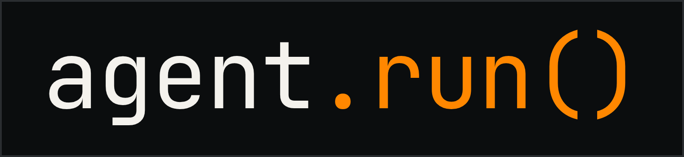</a>
</p>

<p align="center">
  <b>Run smarter agents. Use fewer tokens.</b>
</p>

<p align="center">
  <a href="#case-studies">Our code review bill went up 36x this year. Now a review costs us 18 cents. See how ↓</a>
</p>

<p align="center">
  <a href="https://www.npmjs.com/package/@parcha/agentrun"></a>
  <a href="https://github.com/Parcha-ai/agentrun/actions/workflows/ci.yml?query=branch%3Amain"></a>
  <a href="LICENSE"></a>
  <a href="https://agentrun.ai/docs"></a>
</p>

<p align="center">
  <a href="https://console.agentrun.ai/"><b>AgentRun Cloud</b></a> ·
  <a href="#set-it-up-with-one-prompt">Run locally</a> ·
  <a href="#deploy-it">Self-host</a>
</p>

<p align="center">
  <a href="#get-started">Quickstart</a> ·
  <a href="#connect-your-existing-agent">Connect your agent</a> ·
  <a href="#case-studies">Case studies</a> ·
  <a href="#take-the-tour">Tour</a> ·
  <a href="#templates">Templates</a> ·
  <a href="#deploy-it">Deploy</a> ·
  <a href="https://agentrun.ai/docs">Docs</a>
</p>

AgentRun is an open-source platform that supercharges your agents. It adds self-improvement, durable execution and a
control plane on top of your favorite agent harness. Your agents become smarter, more fault tolerant and use fewer
tokens with every run.

<p align="center">
  <a href="https://agentrun.ai">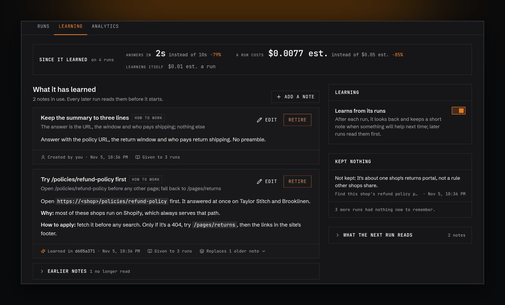</a>
  <br><sub>An agent's Learning tab: what it kept, and what changed since. Demo data from the console's recorded fixtures.</sub>
</p>

## Case studies

<p align="center">
  <a href="docs/case-studies/code-review.md">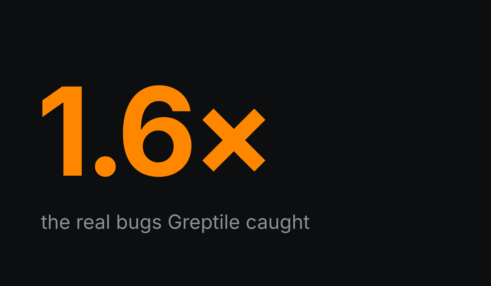</a>
  <a href="docs/case-studies/merchant-classification.md">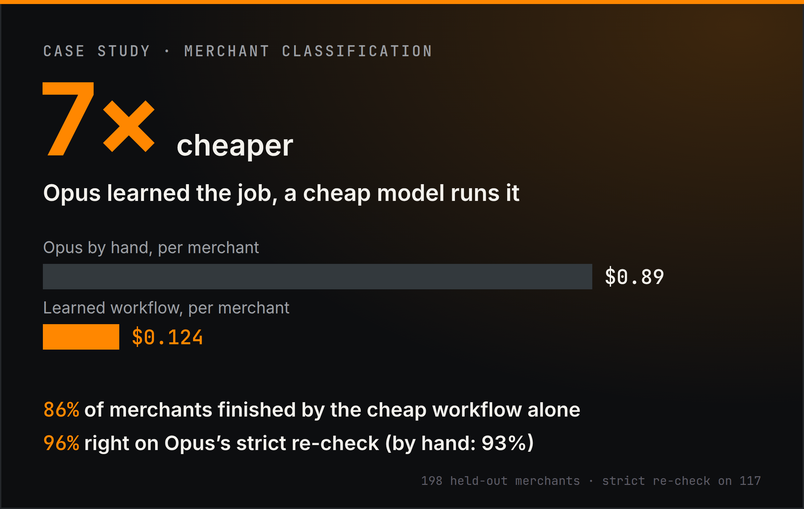</a>
</p>

**Code review.** Greptile started charging a dollar a review in March, then our agents took off, and our bill went
from $180 a month to $6,451. So we built our own reviewer on a cheap model and tuned it on our own PRs. It costs 18 cents a review, and on 30 PRs
it had never seen it caught 1.6x the real bugs Greptile did. [How we built it](docs/case-studies/code-review.md) · [Tune one on your repo](docs/tutorials/tune-a-template.md)

**Merchant codes.** We let Opus figure out how to classify merchants, then handed what it learned to a cheap model.
Same job, $0.89 down to $0.12 a merchant. [How it works](docs/case-studies/merchant-classification.md) · [Do it with your own job](docs/tutorials/learn-then-hand-off.md)

## Why AgentRun

Agents are great at figuring things out. The problem is they figure out the same things over and over. Give an agent
a job it has done a hundred times and it rediscovers the same API, rereads the same docs and rebuilds the same plan, and
you pay for every token of it.

Bring your agent on the harness it runs best on: Claude Code, Codex, OpenCode or pi. AgentRun does everything around it:

- **It learns the work.** After each run, the agent keeps what will help next time: a note, a skill, or a workflow
  that does the job without the loop. The next run starts from there.
- **It never loses a run.** Every run lives in one store. Kill the server mid-run, start it again, and the run carries
  on. Give each agent the computer the job needs: a sandbox, a Linux desktop, an Android phone or a browser.
- **You stay in control.** Approvals, spend caps and one console for every agent: what needs you, what failed, what's
  running and what it cost.

You don't build the plumbing: provider integrations, recovery, run tracking and learning are all here. Use
[AgentRun Cloud](docs/getting-started.md#agentrun-cloud) for hosted access, or run the open-source platform on your
laptop, in one container, or as a server with runners. Apache-2.0.

## Get started

**AgentRun Cloud.** Run agents without maintaining your own server. [Open Cloud](https://console.agentrun.ai/) to
create an account or sign in. For help setting up your team's workflows,
[talk to us](https://calendly.com/d/dtwn-dsp-nx5/agentrun).

Prefer your own machine or infrastructure? Have your coding agent set it up below, or
[self-host on Railway, Render, a VPS, Kubernetes, Coolify, Dokploy or Docker](#deploy-it) yourself. The
[getting-started guide](docs/getting-started.md) explains the three options. Wherever it runs, AgentRun counts itself
anonymously; `AGENTRUN_TELEMETRY=0` or `DO_NOT_TRACK=1` turns that off ([anonymous usage counts](docs/telemetry.md)).

<a id="start-in-three-steps"></a>
<a id="run-locally-in-three-steps"></a>

### Set it up with one prompt

Paste this into Claude Code, Codex or another coding agent:

```text
Read https://agentrun.ai/SKILL.md and follow it to set up AgentRun for me. Ask me where AgentRun should run before you install or deploy anything.
```

Your agent first asks where AgentRun should run: this computer (macOS or Linux), your own always-on machine, Railway,
Render or AgentRun Cloud. It installs nothing before you answer. It can bring in a Claude Code or Codex job you
already schedule as the first run, or create and run a first agent with you. You save keys and passwords in the
AgentRun console, never in the chat. The link is [the setup skill](docs/SKILL.md) in this repository.

<details>
<summary>Or run it locally yourself, in three steps</summary>

You need Node 24.22.3 or newer, on macOS or Linux.

Already use Claude Code or Codex? [Connect your existing agent](#connect-your-existing-agent) with its current
configuration and sign-in. You do not need to add a model key to AgentRun for that connection. The steps below
start a new agent from a template.

1. **Start it.**

   ```sh
   npx @parcha/agentrun
   ```

   It starts the server and one runner on port 7340 (or the next free one), keeps everything in `~/.agentrun` (not the
   folder you run it in: `--data DIR` names another, and a new folder alone is not a new install), and
   opens the console in your browser. It runs in that terminal until you press Ctrl-C there, which stops it.

2. **Continue with ChatGPT, or add a model key.** In the console, set a password, then press **Continue with ChatGPT**
   (on the first screen, or under **Settings → Model keys**) and sign in on OpenAI's page: Codex and pi agents run on
   your ChatGPT plan, with no key. Or add a key in the same place: one `OPENROUTER_API_KEY` gives every harness a model;
   an Anthropic key runs pi and Claude Code; an OpenAI key runs pi, Codex and OpenCode.

3. **Run your first agent.** Open **Templates**, apply **KYB due diligence**, and start a run with a company's name and
   website. It needs nothing but your ChatGPT sign-in or your model key. When it finishes, the run's **Report** tab has
   a due diligence report with a verdict and every claim cited. Then open the agent's **Learning** tab to see what it
   kept for next time.

</details>

<details>
<summary>Docker, sandboxes and running it on a server</summary>

If Docker is running on your machine, new agents get a Docker sandbox with a shell. Its image builds on first use,
which takes a few minutes, and the console says when it's ready. Without Docker, agents still read and write files,
but get no shell.

Want your own server with a URL? [Self-host on Railway or Render](#deploy-it).

</details>

## Connect your existing agent

Already have agents running in a backend, Docker deployment or terminal? **Connect agent** can observe them
through the same CLI and OpenTelemetry Collector used by hosted AgentRun. The OSS console shows their reported
activity and token usage while your application keeps starting the work. Follow
[Observe agents that already run elsewhere](connector/README.md#observe-agents-that-already-run-elsewhere).
Observation needs no model key and does not automatically enable learning or import transcripts.

Keep the project, instructions, skills, MCP tools and sign-in you already use in Claude Code or Codex. AgentRun can
start new jobs with that setup and show their activity and results in the console.

**Development build:** remote connections currently require the server and the Python connector from the same
reviewed checkout. The published observation-only CLI does not include this remote execution mode. Follow the
[source connector setup](connector/README.md) for installation and the matching Node bridge.

1. **Choose your coding agent.** In Mission Control or Connected agents, open the **Connect agent** dropdown and
   select your coding agent. The button remembers your choice and provides a prompt that reads the skill from
   this server's build.
2. **Choose what to bring.** The skill first distinguishes **observing existing sessions** from letting AgentRun
   **start future jobs**. For future jobs, choose **a live connection**, **past history**, or **both**,
   then confirms the source machine, project and runtime. For a laptop, VM or container separate from the server,
   use **Connection setup → Another machine** and create a code with the chosen scope. Enter it directly in the
   source CLI's secure prompt. Your native credentials stay on that machine; the worker connects outbound.
3. **See the result.** For **History only**, open Runs and check the imported conversations and counts; no worker
   or model job is started. For a **live connection** or **Both**, open the connected agent, verify its setup, and
   start a job. Keep a remote source worker online. Turn **Self-improving** On to give future native runs your
   standing corrections, which you can inspect and edit in Learning. Native connections do not compile or run
   learned workflows; those require managed execution or a compatible backend workflow bridge.

History import brings selected completed conversations into Runs without executing them or automatically training
the agent. A live connection starts new CLI sessions; it does not attach to a desktop conversation already in
progress. You can connect first and import history later with an explicitly approved history scope.

[Connection and history guide](docs/native-agents.md) · [Remote CLI installation and commands](connector/README.md)

Already use Codex CLI or Claude Code directly? [Connect its existing sessions for learning](docs/tutorials/existing-cli-learning.md)
with project-scoped hooks that capture completed prompts and deliver explicit owner corrections. Keep starting
the agent normally; no SDK wrapper or AgentRun task launcher is needed.

Already run an agent inside your backend with an SDK? The development build can add checked learning around its
existing call site. Your backend keeps its job queue, tools, model credentials and cancellation; AgentRun records
the run and supplies accepted learning to the next fresh task. Use the matching client and server from this checkout.

| Backend SDK | Integration |
| --- | --- |
| Claude Agent SDK | [Wrap your existing query and custom tools](docs/tutorials/claude-sdk-learning.md) |
| Codex SDK | [Wrap your existing Codex client and fresh threads](docs/tutorials/codex-sdk-learning.md) |
| External platforms, including OpenClaw and Capy | [Report agents, scheduled jobs and threads from their platform](docs/tutorials/platform-sdk-runs.md) |

The [live examples](examples/sdk-learning/README.md) verify native tool execution, owner-correction delivery in a fresh
session, and a learning-Off control. Separate workflow examples verify compilation, an independent check, and reuse
through the backend's tool bridge. Workflow compilation adds server model usage.

## Take the tour

**Workflows that make the call.** A step can ask a fast typed question, see how sure the answer is, and pick a route.
Here the model leans approve at 0.61, below the workflow's 0.75 bar, so the case goes to review.

<p align="center">
  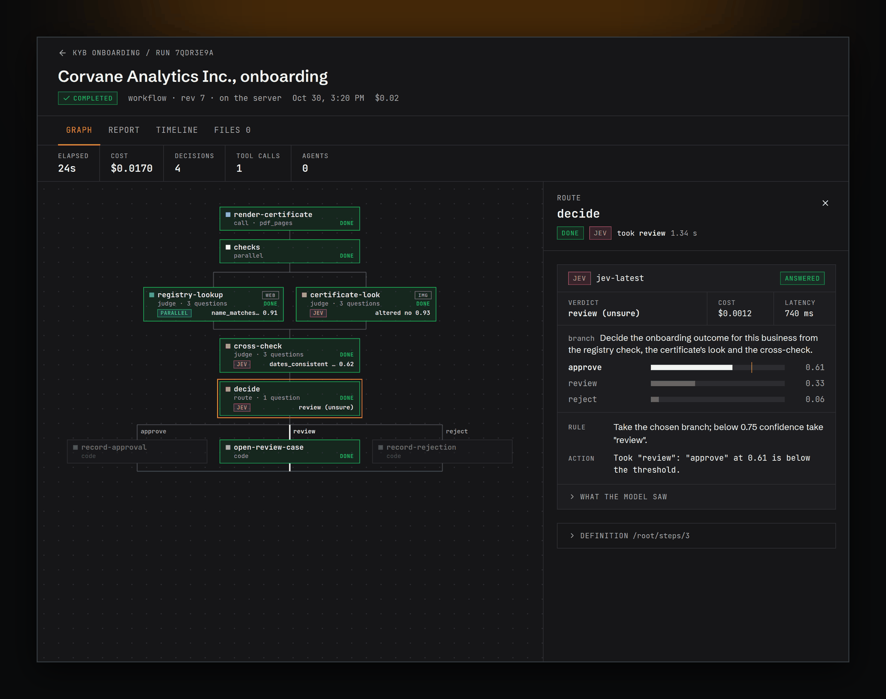
</p>

**Every agent in one place.** Mission Control opens first: what needs you, what failed, what's running and what it
cost, by day, by harness and by tool.

<p align="center">
  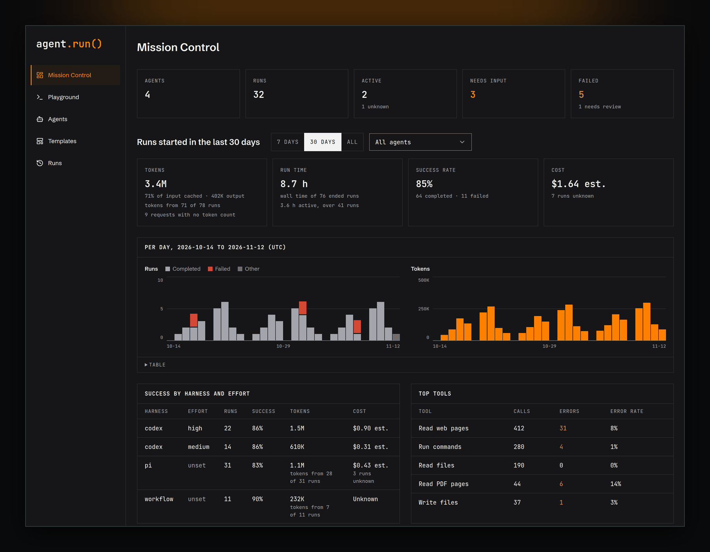
</p>

**Every agent is an API.** Start a run from the Playground, then copy the same request into your code.

<p align="center">
  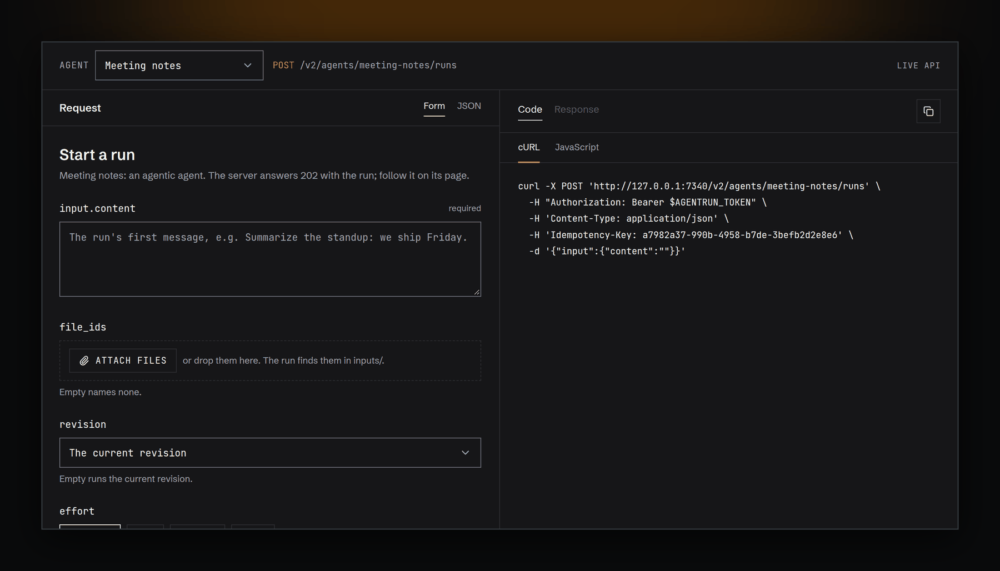
</p>

**You stay in control.** An agent can stop and ask you, and the run waits until you answer.

<p align="center">
  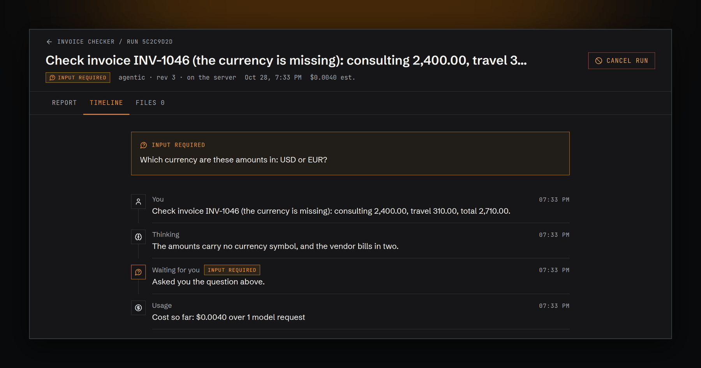
</p>

## Agents that learn the work

Turn it on with `"learning": true` in an agent's definition. An agent learns two things, both kept in its own git
folder, and every run starts from that folder's `main`.

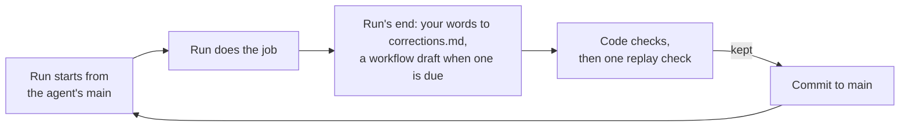

- **Corrections** are your words. A grade's words, or a message you send after a run's first answer, become one line
  of the agent's `corrections.md` at that run's end. Every later run is given the file whole, under `# Learned`.
- **Learned workflows** run as one tool call on any harness, under the run's own cap and tool permissions. Once the
  agent has 20 completed runs (`learning: { "compile_after": 20 }` is the default), one run's end compiles the job into
  a workflow draft. Code checks the draft and dry-runs it (no model is asked and no tool runs), then it is replayed
  once on those runs' inputs and serves only when it answers enough of them alone and agrees with the agent's answers.

The agent's **Learning** tab shows its corrections, its workflows and the log of changes. Edit the corrections there,
or with `PUT /v2/agents/{id}/learning/corrections`. Git keeps the history. `DELETE /v2/agents/{id}/learning` resets
it: everything the agent learned is deleted, history included, and the agent and its runs stay. Learning starts over
from the runs after it: `compile_after` counts from the reset.

<details>
<summary>What gets kept, and what gets refused</summary>

Each agent has a learning folder: plain git with one branch, `main`. Over a cap a write is refused whole, never cut:
2048 bytes for `corrections.md`, 16384 for a draft's `workflow.json`, 1024 for its README. A secret or a secret's
shape in a correction or a draft refuses it too. A held draft gets one revision, shown the inputs it disagreed on;
held again, it stops, and nothing compiles again until you act.

</details>

## Workflows

A lot of agents don't need to be agents. Write repeatable work as a typed workflow: tool calls, model steps and fast
typed decisions (yes or no, pick one, a score, each with its confidence), with an agent to fall back on when a case is
unclear. AgentRun runs it as an agent's revision, under the agent's tool permissions and a cap like any run, and a
trigger can start one.

<p align="center">
  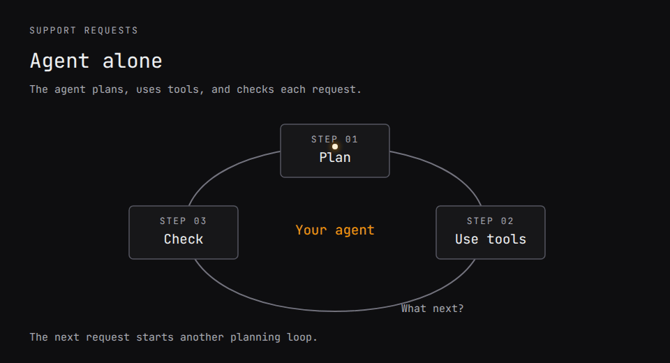
  <br><sub>An illustration of the control flow in <code>examples/support-answer.mjs</code>, not a recording of a model run.</sub>
</p>

Watch any workflow run node by node, pause it and resume it, and read every decision and why it was made:

<p align="center">
  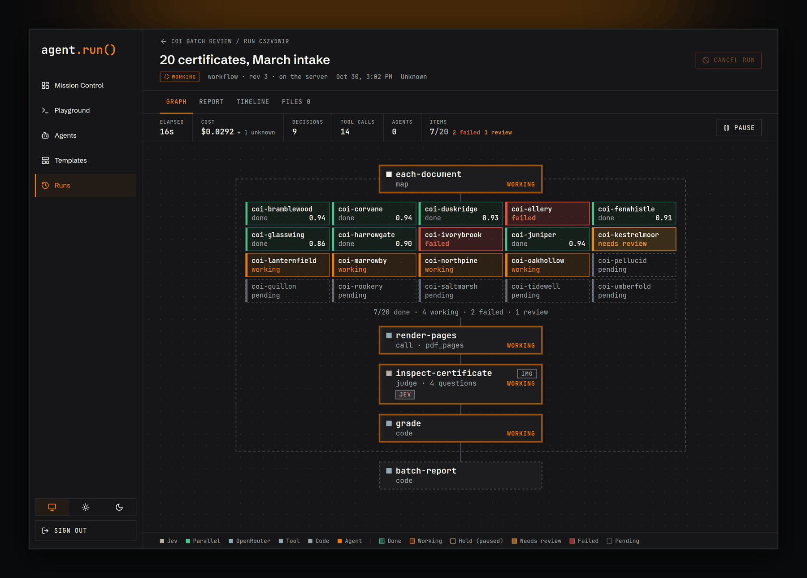
</p>

<details>
<summary>What a workflow looks like</summary>

A workflow is a JSON document of typed steps:

```json
{
  "v": 2, "name": "read-site",
  "schemas": {
    "In":   { "type": "object", "required": ["website"], "properties": { "website": { "type": "string" } } },
    "Page": { "type": "object", "required": ["ok"], "properties": { "ok": { "type": "boolean" } } }
  },
  "input":  { "schemaId": "In" },
  "output": { "schemaId": "Page", "path": "home" },
  "root": { "node": "chain", "steps": [
    { "node": "call", "label": "Read the home page", "via": "tool", "tool": "web_fetch",
      "args": { "url": "{website}" }, "out": "Page", "as": "home", "deadline_s": 60 }
  ] }
}
```

Steps can call tools, run a model, ask a fast typed question, branch on the answer, map over a list in parallel, loop a
bounded number of times, call other workflows, or hand the hard case to an agent. Save one as an agent's `workflow`
field; `npx @parcha/agentrun workflows validate` checks it first. The [workflow language](packages/dsl/README.md) also
runs on its own inside your app, with a [TypeScript builder](docs/authoring.md).

</details>

## Runs that survive

Every agent, revision, run and step lives in one store. Stop the server mid-run and start it again, and the run carries
on. With several runners, another runner picks up a dead runner's runs once their 30-second lease runs out. A finished
step is never run again; a write a crash cut off mid-call is marked interrupted rather than retried, so you can check it.

## You stay in control

- **Approvals.** Each tool is allowed, asks you first, or is denied. A call that asks waits on the run's page until you
  answer. "Never ask" lets an agent run unattended, and a deny set on the server still holds over it.
- **Spend caps.** Give a run a cap and it pauses there instead of failing, and tells you the least it needs to go on.
  A cost AgentRun can't price reads "unknown", never $0.
- **Questions.** An agent can stop and ask you, and the run waits until you answer.
- **One console.** Each run has a live Timeline, its files and, for a browser, a screen you can take over.

## Templates

Six ready-made agents. Apply one in one screen, make it yours, and measure it with its own eval cases. Each template is
one folder: the agent's instructions, its skills, its rules and its eval cases. **Templates → Apply** grants nothing
until you tick each MCP tool yourself.

| Template | What it does |
| --- | --- |
| `agent-scout` | Reads a GitHub repository on a read-only checkout and suggests up to five agents its app could call, each with the lines of code that show why. The **Suggested agents** page shows them: Create opens a pull request that adds the agent and a client to your repository; Discard hides it for good |
| `code-review` | Reviews a pull request with eight independent reviewers on a read-only checkout (or a pasted diff), merges and verifies their findings, quotes the line behind each, and returns them as JSON. It sets up its own GitHub trigger |
| `kyb` | Due diligence on one company: registries, owners, sanctions lists, dated adverse media, and a verdict with every claim cited |
| `market-monitor` | Every Monday, a digest of what changed at the companies you watch, each item dated and linked |
| `inbound-lead` | Researches each lead a webhook sends and scores it 0 to 100 against your ideal customer profile |
| `release-notes` | Turns the pull requests merged since the last release into release notes, left as a draft issue for a person |

`npx @parcha/agentrun template eval DIR` runs a template's eval cases as real runs on a throwaway server and grades
them. [Template packages](packages/serve/templates/README.md) has the folder format.

**Agents → Suggested** connects a repository and runs `agent-scout` for you. A scan reads with a token for that one
repository, contents read-only. Opening a pull request needs the GitHub App's Contents write, asked for only when you
tick it at Connect GitHub ([Suggested agents](packages/serve/README.md#suggested-agents)).

Want a template to know your code? [Tune a template on your own code](docs/tutorials/tune-a-template.md) walks
through the loop we ran on `code-review`.

**Triggers** start capped runs on their own: schedules, signed webhooks, GitHub pull request events and Composio
events.

## Connect your tools

Give an agent the tools of any remote MCP server in **Settings → MCP servers**. With a Composio key, five steps take
you from a toolkit to a run that a Composio event starts:

1. In **Settings → MCP servers → Add from Composio**, paste your Composio API key, type a toolkit (`hackernews`) and
   press **Load actions**.

   <p align="center">
     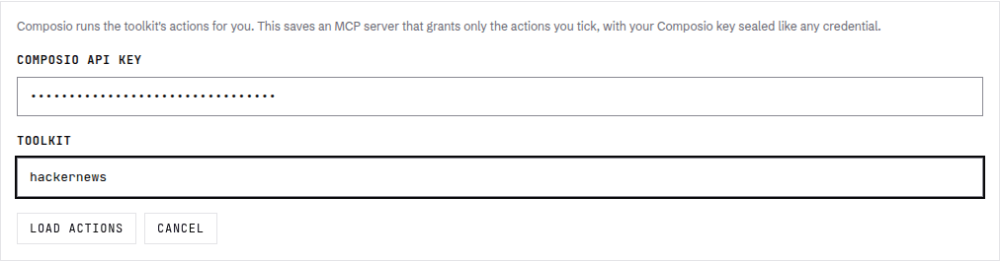
   </p>

2. Save a toolkit that acts as you, such as `github`, and open its link to connect your account on Composio.

   <p align="center">
     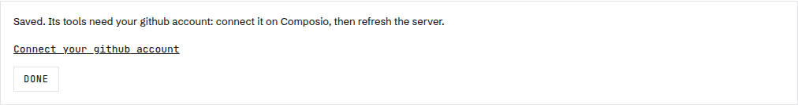
   </p>

3. Tick the actions an agent may use and save the server, then tick its tools in the agent's **Tools & skills** step.

   <p align="center">
     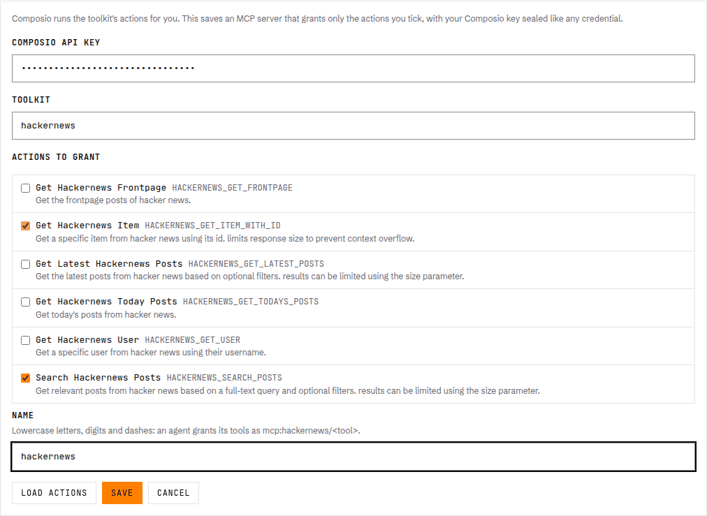
   </p>

4. In **Triggers → New app trigger**, pick the saved `github` server, an event such as a new issue and its repository,
   and the agent. The server makes the trigger on Composio and its webhook subscription at this server's public
   address (`AGENTRUN_PUBLIC_URL`).

5. Open an issue in your repository and watch the run it starts on the **Timeline**.

   <p align="center">
     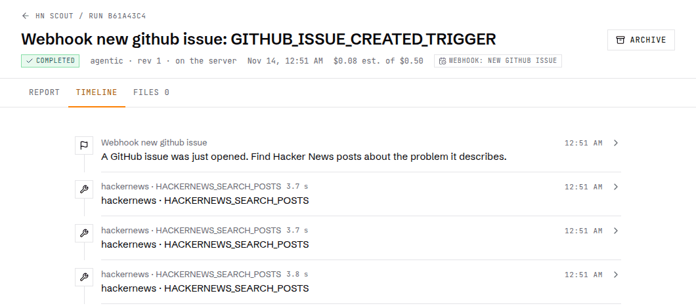
   </p>

[Connect Composio tools and triggers](docs/tutorials/composio.md) has each step's API call and the Composio side of the
trigger.

## Harnesses and computers

**Harnesses.** Name one in the agent's definition with `harness`. Approvals, caps, computers, triggers and learning work
the same on each. `npx @parcha/agentrun server capabilities` says which harnesses your server runs.

| Harness | `harness` | On a ChatGPT plan | Notes |
| --- | --- | --- | --- |
| pi | `pi` | Yes | The default |
| Claude Code | `claude-agent` | No: an Anthropic or OpenRouter key | Installs itself on first use |
| Codex | `codex` | Yes | Installs itself on first use |
| OpenCode | `opencode` | No: an OpenAI or OpenRouter key | Needs its `opencode-ai` package beside the server; AgentRun prints the line that installs it |

Signed in with ChatGPT and no key, Codex and pi agents run on your plan. Claude Code, OpenCode, Jev decisions and paid
tools need their own keys.

**Computers.** An agent gets a computer with one setting. It gets the tools for that kind and nothing else, and changing
the computer changes nothing else about the agent.

```yaml
computer:
  kind: sandbox        # none, sandbox, desktop, phone or browser
  provider: daytona    # one you connected in Settings → Computers (none takes no provider)
```

| Kind | What the agent can do | Providers |
| --- | --- | --- |
| `none` | Read and write files in its run folder; no shell (with Archil, commands run on Archil's exec) | none needed |
| `sandbox` | Run code, install packages, keep processes in the background, on Linux | Docker, Daytona, Modal, E2B, Cloudflare (through a relay Worker you deploy) |
| `desktop` | See a Linux screen, move the mouse, type | Orgo, E2B, Docker (your own image with an X server), and on dial Daytona, Modal, Cloudflare and Fly Machines (the box image's desktop) |
| `phone` | Tap, swipe, type, open apps and read the screen on Android | phone harness (a rented cloud Android) |
| `browser` | Browse the web, and hand the controls to you at any point | Browserbase, Kernel |

Every kind but `none` names its provider. An agent with no computer setting gets the Docker sandbox where the server
has Docker, and no computer otherwise. Remote computers bill through your own account with the vendor.

<details>
<summary>Keys, run files, taking over, and conformance</summary>

- **Keys.** Add a vendor's key once in **Settings → Computers**. Your server seals it and shows it only as set or
  missing; it never enters the agent's computer. **Test connection** makes one read at the vendor and starts nothing.
- **The run's files.** By default a run's folder lives on your server and the Docker sandbox mounts it. Turn on an
  Archil disk in Settings and the folder lives there instead, and the Docker sandbox is refused. A sandbox that mounts
  the disk needs Archil's image in your own vendor account. Agent37's sandbox and desktop register it there on their
  first run (the run waits once while the image is pulled), so they are ready once the keys work. A Modal sandbox starts
  from our public box image, which has it, so it is ready once the keys work too. An E2B sandbox and desktop start from
  our public box template, so they are ready once the keys work as well. Orgo's desktop, a phone and a browser mount
  nothing and still run.
- **Watching and taking over.** A browser run streams to the run's **Screen** tab through your own server, never
  through a vendor link. Take the controls, then hand them back. The agent can also stop and ask you to take over, for
  a login or a captcha.
- **Proof.** Each provider has a conformance suite for its kind. Run it against the vendor yourself, from a checkout
  after `npm ci && npm run build`:
  `npm run conformance -w @parcha/agentrun-computer -- --provider docker --kind sandbox`.

[`@parcha/agentrun-computer`](packages/computer/README.md) is the protocol underneath: one small daemon in every
computer and one provider per vendor. To add your vendor, see [How to contribute a provider](packages/computer/PROVIDERS.md#how-to-contribute-a-provider).

</details>

## How it fits together

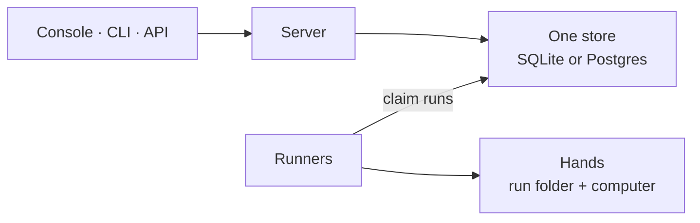

- **Server.** Serves the API at `/v2` and the console. It writes runs and commands to the store and reads it back for
  you. It runs no agent loop itself when you start it with `--no-runner`.
- **Store.** Agents, revisions, runs and every run's journal, in one place. SQLite in the data folder by default, or
  Postgres with `AGENTRUN_STORE_URL`.
- **Runners.** Each runner claims runs from the store and runs many at once. Every approval check, cap and model call
  happens here. Add runners to scale out.
- **Hands.** Where the agent's tools act. Each run has a run folder for its files. A sandbox mounts that folder at
  `/workspace` and the tools run inside it; a desktop, phone or browser leaves the folder on the runner.

## From the terminal and from code

`npx @parcha/agentrun` is also the server's CLI. Run these in a second terminal while the server is up; the CLI finds
it and its token by itself. The script makes an agent, starts a run capped at $1, lets the agent ask you a question,
answers it, and reads the file the agent wrote. With Docker on, the first run waits for the sandbox image.

```sh
# 1. Make an agent that can write files and ask you things.
cat > agent.json <<'EOF'
{"definition": {"id": "notes", "version": 1, "name": "Notes",
  "instructions": "Do what you are asked, and write what you make to a file.",
  "skills": [], "tools": ["write", "ask_person"]}}
EOF
npx @parcha/agentrun agents create --body @agent.json

# 2. Start a capped run and wait. It stops to ask you which region (exit code 8: it waits on you).
npx @parcha/agentrun runs start notes --max-cost-usd 1 --wait \
  --body '{"input": {"content": "Ask me which region to cover, then write region.md about it."}}' > out.json

# 3. Answer, wait for it to finish, and read what it wrote.
run=$(node -p 'require("./out.json").run_id')
npx @parcha/agentrun runs message "$run" --content "Europe"
npx @parcha/agentrun runs wait "$run" > out.json
npx @parcha/agentrun runs read-file "$run" region.md
```

`runs wait` exits 0 when the run completed, 1 when it failed, and 8 when it waits on you: a question, its cap, or an
approval. `runs timeline RUN_ID --follow` streams each step as it happens, and every run carries a `console_url` to its
page. `npx @parcha/agentrun help` lists every command; `npx @parcha/agentrun skill install --claude` (or `--codex`)
teaches your coding agent the CLI.

<details>
<summary>The same run from TypeScript or Python</summary>

With the TypeScript client (`npm install @parcha/agentrun-client`, no dependencies). The client reads its server and
token from the environment; the server prints both when it starts (with `npx @parcha/agentrun`, the token is in
`~/.agentrun/.token`, and the address is normally `http://127.0.0.1:7340`):

```sh
export AGENTRUN_BASE_URL=http://127.0.0.1:7340/v2
export AGENTRUN_API_KEY=$(cat ~/.agentrun/.token)
```

```ts
import { AgentRun } from "@parcha/agentrun-client";

const client = new AgentRun(); // AGENTRUN_BASE_URL and AGENTRUN_API_KEY
const started = await client.runs.start("notes", { input: { content: "Ask me which region to cover, then write region.md about it." }, max_cost_usd: 1 });
let run = await client.runs.wait(started.run_id);
if (run.pending?.kind === "question") await client.runs.message(run.run_id, { content: "Europe" });
run = await client.runs.wait(run.run_id);
console.log(run.status, run.cost.usd);
```

The Python client is `pip install parcha-agentrun`, with the same methods
([TypeScript client](packages/client/README.md), [Python client](python/README.md)).

</details>

## Deploy it

For a hosted workspace, [use AgentRun Cloud](docs/getting-started.md#agentrun-cloud). The options below deploy the
open-source platform on infrastructure you manage. None of them needs a model key: once it's up, Continue with ChatGPT
(Settings → Model keys, or the first screen), then run your first agent. Or add a model key there instead.

**Your server, your ChatGPT plan, only you:** a ChatGPT sign-in is for the person who runs this server. Don't share it
or let others run agents on it. Eligible usage in this app uses your ChatGPT plan. Manage usage in your ChatGPT
settings. On a server that isn't this computer, the sign-in tab ends on a page that won't load: copy its whole address
into the console.

**Self-host on Railway.**

[](https://railway.com/deploy/agentrun-1)

The button deploys the published template: the image, a volume at `/data`, a domain, and the token and seal key made
for you. About $5 a month on Railway's Hobby plan, which includes $5 of usage; agents get no shell. When it's live, open
its domain and paste `AGENTRUN_TOKEN` from the service's Variables tab as the setup code. Then Continue with ChatGPT or
add a model key, and run your first agent. Walked from click to a finished first run in 46 seconds. Details:
[deploy/README.md](deploy/README.md).

**Self-host on Render.**

<a href="https://render.com/deploy?repo=https://github.com/Parcha-ai/agentrun"></a>

The button deploys [`render.yaml`](render.yaml): one 1 CPU / 2 GB instance with a 10 GB disk, the published image (no
build), and the token and seal key generated for you. Render gives the service no Docker, so its agents get file tools
and `web_fetch` but no shell. It needs a card on your Render workspace: about $25 a month for the instance and $2.50
for the disk, at Render's prices when this was written. Leave the model keys in Render's form
blank. When it's live, open its URL and paste `AGENTRUN_TOKEN` from the service's Environment tab to set your password.
Then Continue with ChatGPT (Settings → Model keys, or the first screen), then run your first agent. Or paste a key in
Render's form, or add it in the console: we recommend an `OPENROUTER_API_KEY` with a dollar cap and an expiration
date. Do not share it with anyone. Walked from the service's creation through Render's API to a finished first run
in 85 seconds.

**Self-host on a $5 VPS.**

On a fresh Linux server you rent (Ubuntu or Debian), as root:

```sh
curl -fsSL https://agentrun.ai/install | sh -s -- --vps
```

It installs Docker if the server has none, runs the published image with Docker Compose in `/opt/agentrun`, and makes
the token and seal key once, in `/opt/agentrun/.env` (mode 600). Its agents get a shell in Docker sandboxes. It stays
private. With [Tailscale](https://tailscale.com) logged in, only your own tailnet reaches it. Without Tailscale,
AgentRun listens on the server's loopback and the installer prints the steps to add it. `--public` opens port 7340 to
the internet over plain HTTP instead, and warns you first. It prints the address and the setup code. Run it again to
upgrade.
A Hetzner Cloud CPX02 (1 GB) is from €5.49 a month before VAT and a DigitalOcean Basic Droplet (1 GiB) is $6, at their
prices when this was written. The server gets the VPS's Docker socket, which is root on it, so keep the VPS for
AgentRun alone. Details: [deploy/README.md](deploy/README.md#one-command-on-a-server-you-rent).

**Self-host on Kubernetes.**

```sh
helm install agentrun oci://ghcr.io/parcha-ai/charts/agentrun --devel --namespace agentrun --create-namespace
```

One pod on a 10 GiB volume, from the release's image; agents get file tools and `web_fetch`, no shell. Details:
[the chart's README](deploy/helm/agentrun/README.md).

**Self-host on Coolify or Dokploy.** One service from the release's image on a volume, with the token, the seal key and
the domain made by the platform; agents get file tools and `web_fetch`, no shell. The templates and their steps:
[deploy/README.md](deploy/README.md#on-coolify-or-dokploy).

<details>
<summary>Docker Compose: a server and two runners</summary>

On a Linux machine with Docker:

```sh
git clone https://github.com/Parcha-ai/agentrun && cd agentrun/deploy
printf 'AGENTRUN_SEAL_KEY=%s\n' "$(openssl rand -base64 32)" > .env && chmod 600 .env
docker compose up -d --build
docker compose logs server     # the console's link, the first visit's setup code and, the first time, the token
```

Open the link, set your password, then Continue with ChatGPT (Settings → Model keys, or the first screen), then run
your first agent. Or add a model key in the console, or in `.env` before `docker compose up`
(`echo 'OPENROUTER_API_KEY=...' >> .env`).

The port is published on this machine's loopback only; put a TLS proxy in front before you open it to anyone else.
This compose file has no Docker socket, so its agents get file tools and `web_fetch` but no shell. For a Docker
sandbox, use the single-server `compose.yaml` at the repository's root (Docker Engine 26 or later), which gives the
server the host's Docker socket (that socket is root on the host: give it only where you would give AgentRun root), or
run the server on the host with `npx @parcha/agentrun`. The start's `Boxes:` line
and the agent editor's place say which one a container lacks: the socket, or its group (`DOCKER_GID`).

</details>

<details>
<summary>Runners on Postgres</summary>

Set `AGENTRUN_STORE_URL` to a `postgres://` URL on the server and every runner (the compose file's `pg` profile runs
one), start the server with `--no-runner`, and start each runner from the same image with
`runner --data /data --name <name>`. Give every process the same `AGENTRUN_SEAL_KEY`. Runners still share the `/data`
volume in this release.

</details>

[Deploying AgentRun](deploy/README.md) covers runners, health checks and upgrades.

## Security

Every saved secret (model and tool keys, MCP credentials, sign-ins, webhook signing secrets) is sealed under one key,
`AGENTRUN_SEAL_KEY`; keep it, because losing it loses what it sealed. Secrets are write-only: the console shows each
one as set or missing, and only the console can paste, replace or remove one (your signed-in session, or the
launcher's console on loopback when accounts are off). A key set where the server starts wins over a pasted one. The
API token can't write a secret or approve a tool call: its secret write is refused with a console link
(`error.details.console_url`) to the form, filled in except for the secret. A run gets only the keys its own model and tools need, and
nothing a run learns can keep a secret it was handed. [SECURITY.md](SECURITY.md) says how to report a vulnerability.

The server counts itself anonymously (a random id, its version, its platform): never prompts, files or keys.
`AGENTRUN_TELEMETRY=0` or `DO_NOT_TRACK=1` turns that off, and the first start only prints a notice.
[Anonymous usage counts](docs/telemetry.md) lists every field.

## Docs

- [AgentRun Server](packages/serve/README.md): the API, models, tools, MCP servers, triggers, spend caps, learning and
  safety, in full
- [Get started](docs/getting-started.md): AgentRun Cloud, local setup or self-hosting
- [Quickstart on agentrun.ai](https://agentrun.ai/docs/quickstart) and the [docs](https://agentrun.ai/docs)
- [The CLI's skill](packages/agentrun/skills/agentrun-cli/SKILL.md) and [every command](packages/agentrun/skills/agentrun-cli/references/commands.md)
- [Connect existing agents and import history](docs/native-agents.md), locally or from another machine
- [Deploying](deploy/README.md), [computers](packages/computer/README.md), [templates](packages/serve/templates/README.md)
- [Give an agent tools](docs/connect-tools.md): Sentry, GitHub, Slack and other services as MCP servers, with no token in the box
- [Connect Composio tools and triggers](docs/tutorials/composio.md)
- [The workflow language](packages/dsl/README.md), [authoring](docs/authoring.md), [the guide](docs/guide.md)
- [Changelog](CHANGELOG.md) and [contributing](CONTRIBUTING.md)

## Coming next

- A computer chosen per call, not only per agent
- First-party computers
- iPhone, macOS and Windows computers
- Watching and taking over a desktop or phone run, as a browser run does today
- Composio as a tool catalog
- Harnesses over the Agent Client Protocol
- A Slack trigger and a Parallel monitor trigger

## License and thanks

Apache-2.0. Copyright 2026 Parcha Labs, Inc. Built by [Grep.ai](https://grep.ai).

AgentRun builds on [pi](https://github.com/earendil-works/pi) by Earendil Works (MIT), the agent loop and durable
runtime under it; [Stagehand](https://github.com/browserbase/stagehand) and the
[Browserbase Node SDK](https://github.com/browserbase/sdk-node); the
[TypeSafe JavaScript SDK](https://github.com/typesafe-ai/typesafe-sdk-js); Archil's
[disk SDK](https://github.com/archil-data/archil-sdk); and
[vercel-labs/durable-harness](https://github.com/vercel-labs/durable-harness) (Apache-2.0), whose ideas and code the
durable harnesses build on. Each keeps its own license; each package's NOTICE lists what it carries.
