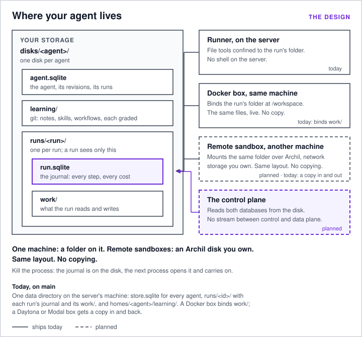
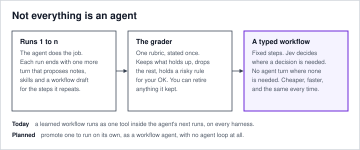

# AgentRun

**An open-source managed agent platform that grows with your business.**

Bring your agent on the harness you already use: pi, Claude Code, Codex or OpenCode. AgentRun runs it with a durable
loop, a sandbox, a browser that stays signed in, one permission gate, one spend cap, analytics across every agent, and
self-learning that turns what a run figured out into notes, skills and workflows the next run uses. One server, one
API, one console, on your machine or your server. Apache-2.0.

Every claim in this README carries one of three tags. **Today** is on `main` now. **Coming** is in review or being
built for V1. **Planned** is designed, not built. Nothing here says more than that.

## Why AgentRun

- It gives your agents superpowers, whichever harness you use: the same gate, cap, sandbox, browser and learning on pi,
  Claude Code, Codex and OpenCode. **Today**
- Persistent browser connections: an agent's browser stays signed in from one run to the next, at Browserbase or
  Kernel. **Today**
- A persistent workspace: a disk per agent that you own, where every run, every journal and the learning repo live.
  **Planned** (today each run has a folder on the server, kept after it ends)
- A management platform for spend: a per-run cap no request crosses, which pauses the run and lets you raise it; usage by
  agent, day and meter. **Today**
- Analytics for all your agents and harnesses: Mission Control, runs by harness and effort, tokens, cost, tools, what
  needs you. **Today**
- Self-learning, self-improving agents: notes, skills and learned workflows, each graded, risky rules held for your OK.
  **Today**
- APIs, MCPs and adapters: tools, paid APIs and remote MCP servers behind one allow, ask or deny gate **Today**; agents
  calling MCP tools on every harness **Coming**; Composio connectors, and your own APIs and MCPs through ContextForge
  **Planned**
- Run the agent whenever you want, where you want: schedules and signed webhooks start it; a Docker box per run, or a
  Daytona or Modal sandbox **Today**; E2B, full computers on Orgo, and your own machine **Planned**

## Start in 30 seconds

```text
Ask your coding agent: "Read agentrun.ai/SKILL.md and set up AgentRun for me"
npx @parcha/agentrun
```

Either line starts AgentRun on this machine and opens its console. Your coding agent follows [the skill](docs/SKILL.md);
[`npx @parcha/agentrun`](packages/agentrun/README.md) does it in one command (Node 22.19 or newer). One
`OPENROUTER_API_KEY` gives every harness a current model. Save it in the console under Settings, Tool keys, Model keys,
and it takes effect at once. Then New agent, Start a run, and watch the timeline.

Where Docker runs, the first agent you make lands in a box of its own with a shell. Point your coding agent at the
server's MCP endpoint and it makes agents and starts runs for you
([for coding agents](packages/serve/README.md#for-coding-agents)).

## How it works


Three rings, inside out.

**Your harness.** pi is the default. Claude Code runs through the Claude Agent SDK, Codex through its app-server,
OpenCode through its serve mode. A workflow harness runs typed steps with no agent at all. `GET /v2/capabilities` says
which of them a server runs, and why not when it doesn't.

**The kernel.** One adapter shape for every harness. A driver says how to launch the CLI, talk to it and read its own
record. The kernel does the rest, once: it points the CLI's model at AgentRun's pricing proxy, gives it AgentRun's tools
and no others, turns its built-ins off, and mirrors its record into the run's journal. Today the kernel package drives
Claude Code, Codex and OpenCode; pi runs on pi-durable in a process of its own under the same gate, cap and journal.
One driver shape for every CLI, pi included, is the design, and the way new harnesses arrive: write the driver, pass
the suite, ship. **Planned**

**The meta harness.** The loop AgentRun runs around any harness: a durable journal of every turn and tool call, the
tool bridge and its gate, the model proxy that prices every request and holds the cap, stop and resume, crash recovery,
and the end-of-run learning turn. It is one loop whether the harness is pi or Codex, so a feature lands once and every
harness has it. **Today**

**The layers.** Around the loop: the browser, integrations and tools, the sandbox, the workspace, self-learning,
triggers, spend and analytics, and the console and API. Each has a short section below, with the full detail one link
away in [AgentRun Server's README](packages/serve/README.md).

Simplicity is the point. The control plane is one Node process over one data directory. Each run is a process of its
own. No message bus, no queue, no worker fleet. Fewer moving parts is why it recovers: kill anything and the journal is
still on disk.

## Where your agent lives



The design, in one line: every agent has a disk, and each run gets its own folder on it. **Planned**

- `agent.sqlite` is the agent store: the agent, its revisions, its runs.
- `learning/` is a git repo of what the agent learned: notes, skills and workflows, each one a graded commit.
- `runs/<run>/` is one folder per run. `run.sqlite` is the run's journal, every turn, tool call and cost as a row
  written before the next step. `work/` is what the run reads and writes. A run mounts this folder and nothing else.

On one machine the disk is a folder on your machine. For sandboxes on other machines it is an Archil disk, network
storage you own, mounted the same way, same layout, no copying. The control plane reads the databases straight from the
disk. That is what makes an agent durable without infrastructure: there is no stream between a control plane and a
data plane to lose, no message passing to replay. A run's process dies, the journal is on the disk, the next process
opens it and carries on. Two ways to run on the same disk: the loop on the server with the tools in a sandbox
(**Today**), or the whole loop inside the sandbox (**Planned**).

What ships today: one data directory on the server's machine, with `store.sqlite` for every agent, `runs/<id>/` holding
each run's journal and its `work/`, and `homes/<agent>/learning/`. A Docker box binds the run's `work/`. A Daytona or
Modal box gets a copy in, and a copy back at each turn's end. A run whose process died is opened again on its directory
and resumes from its store. Archil mounting exists as a package,
[`@parcha/pi-durable-disk`](packages/pi-durable-disk/README.md); the server does not use it for the workspace yet.

## The life of a request


Every step below ships today unless it says otherwise.

1. **A run starts.** You, the API, a schedule or a signed webhook: `POST /v2/agents/{id}/runs`, with an input, a cap if
   you want one, and uploaded files if the job needs them.
2. **The server sets it up.** It pins the agent's current revision, makes the run's folder, copies the uploads in and
   starts the run's own process. There is no queue to lose it in. A server with no room for one more run says so, with
   a retry-after, and starts nothing.
3. **The agent loop runs on its harness.** pi, Claude Code, Codex or OpenCode, with the agent's instructions, its
   skills, what it learned, and the tools its revision names. A workflow revision runs its typed steps instead, with no
   agent turn.
4. **Every model request goes through the proxy.** It is priced before it is sent. What the run has spent, plus every
   request still in flight at its worst case, plus this one, must fit the cap, or the request is not sent and the run
   pauses for you to raise the cap. On every harness.
5. **Every tool call goes through the gate.** Allow, ask or deny, per tool, for the server or for one agent. An ask
   parks the run until you answer in the console, with the call's price on the card. A paid call is held before it
   runs. Under a cap an unknown cost is refused, never passed as $0.
6. **The tool runs where it belongs.** A shell runs in the run's box: a Docker container made for the run, or a Daytona
   or Modal sandbox, with a package-registry allowlist and no key inside. A browser session runs at Browserbase or
   Kernel, signed in as the agent. Web search and fetch, paid data APIs through monid, and a learned workflow run as
   host tools. Keys never enter the run's environment.
7. **Everything lands on the disk.** Files in the run's `work/`. Each turn, tool call and cost as a row in the run's
   journal, `run.sqlite`, before the next step.
8. **The control plane reads the records.** The timeline, the cost so far, the files, Mission Control and analytics,
   from the run's own store. A live run's timeline streams from its process today; once it ends, and after any restart,
   the server reads the store. Reading it live from the disk is the design above.
9. **The run ends with one more turn.** The server asks the same session to look back and propose notes, skills and a
   workflow draft, under the run's own cap.
10. **One grader decides.** One rubric, stated once. Kept items merge as one commit into the agent's learning repo. A
    risky rule (trust a site, skip a check, send money) waits for your OK, whatever the grader said.
11. **The next run starts from what was learned.** On any harness. A learned skill loads like one you wrote. A learned
    workflow runs as one tool.

The same run, from the server's side, is in [a run's life](packages/serve/README.md#a-runs-life).

## Self-learning and workflows

Learning is on per agent (`learning: true`). An agent that learns has its own git repo, in Claude Code's auto-memory
format: a `MEMORY.md` index and one file per note, plus `skills/<name>/SKILL.md` and `workflows/<name>/` for what it
wrote. Every run starts from `main` as it stands, on every harness. **Today**

What a run learns, it learns at the end: the server asks the same session one more turn, then checks what came back
(format, size, a secret shape, a name already taken), then one grader decides, note by note, against the rubric in
`GRADE_RUBRIC`. Kept items merge as one commit. A risky rule is merged as pending and waits for your OK. The console's
Learning tab shows the notes, skills and workflows, what each run used and learned, what was not kept and why, and
lets you edit, approve or retire any of them. The next run gets the active ones. **Today**
([learning](packages/serve/README.md#learning))

Not everything is an agent. A support flow, a document check, a ranking: these have fixed steps and a few judgment
calls. AgentRun's second harness runs them as a typed workflow: steps as JSON or a TypeScript builder, decisions on
[Jev](https://docs.typesafe.ai/), TypeSafe's typed decision model, with answers and probabilities, and an agent only
where the work needs investigation. A workflow run has no agent loop at all. Its graph is drawn live in the console,
every decision with its receipt. **Today** ([decision workflows](packages/serve/README.md#decision-workflows))


[View the static diagram](docs/assets/support-workflow.svg) · [Run this example](#run-the-support-example)

Self-learning and workflows meet in the middle. An agent that repeats the same steps proposes a workflow draft; the
grader checks it; the next run gets it as one tool, `learned_workflow`, on pi, Claude Code and Codex alike, each node
checked against the agent's own tools before it runs. **Today** Promoting a learned workflow to run on its own, as a
workflow agent with no agent loop, is the next step. **Planned**



## Harnesses

| Harness | How it runs | Model | Status |
| --- | --- | --- | --- |
| pi | The default. pi-durable in the run's own process. | Any provider pi-ai knows, or a gateway. | **Today** |
| Claude Code | The Claude Agent SDK, through the kernel. | Anthropic's models, direct or through OpenRouter. | **Today** |
| Codex | Codex's app-server, through the kernel. | OpenAI's Responses API, direct or through OpenRouter. | **Today** |
| OpenCode | OpenCode's serve mode, through the kernel; `opencode-ai@1.19.5` beside the server. | Same route as Codex. | **Today** |
| Workflow (no agent) | The agentrun-dsl interpreter: typed nodes, Jev or Parallel for decisions. | A model per tier: fast, default, strong. | **Today** |
| Any CLI with a driver | One shared ACP driver for the CLIs that speak it; a small driver for the rest. | Through the pricing proxy, or refused. | **Planned** |

A definition names its harness; an agent on one never silently runs on another. A harness the server can't run is
listed with the reason, and a run of it is refused with that reason. One `OPENROUTER_API_KEY` gives all four a model;
a provider's own key gives its harnesses theirs. Claude Code and Codex are packages beside the server: when one is
missing, AgentRun prints the one `npx` line to paste. **Today** Installing it on first use without the paste is
**Coming**. Subagents under the parent run's cap are **Coming**.
([harnesses](packages/serve/README.md#harnesses), [models](packages/serve/README.md#models))

## Sandboxes

A sandbox agent's shell runs in a box, a machine apart from the server. A Docker container made for the run, binding
the run's `work/` and nothing else, no key inside, reaching the package registries and GitHub through a proxy and
nothing else (`AGENTRUN_BOX_ALLOW` widens it). It gets 2 CPUs, 4 GiB and 1,024 processes, so a fork bomb stops in the
box. The box is the default machine for a new agent wherever Docker runs. Daytona and Modal sandboxes run the same
tools on another machine, made and destroyed by the server, with a run's own door token as the only way in. Background
processes (a dev server, a long build) run in the box and outlive one call. **Today**
([sandbox](packages/serve/README.md#sandbox), [a run in a Docker box](packages/serve/README.md#a-run-in-a-docker-box),
[Daytona](packages/serve/README.md#a-run-in-a-daytona-box), [Modal](packages/serve/README.md#a-run-in-a-modal-sandbox))

E2B, Modal's VM runtime, full computers with a screen on Orgo, and a daemon that connects your own machine: **Planned**,
each as an adapter against one sandbox conformance suite.

## Browser

The `browser` tool is a hosted session at Browserbase or Kernel, never a Chrome on the server. Sign in once in one of an
agent's runs and every later run of that agent starts from that signed-in browser: the cookies stay at the vendor, the
server keeps a sealed pointer per agent, and the model never sees it. Every page the agent reads is filed under the
run's `work/evidence/`. Browser minutes are held against the run's cap before each call. **Today**
([saved sign-ins](packages/serve/README.md#saved-sign-ins), [the `browser` tool](packages/serve/README.md#tools))

Today the browser runs on pi agents on the runner. The browser inside a sandbox place, on Claude Code and Codex, and a
local Chrome behind the egress proxy: **Planned**.

## Integrations and tools

A revision names its tools from one closed table: `read`, `write`, `edit`, `bash` and its background family,
`ask_person`, `web_search`, `web_fetch`, `browser`, and `monid.discover`, `monid.inspect` and `monid.run`, which give an
agent [monid](https://monid.ai)'s catalog of paid data APIs on one key, each call priced and booked as the run's spend.
Web search is native where the harness or the model provider has it, else Parallel on your key, else keyless. Every
tool call passes one gate, allow, ask or deny, set for the server or per agent; built-in tools allow by default and
third-party tools ask. **Today** ([tools](packages/serve/README.md#tools),
[search and fetch](packages/serve/README.md#search-and-fetch), [tool keys](packages/serve/README.md#tool-keys))

Remote MCP servers: add one once with its credential, see its tools before you keep it, refresh them later; the
credential is sealed on disk and never shown again. Each server's tools have their own gate entry, ask by default.
**Today** ([MCP servers](packages/serve/README.md#mcp-servers)) Agents calling those tools on pi, Claude Code, Codex and
OpenCode, through one proxy that holds the credential, with OAuth sign-in done by the server: **Coming**.

Composio as the one integration catalog, with its triggers; your own custom APIs and MCPs through ContextForge:
**Planned**.

## Triggers

A schedule starts an agent's runs with no one there: a cron line in a time zone, one time, or every N seconds, with a
history of firings, an overlap rule (skip, never queue behind a run waiting on a person), catch-up after downtime, and
auto-pause after five failures. A webhook trigger fires on a signed request to `POST /v2/hooks/{id}`. Every run a
trigger starts is capped, with no exception. An outbound webhook tells your URL when a run needs you and when it ends,
signed by the Standard Webhooks spec. **Today** ([schedules](packages/serve/README.md#schedules),
[webhook triggers](packages/serve/README.md#webhook-triggers), [webhooks](packages/serve/README.md#webhooks))

Slack mentions and replies, GitHub issues and pull requests: **Coming**. Run chaining, Composio's triggers, Linear,
GitLab and more, each as an adapter: **Planned**.

## Spend and analytics

A run may name `max_cost_usd`, or take its agent's default. The cap is checked in the run's own process before each
model request, on every harness: spent, plus requests in flight at their worst case, plus this request's worst case,
must fit. A request the cap can't buy is not sent, and the run pauses, `input_required` with the raise it suggests;
`PATCH /v2/runs/{id}` raises it and the run goes on. Paid tools, browser minutes and the end-of-run learning turn count
against the same cap. Anything that can't be priced is refused, never passed as $0, and a run's cost reads unknown
rather than zero. **Today** ([spend cap](packages/serve/README.md#spend-cap))

Mission Control is the first page: counts, the latest runs, what needs you (questions, approvals, a paused cap) and
answers in place. `GET /v2/stats` gives analytics over a date range and an agent: runs, tokens by kind, cost, time, by
harness and effort, by day, the top tools, and how learning fared. `GET /v2/usage` gives cost by meter, agent and day.
Each agent has an Analytics tab and a Learning tab with what learning changed, run time and cost before and after.
**Today** ([the console](packages/serve/README.md#the-console), [what it serves](packages/serve/README.md#what-it-serves))

OpenTelemetry export and an inspector of raw events: **Planned**.

## Run it on a server

[AgentRun Server](packages/serve/README.md) is one container, `ghcr.io/parcha-ai/agentrun-server`, serving the `/v2` API
and the console over one data directory. It is for one person, who signs in with a password; the token in the log is
for scripts and the CLI. **Today**

1. **Free, on your machine or server.** Run the public image with your own model key. An OpenRouter key with a credit
   limit caps what your agents can spend.

   ```sh
   docker run -d --name agentrun -p 127.0.0.1:7340:7340 -v agentrun:/data \
     -e OPENROUTER_API_KEY \
     ghcr.io/parcha-ai/agentrun-server:beta
   docker logs agentrun | grep Open
   ```

   With the key in your environment, `-e OPENROUTER_API_KEY` passes it on and it never sits on the command line. Open
   the link it prints and set your password; the volume `agentrun` keeps every agent and run. For a provider's own key,
   pass `-e ANTHROPIC_API_KEY` or `-e OPENAI_API_KEY` instead; any OpenAI Responses gateway works through
   `AGENT_MODEL_BASE_URL` and `AGENT_MODEL_API_KEY`, with its model in `AGENT_MODEL`.

2. **About $7 a month, on Render.** [Deploy to Render](https://render.com/deploy?repo=https://github.com/Parcha-ai/agentrun)
   from [`render.yaml`](render.yaml): a Starter instance with a 1 GB disk, always on, with a URL. Set
   `OPENROUTER_API_KEY` in the service's Environment, then open `https://<your service>.onrender.com/` and set up with
   the code in the log. A Starter's 512 MB runs 3 pi runs or 2 Codex runs at once; a start that doesn't fit is refused
   with a retry-after until a run ends.

Two limits of the published image today: it cannot host a sandbox box (no Docker inside), so for sandbox agents run the
server from a checkout on a machine with Docker ([Sandbox in 60 seconds](packages/serve/README.md#sandbox-in-60-seconds));
and it leaves the Claude Code harness out until its licence review, so run Claude Code agents with `npx @parcha/agentrun`.
A box that runs inside the image itself: **Coming**.

Capacity, health, logs, keys and what a run can and cannot reach are in the server's README:
[capacity and health](packages/serve/README.md#capacity-and-health), [in a container](packages/serve/README.md#in-a-container),
[safety](packages/serve/README.md#safety).

## Open source, hosted and enterprise

**Open source** is this repository: the server, the console, the kernel, every harness adapter, the sandboxes, the
browser, learning, workflows and the building blocks, Apache-2.0. It is single-user by design: one owner, its own
password login, one token. It stays simple on purpose. No teams, orgs, roles, SSO or SCIM live here, ever.

**Hosted AgentRun** is the same product on our cloud: the place for model billing on one account, teams and members,
and managed sandboxes, so nobody has to run a server or hold a key. The `/v2` contract is the same, so an agent built
here deploys there. **Planned**

**Enterprise** is AgentRun in your cloud and on your disk, with SSO, SCIM, audit, per-project budgets, and the
ContextForge gateway for your own APIs and MCPs as an add-on. **Planned**

No dates. The open-source server ships every day; hosted and enterprise come when they are ready.

## Building blocks

The open packages underneath the platform, each usable on its own in your pi agent. Install the ones you need; the
server composes them. All on npm under `@parcha`, Apache-2.0, except the two marked held, which are built and tested
with the rest but not published.

| Package | What it does |
| --- | --- |
| [`agentrun-serve`](packages/serve/README.md) | AgentRun Server: the `/v2` API, the console, the data directory. What `npx @parcha/agentrun` starts. |
| [`agentrun`](packages/agentrun/README.md) | The one-command start: `npx @parcha/agentrun`, pinned to its server version. |
| [`agentrun-kernel`](packages/run-adapters/README.md) | The seam for harnesses other than pi: `createHarnessRunner` runs a node on a harness adapter, durable in AgentRun's own store. |
| [`agentrun-harness-claude`](packages/run-adapters-claude-agent/README.md), [`agentrun-harness-codex`](packages/run-adapters-codex/README.md) | Claude Code and Codex as harnesses: the host's tools as their only tools, the model behind a per-session proxy. |
| [`agentrun-dsl`](packages/dsl/README.md) | Define, validate, inspect and run typed workflows. `npx @parcha/agentrun-dsl@latest demo` needs no key. |
| [`agentrun-jev`](packages/jev/README.md), [`agentrun-decisions`](packages/decisions/README.md) | Jev's typed decisions, and Parallel Decisions, as a workflow's decision provider. |
| [`agentrun-pi`](packages/pi/README.md) | The `/agentrun` pi extension and a pi-backed node runner. |
| [`pi-durable-agent`](packages/pi-durable-agent/README.md) | The agent store: definitions, revisions, skills, saved sign-ins and runs in one directory. |
| [`pi-durable-disk`](packages/pi-durable-disk/README.md) | A pi-durable agent on a network disk (Archil): one owner per run, a fence, a supervisor. |
| [`pi-transport`](packages/pi-transport/README.md) | A pi agent's tools on the machine each step needs: this machine, Docker, Daytona or Modal, behind one `Box` interface. |
| [`pi-browser`](packages/pi-browser/README.md) | An agent's own browser (local Chrome, Browserbase or Kernel); pages it reads filed as evidence. |
| [`pi-vision`](packages/pi-vision/README.md) | Documents, images, scans and video, with a priced record of every look. `npm run demo:vision -- examples/document-check` runs on fakes. |
| [`pi-git-remote`](packages/pi-git-remote/README.md) | A git repository a host keeps for its agent, through git's plumbing, no hook or filter run. |
| [`pi-agent-learn`](packages/pi-agent-learn/README.md) | An agent that learns in its own git repo: a `learn` tool, notes curated into commits, workflows promoted on receipts. |
| [`agentrun-learn`](packages/learn/README.md) | Held. The contract of an agent's learning repo and a checker for a run's branch. |
| [`agentrun-harness`](packages/harness/README.md) | Held. A reference host, meant to be read and forked. |

`npm view @parcha/agentrun-dsl dist-tags` prints the version `latest` points at; every published package is at one
version. [Changelog](CHANGELOG.md) · [Contracts and limits](docs/guide.md#contracts-and-limits) ·
[Compatibility](docs/compatibility.md) · [What a host supplies](docs/reference-host.md)

## Examples

Every example here runs with scripted models and no key, from a built checkout:

```sh
git clone --branch main --single-branch https://github.com/Parcha-ai/agentrun.git
cd agentrun
# With nvm: nvm install && nvm use
npm ci --ignore-scripts
npm run build
```

### Run the support example

The workflow in the animation above: search for an answer, check it with Jev, call an agent once if it doesn't fit,
check again, escalate what still fails.

```sh
npm run demo:support
npm run demo:support -- unresolved   # an escalation; exits 2
npm run test:support
```

| Request | Agent calls | Decision calls | Result |
| --- | ---: | ---: | --- |
| Reset a password | 0 | 1 | Return the help answer |
| Find an invoice | 0 | 1 | Return the help answer |
| Investigate a failed payment | 1 | 2 | Return the investigation answer |
| Payment still unresolved | 1 | 2 | Escalate for review |

The search and decision nodes from [the definition](examples/support-answer.mjs):

```js
{
  node: 'call', label: 'find-answer', via: 'tool',
  tool: 'help.search', args: { request: '{request}' },
  out: 'Candidate', as: 'answer', deadline_s: 10,
},
{
  node: 'judge', label: 'check-existing-answer',
  state: { request: '{request}', answer: '{answer}' },
  out: 'Fit', as: 'fit',
}
```

`Fit` is a schema in the workflow with the question and its `yes`, `no` and `uncertain` criteria; code reads the answer
and its confidence to pick the next step. [Connect live Jev and your agent](docs/support-quickstart.md), or
[hand these instructions to your coding agent](docs/agent-instructions.md).

### More

| Example | What it shows |
| --- | --- |
| [Research a decision](examples/typed-research.ts) (`npm run demo`, `npm run eval:research`) | Nested workflows, parallel research, evidence selection, a report, six labelled eval cases |
| [Rank a list](examples/rank-candidates.mjs) (`npm run demo:rank`) | Jev scores, code sorts and applies quotas, long lists split themselves |
| [Standalone TypeScript starter](examples/starter/README.md) | The packages in your own app: search and screen evidence |
| [The reference host](examples/reference/) (`npm run demo:reference`) | Every package together on pi-durable: a durable run, recovery, the browser and vision, with fakes |
| [An agent that learns](examples/agent-learn/README.md) (`npm run demo:learn`) | Notes curated into commits, a saved workflow promoted on receipts |
| [A vision agent](examples/vision-agent/README.md) (`npm run demo:vision -- examples/document-check`) | Questions about documents, images and video; needs ffmpeg and poppler |

[Use it in pi](packages/pi/README.md#install): `pi install npm:@parcha/agentrun-pi@latest -l`, then `/agentrun demo`.
[All examples](docs/examples.md) · [Authoring workflows](docs/authoring.md) ·
[Host integration](docs/host-integration.md) · [Documentation](docs/guide.md)

## Contributing

Development setup and the checks are in [Contributing](CONTRIBUTING.md); every pull request runs them on CI.
[Open an issue](https://github.com/Parcha-ai/agentrun/issues) for bugs or proposals, and read [Security](SECURITY.md)
before reporting one of those.

Two things to know before you build on it. Code nodes in a workflow run JavaScript with the run process's privileges,
so a server runs them only when you turn them on, for workflows you wrote. Typed decisions and validated output shapes
do not prove that an answer is factually right.

## Licence

Code and documentation use [Apache-2.0](LICENSE). Copyright 2026 Parcha Labs, Inc. Dependencies retain their own
licenses. Built by [Grep.ai](https://grep.ai).

## Acknowledgements

AgentRun builds on these projects. Each keeps its own license.

- [Pi](https://github.com/earendil-works/pi) by Earendil Works and Mario Zechner (MIT): `@earendil-works/pi-ai`, `pi-agent-core`, `pi-coding-agent`, `pi-tui`, `pi-durable`, `chord` and `pi-codemode`, the agent loop and the durable runtime every package here runs on.
- [Stagehand](https://github.com/browserbase/stagehand) by Browserbase (MIT): browser automation in `@parcha/pi-browser`, which also vendors part of Stagehand's facade (see [its NOTICE](packages/pi-browser/NOTICE)).
- The [Browserbase Node SDK](https://github.com/browserbase/sdk-node) (Apache-2.0): Browserbase sessions in `@parcha/pi-browser`.
- The [TypeSafe JavaScript SDK](https://github.com/typesafe-ai/typesafe-sdk-js) (MIT): Jev's typed decisions in `@parcha/agentrun-jev`.
- Archil's [disk SDK](https://github.com/archil-data/archil-sdk) (MIT): the network disk under `@parcha/pi-durable-disk`.
- The document readers in `@parcha/pi-vision`: [@hyzyla/pdfium](https://github.com/hyzyla/pdfium) (MIT, with Google's PDFium), [unpdf](https://github.com/unjs/unpdf) (MIT, with Mozilla's PDF.js), [Photon](https://github.com/silvia-odwyer/photon) (Apache-2.0), [xmldom](https://github.com/xmldom/xmldom) (MIT) and [fflate](https://github.com/101arrowz/fflate) (MIT).
- [PDF.js](https://github.com/mozilla/pdf.js) by Mozilla (Apache-2.0), vendored in `apps/viewer` with the OpenJPEG decoder (BSD-2-Clause) and PDFium's JBIG2 decoder (BSD-3-Clause) it bundles.
- [TypeBox](https://github.com/sinclairzx81/typebox), [Zod](https://github.com/colinhacks/zod), [undici](https://github.com/nodejs/undici), [node-html-parser](https://github.com/taoqf/node-fast-html-parser), [node-html-markdown](https://github.com/crosstype/node-html-markdown) and [htmlparser2](https://github.com/fb55/htmlparser2), all MIT.
- [vercel-labs/durable-harness](https://github.com/vercel-labs/durable-harness) (Apache-2.0): AgentRun's durable harnesses build on its ideas and code. What `@parcha/agentrun-kernel` and `@parcha/agentrun-harness-claude` copy is listed in each package's `vendor/durable-harness/UPSTREAM.json` and credited in its NOTICE ([adapters](packages/run-adapters/NOTICE), [Claude Agent](packages/run-adapters-claude-agent/NOTICE)).
