<p align="center">
  <a href="https://agentrun.ai">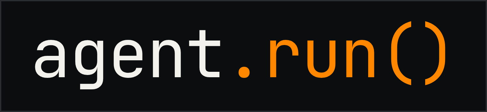</a>
</p>

<p align="center">
  <b>Run smarter agents. Use fewer tokens.</b>
</p>

<p align="center">
  <a href="#case-studies">Our code review bill went up 36x this year. Now a review costs us 18 cents. See how ↓</a>
</p>

<p align="center">
  <a href="https://www.npmjs.com/package/@parcha/agentrun"></a>
  <a href="https://github.com/Parcha-ai/agentrun/actions/workflows/ci.yml?query=branch%3Amain"></a>
  <a href="LICENSE"></a>
  <a href="https://agentrun.ai/docs"></a>
</p>

<p align="center">
  <a href="https://render.com/deploy?repo=https://github.com/Parcha-ai/agentrun"></a>
  &nbsp;
  <a href="#start-in-three-steps">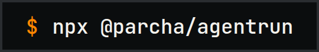</a>
</p>

<p align="center">
  <a href="#start-in-three-steps">Quickstart</a> ·
  <a href="#case-studies">Case studies</a> ·
  <a href="#take-the-tour">Tour</a> ·
  <a href="#templates">Templates</a> ·
  <a href="#deploy-it">Deploy</a> ·
  <a href="https://agentrun.ai/docs">Docs</a>
</p>

AgentRun is an open-source platform that supercharges your agents. It adds self-improvement, durable execution and a
control plane on top of your favorite agent harness. Your agents become smarter, more fault tolerant and use fewer
tokens with every run.

<p align="center">
  <a href="https://agentrun.ai">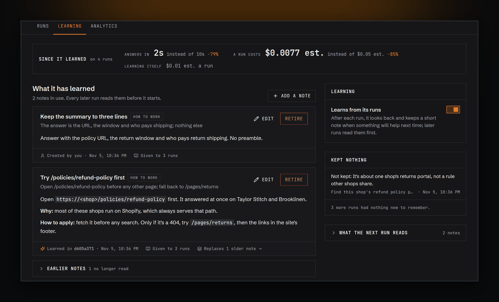</a>
  <br><sub>An agent's Learning tab: what it kept, and what changed since. Demo data from the console's recorded fixtures.</sub>
</p>

## Case studies

<p align="center">
  <a href="docs/case-studies/code-review.md">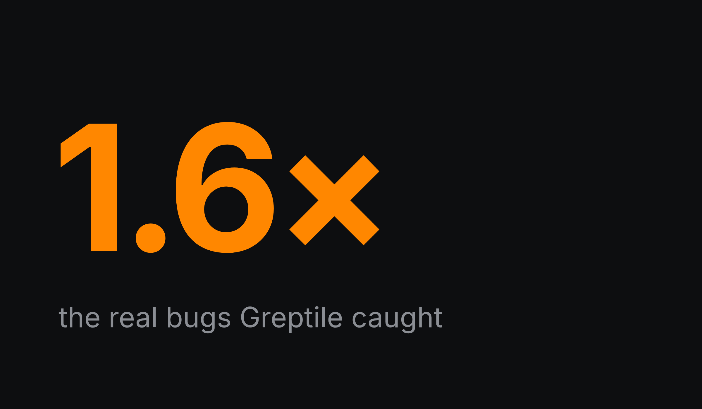</a>
  <a href="docs/case-studies/merchant-classification.md">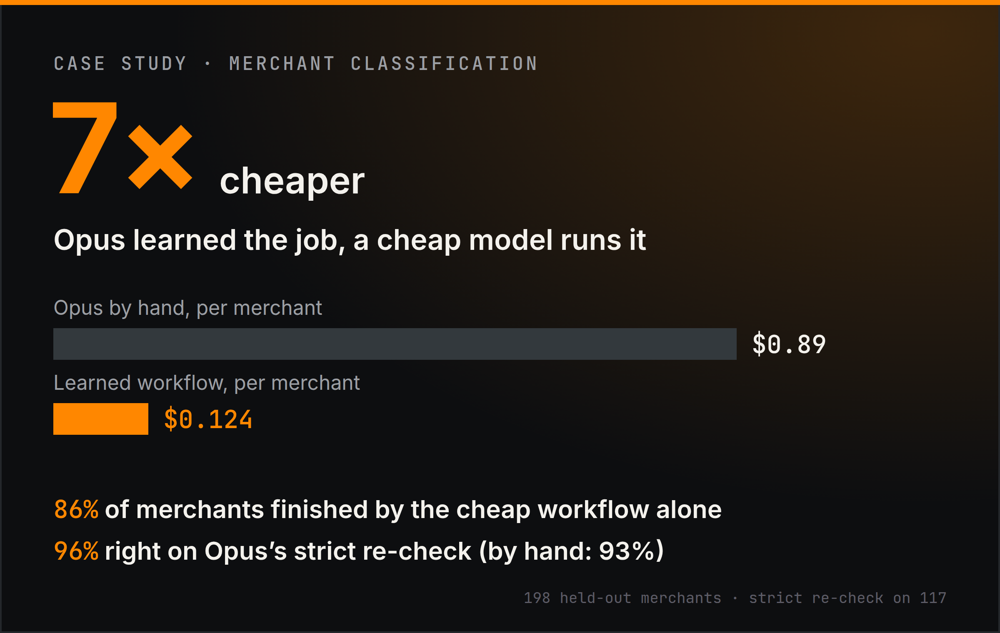</a>
</p>

**Code review.** Greptile started charging a dollar a review in March, then our agents took off, and our bill went
from $180 a month to $6,451. So we built our own reviewer on a cheap model and tuned it on our own PRs. It costs 18 cents a review, and on 30 PRs
it had never seen it caught 1.6x the real bugs Greptile did. [How we built it](docs/case-studies/code-review.md) · [Tune one on your repo](docs/tutorials/tune-a-template.md)

**Merchant codes.** We let Opus figure out how to classify merchants, then handed what it learned to a cheap model.
Same job, $0.89 down to $0.12 a merchant. [How it works](docs/case-studies/merchant-classification.md) · [Do it with your own job](docs/tutorials/learn-then-hand-off.md)

## Why AgentRun

Agents are great at figuring things out. The problem is they figure out the same things over and over. Give an agent
a job it has done a hundred times and it rediscovers the same API, rereads the same docs and rebuilds the same plan, and
you pay for every token of it.

Bring your agent on the harness it runs best on: Claude Code, Codex, OpenCode or pi. AgentRun does everything around it:

- **It learns the work.** After each run, the agent keeps what will help next time: a note, a skill, or a workflow
  that does the job without the loop. The next run starts from there.
- **It never loses a run.** Every run lives in one store. Kill the server mid-run, start it again, and the run carries
  on. Give each agent the computer the job needs: a sandbox, a Linux desktop, an Android phone or a browser.
- **You stay in control.** Approvals, spend caps and one console for every agent: what needs you, what failed, what's
  running and what it cost.

You don't build the plumbing: provider integrations, recovery, run tracking and learning are all here. Run it on your
laptop with one command, in one container, or as a server with runners. Apache-2.0.

## Start in three steps

You need Node 24.22.3 or newer, on macOS or Linux.

1. **Start it.**

   ```sh
   npx @parcha/agentrun
   ```

   It starts the server and one runner on port 7340 (or the next free one), keeps everything in `~/.agentrun`, and
   opens the console in your browser.

2. **Add one model key.** In the console, set a password, then add a key under **Settings → Model keys**. One
   `OPENROUTER_API_KEY` gives every harness a model. An Anthropic key runs pi and Claude Code; an OpenAI key runs pi,
   Codex and OpenCode.

3. **Run your first agent.** Open **Templates**, apply **KYB due diligence**, and start a run with a company's name and
   website. It needs nothing but your model key. When it finishes, the run's **Report** tab has a due diligence report
   with a verdict and every claim cited. Then open the agent's **Learning** tab to see what it kept for next time.

Rather have your coding agent do it? Tell it: `Read agentrun.ai/SKILL.md and set up AgentRun for me`.

<details>
<summary>Docker, sandboxes and running it on a server</summary>

If Docker is running on your machine, new agents get a Docker sandbox with a shell. Its image builds on first use,
which takes a few minutes, and the console says when it's ready. Without Docker, agents still read and write files,
but get no shell.

Want your own server with a URL? [Deploy it to Render](#deploy-it) in one click.

</details>

## Take the tour

**Workflows that make the call.** A step can ask a fast typed question, see how sure the answer is, and pick a route.
Here the model leans approve at 0.61, below the workflow's 0.75 bar, so the case goes to review.

<p align="center">
  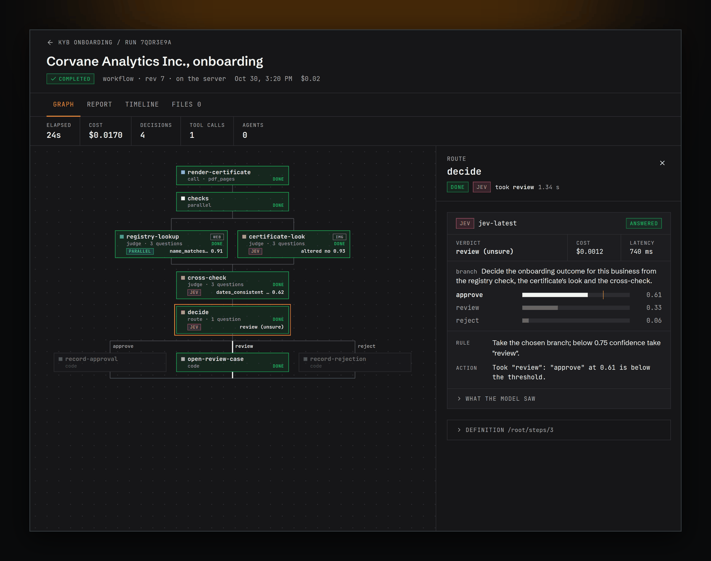
</p>

**Every agent in one place.** Mission Control opens first: what needs you, what failed, what's running and what it
cost, by day, by harness and by tool.

<p align="center">
  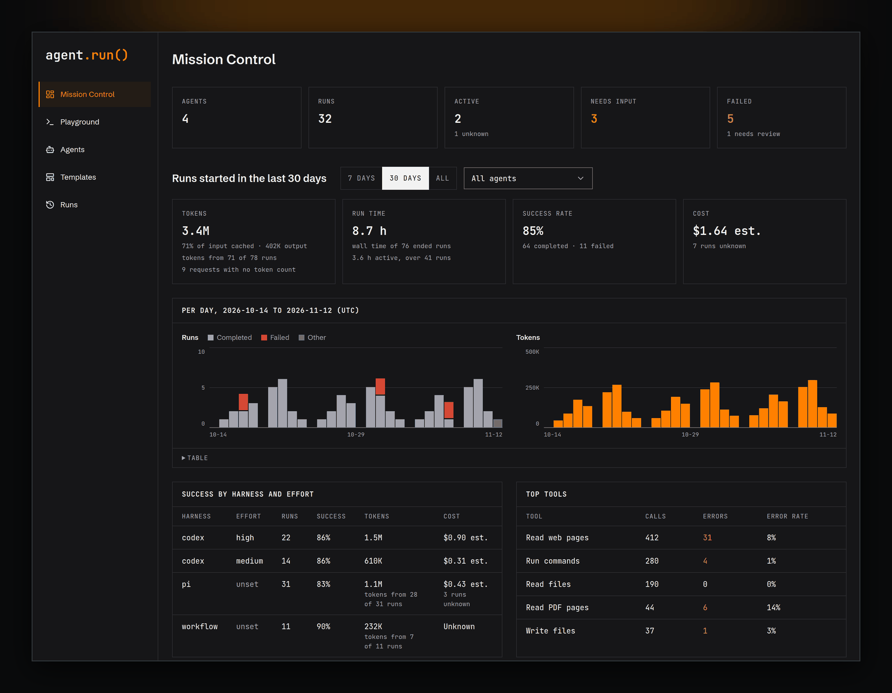
</p>

**Every agent is an API.** Start a run from the Playground, then copy the same request into your code.

<p align="center">
  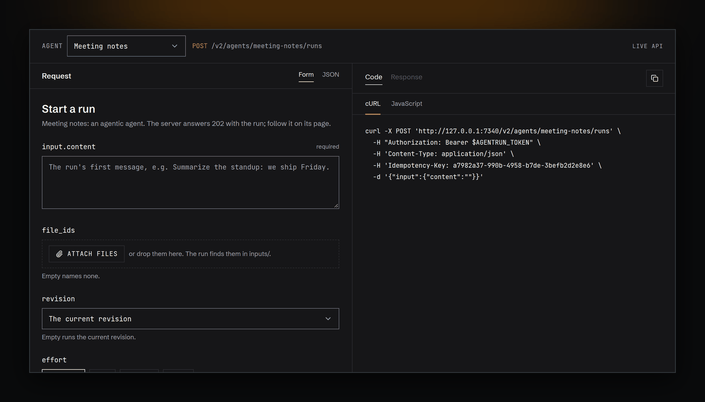
</p>

**You stay in control.** An agent can stop and ask you, and the run waits until you answer.

<p align="center">
  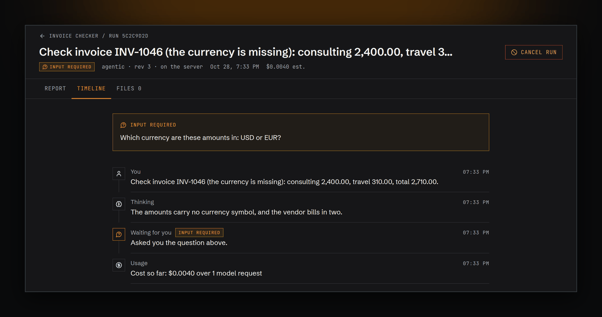
</p>

## Agents that learn the work

Turn it on with `"learning": true` in an agent's definition. At the end of every run, the agent gets one more turn to
say what it would keep. AgentRun checks it, grades it, and commits the keepers to the agent's own git folder. The next
run starts from there.

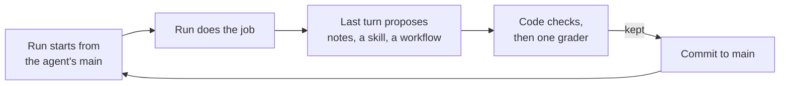

- **Notes** are short markdown files, one fact each, in Claude Code's memory format.
- **Skills** are how to do a job again, and only a run that finished the job can write one.
- **Learned workflows** run as one tool call on any harness, under the run's own cap and tool permissions. Once a
  learned skill has served 3 runs, the next run is asked for that job as a workflow draft, and a draft is dry-run
  before it's kept: no model is asked and no tool runs.

The agent's **Learning** tab shows every note, skill and workflow and the log of changes, and each run shows which
notes it was given and opened. Retire anything there, or with `npx @parcha/agentrun learning retire` and the note's
ETag. Git keeps the history, so a retired note can come back.

<details>
<summary>What gets kept, and what gets dropped</summary>

Each agent has a learning folder: plain git with one branch, `main`. A run reads the index of active notes in its
instructions and gets the learned skills beside its own. Code checks every proposal first. An item that breaks a rule of
its own (a size or count limit, its name, its shape) is left out and the rest goes on. A secret or a hidden character
anywhere in the answer, a file outside the folder, a deletion or a full index drops the whole answer, since no item of
it can be trusted. Then one grader judges what it says, and AgentRun commits what passes. A risky rule waits for your
OK. A rule the run found in a page or a pasted email, or a note that holds an account number, is dropped.

Once an agent's notes outgrow the learning budget, each run gets the ones that bear on its first message, whole, and a
line for each of the rest. A run that only ran a learned workflow isn't asked what to keep.

</details>

## Workflows

A lot of agents don't need to be agents. Write repeatable work as a typed workflow: tool calls, model steps and fast
typed decisions (yes or no, pick one, a score, each with its confidence), with an agent to fall back on when a case is
unclear. AgentRun runs it as an agent's revision, under the agent's tool permissions and a cap like any run, and a
trigger can start one.

<p align="center">
  
  <br><sub>An illustration of the control flow in <code>examples/support-answer.mjs</code>, not a recording of a model run.</sub>
</p>

Watch any workflow run node by node, pause it and resume it, and read every decision and why it was made:

<p align="center">
  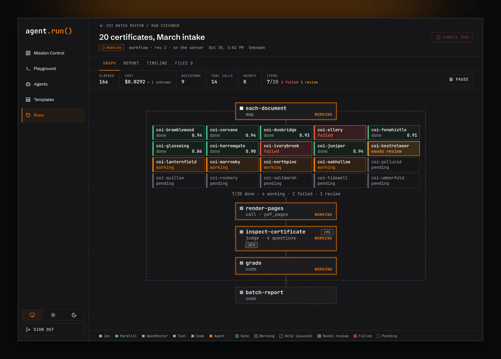
</p>

<details>
<summary>What a workflow looks like</summary>

A workflow is a JSON document of typed steps:

```json
{
  "v": 2, "name": "read-site",
  "schemas": {
    "In":   { "type": "object", "required": ["website"], "properties": { "website": { "type": "string" } } },
    "Page": { "type": "object", "required": ["ok"], "properties": { "ok": { "type": "boolean" } } }
  },
  "input":  { "schemaId": "In" },
  "output": { "schemaId": "Page", "path": "home" },
  "root": { "node": "chain", "steps": [
    { "node": "call", "label": "Read the home page", "via": "tool", "tool": "web_fetch",
      "args": { "url": "{website}" }, "out": "Page", "as": "home", "deadline_s": 60 }
  ] }
}
```

Steps can call tools, run a model, ask a fast typed question, branch on the answer, map over a list in parallel, loop a
bounded number of times, call other workflows, or hand the hard case to an agent. Save one as an agent's `workflow`
field; `npx @parcha/agentrun workflows validate` checks it first. The [workflow language](packages/dsl/README.md) also
runs on its own inside your app, with a [TypeScript builder](docs/authoring.md).

</details>

## Runs that survive

Every agent, revision, run and step lives in one store. Stop the server mid-run and start it again, and the run carries
on. With several runners, another runner picks up a dead runner's runs once their 30-second lease runs out. A finished
step is never run again; a write a crash cut off mid-call is marked interrupted rather than retried, so you can check it.

## You stay in control

- **Approvals.** Each tool is allowed, asks you first, or is denied. A call that asks waits on the run's page until you
  answer. "Never ask" lets an agent run unattended, and a deny set on the server still holds over it.
- **Spend caps.** Give a run a cap and it pauses there instead of failing, and tells you the least it needs to go on.
  A cost AgentRun can't price reads "unknown", never $0.
- **Questions.** An agent can stop and ask you, and the run waits until you answer.
- **One console.** Each run has a live Timeline, its files and, for a browser, a screen you can take over.

## Templates

Five ready-made agents. Apply one in one screen, make it yours, and measure it with its own eval cases. Each template is
one folder: the agent's instructions, its skills, its rules and its eval cases. **Templates → Apply** grants nothing
until you tick each MCP tool yourself.

| Template | What it does |
| --- | --- |
| `code-review` | Reviews a pull request with eight independent reviewers on a read-only checkout (or a pasted diff), merges and verifies their findings, quotes the line behind each, and returns them as JSON. It sets up its own GitHub trigger |
| `kyb` | Due diligence on one company: registries, owners, sanctions lists, dated adverse media, and a verdict with every claim cited |
| `market-monitor` | Every Monday, a digest of what changed at the companies you watch, each item dated and linked |
| `inbound-lead` | Researches each lead a webhook sends and scores it 0 to 100 against your ideal customer profile |
| `release-notes` | Turns the pull requests merged since the last release into release notes, left as a draft issue for a person |

`npx @parcha/agentrun template eval DIR` runs a template's eval cases as real runs on a throwaway server and grades
them. [Template packages](packages/serve/templates/README.md) has the folder format.

Want a template to know your code? [Tune a template on your own code](docs/tutorials/tune-a-template.md) walks
through the loop we ran on `code-review`.

**Triggers** start capped runs on their own: schedules, signed webhooks, GitHub pull request events and Composio
events.

## Connect your tools

Give an agent the tools of any remote MCP server in **Settings → MCP servers**. With a Composio key, five steps take
you from a toolkit to a run that a Composio event starts:

1. In **Settings → MCP servers → Add from Composio**, paste your Composio API key, type a toolkit (`hackernews`) and
   press **Load actions**.

   <p align="center">
     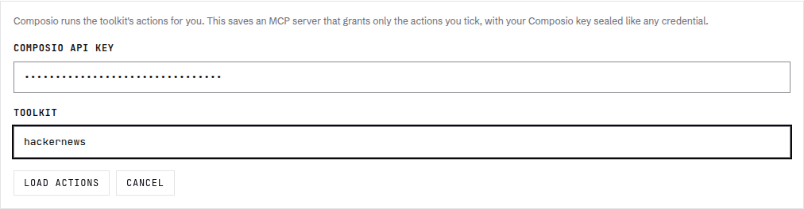
   </p>

2. Save a toolkit that acts as you, such as `github`, and open its link to connect your account on Composio.

   <p align="center">
     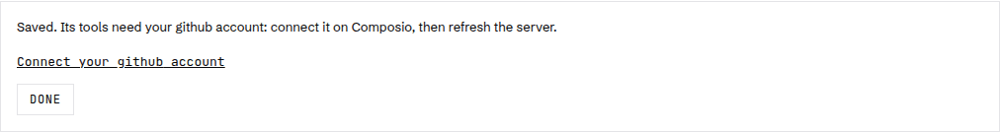
   </p>

3. Tick the actions an agent may use and save the server, then tick its tools in the agent's **Tools & skills** step.

   <p align="center">
     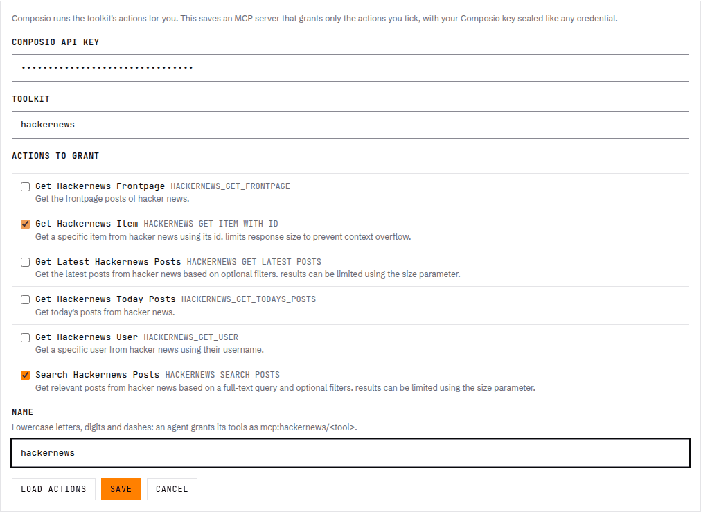
   </p>

4. In **Triggers → New webhook**, pick **Composio's** signature and the agent, subscribe its URL on Composio, then
   paste Composio's secret with **Set secret**.

   <p align="center">
     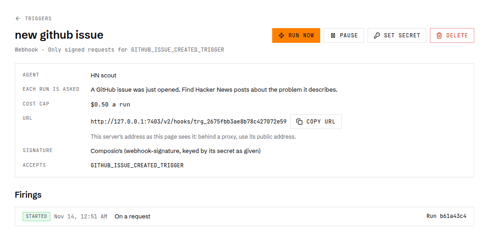
   </p>

5. Open an issue in your repository and watch the run it starts on the **Timeline**.

   <p align="center">
     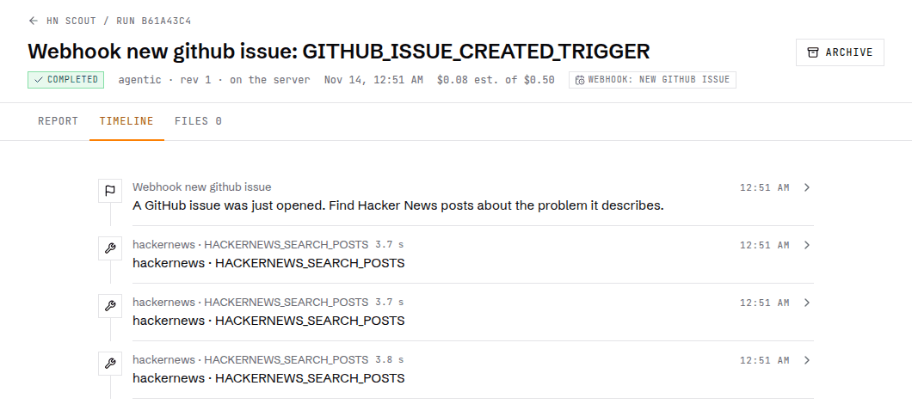
   </p>

[Connect Composio tools and triggers](docs/tutorials/composio.md) has each step's API call and the Composio side of the
trigger.

## Harnesses and computers

**Harnesses.** Name one in the agent's definition with `harness`. Approvals, caps, computers, triggers and learning work
the same on each. `npx @parcha/agentrun server capabilities` says which harnesses your server runs.

| Harness | `harness` | Notes |
| --- | --- | --- |
| pi | `pi` | The default |
| Claude Code | `claude-agent` | Installs itself on first use |
| Codex | `codex` | Installs itself on first use |
| OpenCode | `opencode` | Needs its `opencode-ai` package beside the server; AgentRun prints the line that installs it |

**Computers.** An agent gets a computer with one setting. It gets the tools for that kind and nothing else, and changing
the computer changes nothing else about the agent.

```yaml
computer:
  kind: sandbox        # none, sandbox, desktop, phone or browser
  provider: daytona    # one you connected in Settings → Computers (none takes no provider)
```

| Kind | What the agent can do | Providers |
| --- | --- | --- |
| `none` | Read and write files in its run folder; no shell (with Archil, commands run on Archil's exec) | none needed |
| `sandbox` | Run code, install packages, keep processes in the background, on Linux | Docker, Daytona, Modal, E2B |
| `desktop` | See a Linux screen, move the mouse, type | Orgo, E2B, Docker (your own image with an X server) |
| `phone` | Tap, swipe, type, open apps and read the screen on Android | phone harness (a rented cloud Android) |
| `browser` | Browse the web, and hand the controls to you at any point | Browserbase, Kernel |

Every kind but `none` names its provider. An agent with no computer setting gets the Docker sandbox where the server
has Docker, and no computer otherwise. Remote computers bill through your own account with the vendor.

<details>
<summary>Keys, run files, taking over, and conformance</summary>

- **Keys.** Add a vendor's key once in **Settings → Computers**. Your server seals it and shows it only as set or
  missing; it never enters the agent's computer. **Test connection** makes one read at the vendor and starts nothing.
- **The run's files.** By default a run's folder lives on your server and the Docker sandbox mounts it. Turn on an
  Archil disk in Settings and the folder lives there instead, so a Daytona, Modal, E2B or Agent37 sandbox mounts the same
  folder. Those four run only with an Archil disk, and with Archil on the Docker sandbox is refused.
- **Watching and taking over.** A browser run streams to the run's **Screen** tab through your own server, never
  through a vendor link. Take the controls, then hand them back. The agent can also stop and ask you to take over, for
  a login or a captcha.
- **Proof.** Each provider has a conformance suite for its kind. Run it against the vendor yourself, from a checkout
  after `npm ci && npm run build`:
  `npm run conformance -w @parcha/agentrun-computer -- --provider docker --kind sandbox`.

[`@parcha/agentrun-computer`](packages/computer/README.md) is the protocol underneath: one small daemon in every
computer and one provider per vendor. To add your vendor, see [How to contribute a provider](packages/computer/PROVIDERS.md#how-to-contribute-a-provider).

</details>

## How it fits together

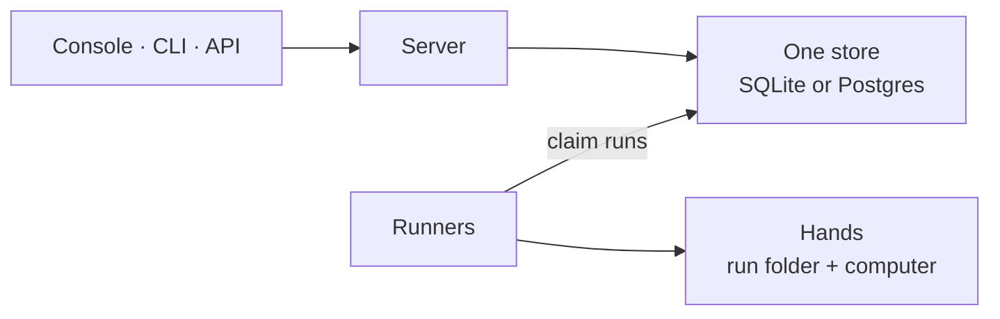

- **Server.** Serves the API at `/v2` and the console. It writes runs and commands to the store and reads it back for
  you. It runs no agent loop itself when you start it with `--no-runner`.
- **Store.** Agents, revisions, runs and every run's journal, in one place. SQLite in the data folder by default, or
  Postgres with `AGENTRUN_STORE_URL`.
- **Runners.** Each runner claims runs from the store and runs many at once. Every approval check, cap and model call
  happens here. Add runners to scale out.
- **Hands.** Where the agent's tools act. Each run has a run folder for its files. A sandbox mounts that folder at
  `/workspace` and the tools run inside it; a desktop, phone or browser leaves the folder on the runner.

## From the terminal and from code

`npx @parcha/agentrun` is also the server's CLI. Run these in a second terminal while the server is up; the CLI finds
it and its token by itself. The script makes an agent, starts a run capped at $1, lets the agent ask you a question,
answers it, and reads the file the agent wrote. With Docker on, the first run waits for the sandbox image.

```sh
# 1. Make an agent that can write files and ask you things.
cat > agent.json <<'EOF'
{"definition": {"id": "notes", "version": 1, "name": "Notes",
  "instructions": "Do what you are asked, and write what you make to a file.",
  "skills": [], "tools": ["write", "ask_person"]}}
EOF
npx @parcha/agentrun agents create --body @agent.json

# 2. Start a capped run and wait. It stops to ask you which region (exit code 8: it waits on you).
npx @parcha/agentrun runs start notes --max-cost-usd 1 --wait \
  --body '{"input": {"content": "Ask me which region to cover, then write region.md about it."}}' > out.json

# 3. Answer, wait for it to finish, and read what it wrote.
run=$(node -p 'require("./out.json").run_id')
npx @parcha/agentrun runs message "$run" --content "Europe"
npx @parcha/agentrun runs wait "$run" > out.json
npx @parcha/agentrun runs read-file "$run" region.md
```

`runs wait` exits 0 when the run completed, 1 when it failed, and 8 when it waits on you: a question, its cap, or an
approval. `runs timeline RUN_ID --follow` streams each step as it happens, and every run carries a `console_url` to its
page. `npx @parcha/agentrun help` lists every command; `npx @parcha/agentrun skill install --claude` (or `--codex`)
teaches your coding agent the CLI.

<details>
<summary>The same run from TypeScript or Python</summary>

With the TypeScript client (`npm install @parcha/agentrun-client`, no dependencies). The client reads its server and
token from the environment; the server prints both when it starts (with `npx @parcha/agentrun`, the token is in
`~/.agentrun/.token`, and the address is normally `http://127.0.0.1:7340`):

```sh
export AGENTRUN_BASE_URL=http://127.0.0.1:7340/v2
export AGENTRUN_API_KEY=$(cat ~/.agentrun/.token)
```

```ts
import { AgentRun } from "@parcha/agentrun-client";

const client = new AgentRun(); // AGENTRUN_BASE_URL and AGENTRUN_API_KEY
const started = await client.runs.start("notes", { input: { content: "Ask me which region to cover, then write region.md about it." }, max_cost_usd: 1 });
let run = await client.runs.wait(started.run_id);
if (run.pending?.kind === "question") await client.runs.message(run.run_id, { content: "Europe" });
run = await client.runs.wait(run.run_id);
console.log(run.status, run.cost.usd);
```

The Python client is `pip install parcha-agentrun`, with the same methods
([TypeScript client](packages/client/README.md), [Python client](python/README.md)).

</details>

## Deploy it

**Render, in one click.**

<a href="https://render.com/deploy?repo=https://github.com/Parcha-ai/agentrun"></a>

The button deploys [`render.yaml`](render.yaml): one 1 CPU / 2 GB instance with a 10 GB disk, the published image (no
build), and the token and seal key generated for you. It needs a card on your Render workspace: about $25 a month for
the instance and $2.50 for the disk, at Render's prices when this was written. In Render's form, paste
`OPENROUTER_API_KEY`. We recommend an OpenRouter key with a dollar cap and an expiration date. Do not share this key with
anyone. When it's live, open its URL and paste `AGENTRUN_TOKEN` from the service's Environment tab to set your password.

<details>
<summary>Docker Compose: a server and two runners</summary>

On a Linux machine with Docker:

```sh
git clone https://github.com/Parcha-ai/agentrun && cd agentrun/deploy
printf 'AGENTRUN_SEAL_KEY=%s\n' "$(openssl rand -base64 32)" > .env && chmod 600 .env
echo 'OPENROUTER_API_KEY=...' >> .env
docker compose up -d --build
docker compose logs server     # the console's link, the first visit's setup code and, the first time, the token
```

The port is published on this machine's loopback only; put a TLS proxy in front before you open it to anyone else.
This compose file has no Docker socket, so its agents get file tools and `web_fetch` but no shell. For a Docker
sandbox, use the single-server `compose.yaml` at the repository's root (Docker Engine 26 or later), run the server on
the host, or use a Daytona or E2B computer with an Archil disk.

</details>

<details>
<summary>Runners on Postgres</summary>

Set `AGENTRUN_STORE_URL` to a `postgres://` URL on the server and every runner (the compose file's `pg` profile runs
one), start the server with `--no-runner`, and start each runner from the same image with
`runner --data /data --name <name>`. Give every process the same `AGENTRUN_SEAL_KEY`. Runners still share the `/data`
volume in this release.

</details>

[Deploying AgentRun](deploy/README.md) covers runners, health checks and upgrades.

## Security

Every saved secret (model and tool keys, MCP credentials, sign-ins, webhook signing secrets) is sealed under one key,
`AGENTRUN_SEAL_KEY`; keep it, because losing it loses what it sealed. Secrets are write-only: the console shows each
one as set or missing, and only the console can paste, replace or remove one (your signed-in session, or the
launcher's console on loopback when accounts are off). A key set where the server starts wins over a pasted one. The
API token can't write a secret or approve a tool call. A run gets only the keys its own model and tools need, and
nothing a run learns can keep a secret it was handed. [SECURITY.md](SECURITY.md) says how to report a vulnerability.

## Docs

- [AgentRun Server](packages/serve/README.md): the API, models, tools, MCP servers, triggers, spend caps, learning and
  safety, in full
- [Quickstart on agentrun.ai](https://agentrun.ai/docs/quickstart) and the [docs](https://agentrun.ai/docs)
- [The CLI's skill](packages/agentrun/skills/agentrun-cli/SKILL.md) and [every command](packages/agentrun/skills/agentrun-cli/references/commands.md)
- [Deploying](deploy/README.md), [computers](packages/computer/README.md), [templates](packages/serve/templates/README.md)
- [Connect Composio tools and triggers](docs/tutorials/composio.md)
- [The workflow language](packages/dsl/README.md), [authoring](docs/authoring.md), [the guide](docs/guide.md)
- [Changelog](CHANGELOG.md) and [contributing](CONTRIBUTING.md)

## Coming next

- A computer chosen per call, not only per agent
- First-party computers
- iPhone, macOS and Windows computers
- Watching and taking over a desktop or phone run, as a browser run does today
- Composio as a tool catalog
- Harnesses over the Agent Client Protocol
- A Slack trigger and a Parallel monitor trigger

## License and thanks

Apache-2.0. Copyright 2026 Parcha Labs, Inc. Built by [Grep.ai](https://grep.ai).

AgentRun builds on [pi](https://github.com/earendil-works/pi) by Earendil Works (MIT), the agent loop and durable
runtime under it; [Stagehand](https://github.com/browserbase/stagehand) and the
[Browserbase Node SDK](https://github.com/browserbase/sdk-node); the
[TypeSafe JavaScript SDK](https://github.com/typesafe-ai/typesafe-sdk-js); Archil's
[disk SDK](https://github.com/archil-data/archil-sdk); and
[vercel-labs/durable-harness](https://github.com/vercel-labs/durable-harness) (Apache-2.0), whose ideas and code the
durable harnesses build on. Each keeps its own license; each package's NOTICE lists what it carries.
