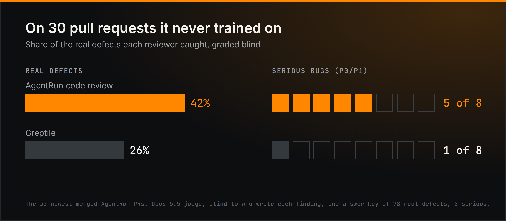

# Code review for 18 cents

> **TL;DR**
> - **$0.18 a review.** One parent agent, eight reviewers, one cheap model.
> - **1.6x the real bugs Greptile caught**, on 30 PRs it never saw.
> - **5 of 8 serious bugs.** Greptile caught 1.

  

## The numbers

| On 30 PRs it never saw | AgentRun `code-review` | Greptile |
| --- | --- | --- |
| Real bugs caught | **42%** (33 of 78) | 26% (20 of 78) |
| Serious bugs caught (P0/P1) | **5 of 8** | 1 of 8 |
| Cost per review | **$0.18** | per seat |

## What ships

- **5 quick reviewers.** They read the whole change and flag what looks wrong.
- **3 deep reviewers.** They chase state, ordering and untrusted input through the code.
- **1 parent.** It merges what they find, checks each finding against the code, and posts one review.

All on particle-1, on a read-only checkout of the PR. It comments. It never approves.

## What moved the numbers

1. **Give the cheap model a shell.** Reading only the diff, it was wrong 70% of the time. With read-only bash on the
   checkout: 7%.
2. **Mix your reviewers.** 5 quick plus 3 deep beat 8 of either.
3. **Don't let the parent talk reviewers out of real bugs.** It drops a finding only when the code contradicts it.
   Serious bugs on our tuning set went from 16 to 23 of 38.
4. **Count the reviews that never posted.** A timeout once made a good version look 15 points worse. Fix the timeout,
   not the reviewer.

## How we scored it

- 70 merged AgentRun PRs to tune on. The 30 newest held out for the final score.
- Opus 5.5 grades every finding blind: real, nit or wrong.
- One answer key with every real bug anyone found: 78 bugs, 8 serious.
- Cost is what OpenRouter billed for the parent and all eight reviewers, averaged over 70 reviews.

## Run it on your repo

1. In the console: **Templates → Apply → code-review**. Pick the repo, tick the GitHub tools. It needs a box (Docker,
   on by default) for its read-only shell.
2. Add `docs/CODEREVIEW.md` to your repo: what matters, what never to flag.
3. Turn on `"learning": true`. It keeps notes from every review.

Want it sharper on your code? [Tune a template on your own code](../tutorials/tune-a-template.md).
