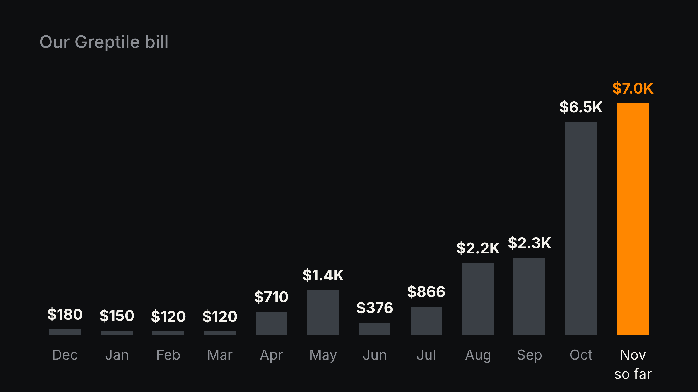

# Code review for 18 cents

Greptile is an industry-leading code review product. In March it moved from a flat price per seat to a dollar for every
review past 50. Then our agents took off, and our bill went from $180 a month to $6,451:

  

So we built our own. It runs on particle-1, a model that costs almost nothing, and a review costs us about 18 cents.

  

That's on the 30 newest PRs in this repo, none of which it was tuned on. On serious bugs it caught 5 of 8. Greptile
caught 1.

## What it is

One agent reads the PR and sends out eight reviewers. Five quick ones read the whole change. Three deep ones dig into
the risky parts. They all work on a read-only checkout of the PR. The parent checks every finding against the code and
posts one review. It comments, it never approves.

## What made it good

- **Give it a shell.** Reading only the diff, the cheap model was wrong 70% of the time. With read-only bash on the
  code, 7%.
- **Mix the reviewers.** Five quick plus three deep beat eight of the same.
- **Don't let the parent argue bugs away.** Our first version tossed real bugs it couldn't prove. Now it drops a finding
  only when the code says it's wrong.
- **Count the reviews that never posted.** A timeout once made a good version look 15 points worse.

## How we scored it

We tuned on 70 merged PRs and kept the 30 newest aside for the final score. Opus 5.5 graded every finding from every
reviewer without knowing who wrote it, and every real bug anyone found went into one answer key: 78 bugs, 8 of them
serious. Cost is what OpenRouter billed.

## Run your own

Start AgentRun with `npx @parcha/agentrun`, or deploy your own server to Render from the button at the top of the
[README](../../README.md). Then, in the console, **Templates → Apply → code-review**. Add a `docs/CODEREVIEW.md` to your repo with what matters and what
to never flag, and turn on `"learning": true`.

Want it sharper on your code? [Tune a template on your own code](../tutorials/tune-a-template.md).
