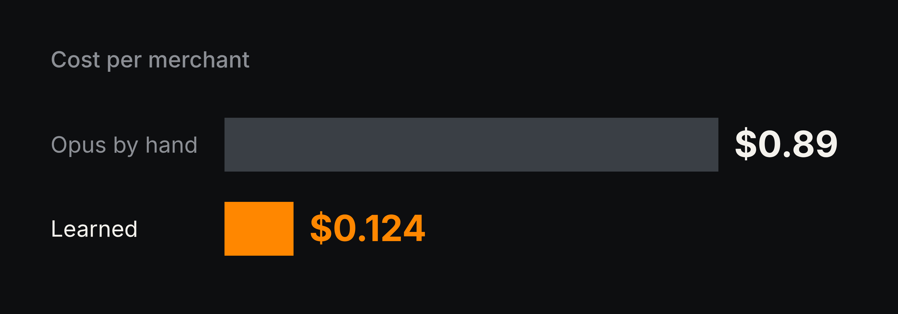

# Opus learns the job, a cheap model runs it

Every merchant a payments company signs needs a 4-digit Merchant Category Code: 5812 for restaurants, 7011 for hotels,
and hundreds more. Someone reads the website and picks one. Over and over.

We gave the job to Opus with learning on, and told it the right answer after every run. It wrote down the path it kept
taking as a workflow. From run 21 on, a cheap model ran that workflow, and Opus only got the hard cases.

  

That's on 198 merchants it never learned on, everything billed. The cheap model finished 86% of merchants on its own.
When Opus re-checked the answers strictly, the learned workflow got 96% right. Opus doing it by hand got 93%.

## The workflow Opus wrote

1. Fetch the merchant's site. If the text is unreadable, open it in a real browser.
2. Still nothing? Hand it to Opus.
3. The cheap model reads the site and picks the code.
4. A judge checks the quote behind the code is on a page it actually read.
5. Not backed up? Hand it to Opus.

## Learning helps the cheap model too

We also ran gpt-6-luna alone on 157 sealed merchants, learning off and on. Off: 75% exact codes. On: 81%. That's after
only 36 runs of learning, at about a cent an answer.

## How we scored it

950 merchants with reference codes from our production classifier: 555 to learn on, 198 held out, 157 sealed with
salted hashes before any run, and 40 to vet new workflow versions. The sealed runs read a recorded web with the answers
scrubbed out. Every cost includes Opus, the cheap model, the hand-backs and the learning.

## Try it

Works for anything you do over and over with different inputs.
[Teach an expensive agent, run a cheap one](../tutorials/learn-then-hand-off.md).
