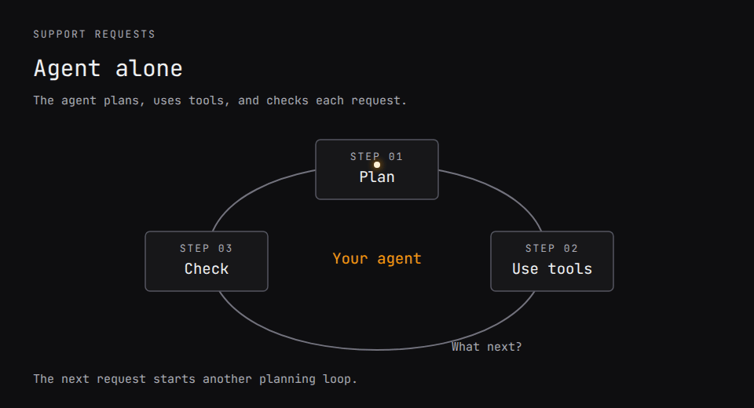

# Runnable examples

The workflow examples below run on scripted models by default, with no key: they exercise the workflow and its plumbing, not model quality. The workflow examples use fictional inputs. Start with the [support example](#run-the-support-example). The separate [backend SDK learning examples](#backend-sdk-learning-live-opt-in) require explicit live execution.



[View the static diagram](assets/support-workflow.svg)

## Run the support example

The workflow in the animation, from a checkout (Node 24.22.3 or newer, and npm):

```sh
git clone --branch main --single-branch https://github.com/Parcha-ai/agentrun.git
cd agentrun
# With nvm: nvm install && nvm use
npm ci --ignore-scripts
npm run build
npm run demo:support
```

This runs the interpreter with scripted tools, Jev answers, and agent responses. It needs no API key and sends no customer replies. The command prints a report for each case:

| Request | Agent calls | Decision calls | Result |
| --- | ---: | ---: | --- |
| Reset a password | 0 | 1 | Return the help answer |
| Find an invoice | 0 | 1 | Return the help answer |
| Investigate a failed payment | 1 | 2 | Return the investigation answer |
| Payment still unresolved | 1 | 2 | Escalate for review |

```sh
npm run demo:support -- payment
npm run test:support
```

Try `npm run demo:support -- unresolved` to see an escalation. It exits with code `2`. The responses are scripted; changing a prompt does not change them. [Connect live Jev and your agent](support-quickstart.md) next.

## Research demo

From the built checkout, a scripted research workflow answers "Should our team move its docs from a wiki into the code repository?":

```sh
npm run demo
npm run eval:research
```

It plans subquestions, researches them in parallel, screens evidence, and writes a report. The evaluation checks six labeled cases with scripted responses. [Connect real Jev decisions and your agents](live-research.md).

## Every example

After `npm ci --ignore-scripts` and `npm run build`:

| Example | Run | What to change |
| --- | --- | --- |
| [Support answers](support-quickstart.md) | `npm run demo:support` | Connect your search tool and agent; check an answer before returning it. |
| [Typed research](authoring.md) | `npm run demo` | Reuse one research component across questions and stop when evidence is missing. |
| [Rank a list](../examples/rank-candidates.mjs) | `npm run demo:rank` | Score candidates against your brief, drop duplicates, cap each bucket, keep the top k; call it from another workflow. |
| [Standalone TypeScript app](../examples/starter/README.md) | Follow the app's install steps, then `npm test` and `npm start` | Build outside this checkout with public package imports. |

The ranking example is a reusable workflow built from existing nodes, not a node of its own. A `sift` scores every candidate with a leveled question, and the continuous score in `<as>.answers[i].answers.<question>.score` orders them. Sorting, the minimum score, per-bucket quotas and the cut-off are a `code` step. A second `sift` over pairs finds near-duplicates among the best `consider` candidates, the only ones that can make the list. That costs `consider × (consider − 1) / 2` questions, so the caller chooses it. A long list needs no batching in the workflow: a `sift` over the host's per-request limits splits itself. `npm run demo:rank -- --live --input request.json` ranks your own list with Jev.

Each example includes a failure or uncertainty path. `npm run demo:support -- unresolved` and `npm run demo -- --no-evidence` exit with code `2` after escalation.

To connect models, follow [support integration](support-quickstart.md) or [research integration](live-research.md). Your application supplies tool permissions, credentials and cancellation. Scripted answers remain fixed when you edit a prompt.

## Backend SDK learning (live, opt-in)

Keep an existing backend agent's native SDK and tools while AgentRun checks learning for its next fresh request:

| Cookbook | Live example | What it verifies |
| --- | --- | --- |
| [Claude Agent SDK](tutorials/claude-sdk-learning.md) | [Release reporter](../examples/sdk-learning/claude.mjs) | The existing in-process MCP tool still executes; an accepted note or skill affects a fresh session. |
| [Codex SDK](tutorials/codex-sdk-learning.md) | [Release reporter](../examples/sdk-learning/codex.mjs) | The existing native shell still reads a status file; an accepted revision is supplied to a fresh thread. |
| [SDK workflow learning via MCP](tutorials/sdk-workflow-learning.md) | [Claude](../examples/sdk-learning/workflow-claude.mjs) / [Codex](../examples/sdk-learning/workflow-codex.mjs) | A generated and checked workflow invokes the original tool callbacks on a fresh request with changed data; an Off control gets the same task. |

Follow the [setup and execution instructions](../examples/sdk-learning/README.md). These examples use real models only with `--live`, compare learning On with an Off control, and preserve the result for inspection in the console. They require this development checkout's client and server, plus the backend's existing SDK credentials and a configured server grading model.
