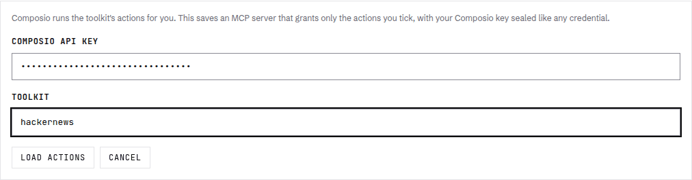
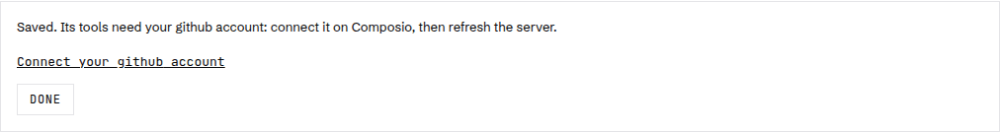
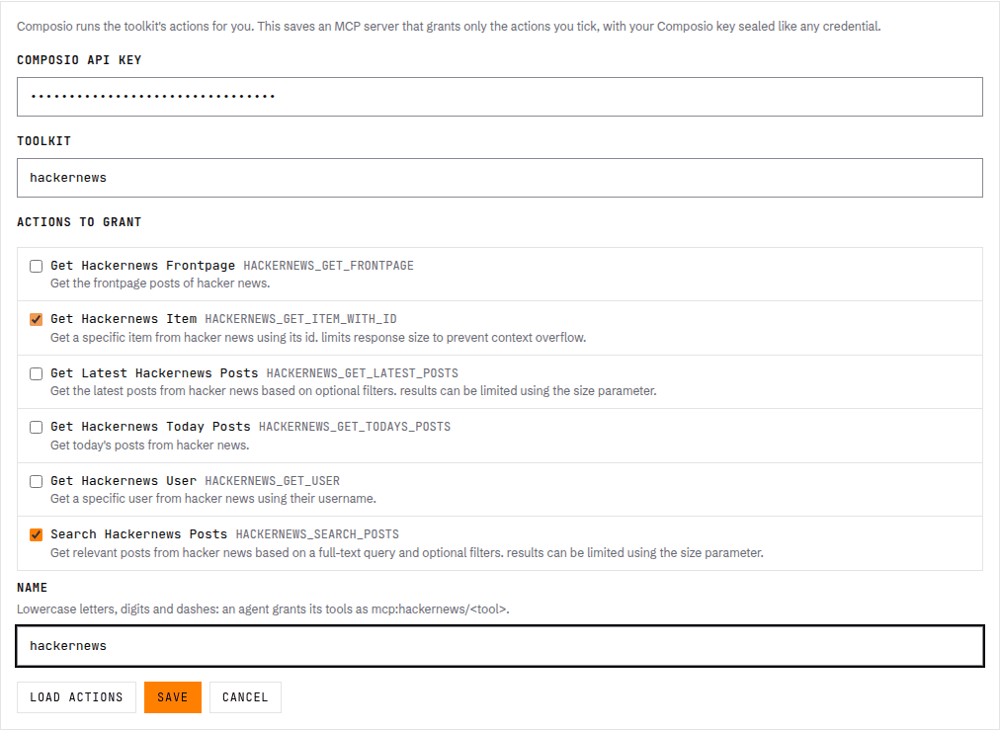
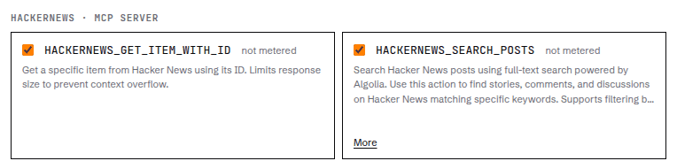
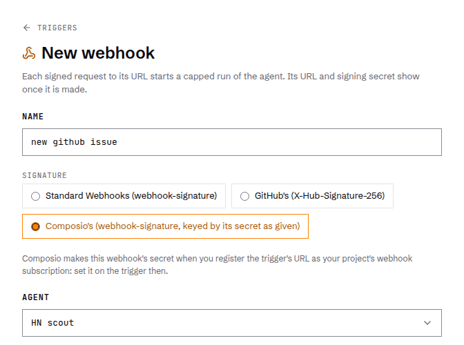
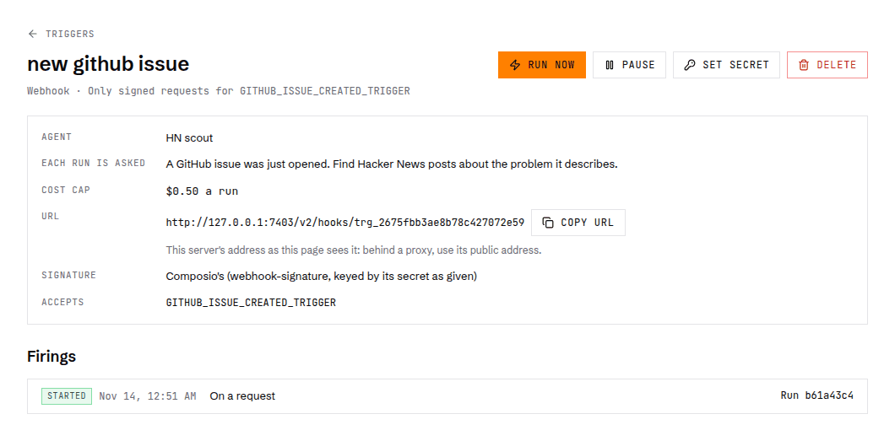
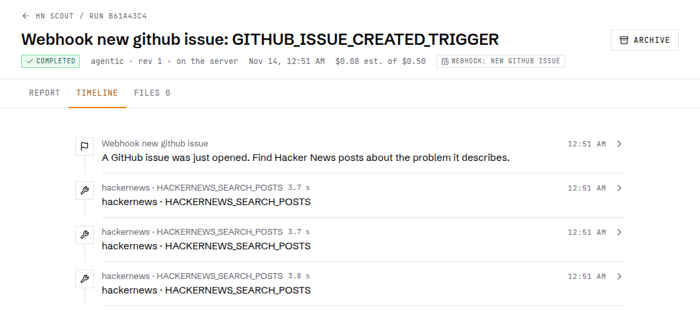

# Connect Composio tools and triggers

Composio runs actions in apps like GitHub, Slack and Gmail, and sends an event when something happens in one of them.
AgentRun takes both: a Composio toolkit becomes an MCP server your agents call, and a Composio event starts a run
through a webhook trigger. You need a Composio API key (from Composio's dashboard) and an AgentRun server where you can
sign in to the console.

This walk-through gives an agent the `hackernews` toolkit, which needs no account, so you see it work before you
connect anything. Then it starts that agent each time someone opens an issue in one of your GitHub repositories.

Each step is a click path in the console. The same step as an API call is in the collapsed block under it.

<details>
<summary>Before the API calls</summary>

The calls below use your server's address and token. The ones that send your Composio key or a webhook secret take
your signed-in session instead, since the token can't write a secret. Sign in once and keep the cookie in `jar.txt`.

```sh
BASE=http://127.0.0.1:7340
TOKEN=$(cat ~/.agentrun/.token)
COMPOSIO_API_KEY=...                    # from Composio's dashboard
read -rs PASSWORD                       # your console password
umask 077
jq -n --arg p "$PASSWORD" '{password: $p}' | curl -sS -c jar.txt -X POST "$BASE/v2/auth/sign-in" \
  -H "origin: $BASE" -H "content-type: application/json" --data-binary @-
```

</details>

## 1. Add your key and pick a toolkit

In **Settings → MCP servers → Add from Composio**, paste your Composio API key, type a toolkit's slug (`hackernews`)
and press **Load actions**.

<p align="center">
  
</p>

<details>
<summary>The same with the API</summary>

```sh
curl -sS -b jar.txt -X POST "$BASE/v2/settings/mcp-servers/composio/tools" -H "origin: $BASE" -H "content-type: application/json" \
  -d "{\"api_key\": \"$COMPOSIO_API_KEY\", \"toolkit\": \"hackernews\"}"
```

The answer lists the toolkit's actions (`tools`, each with its `slug`) and `no_auth`, which is `true` when the toolkit
needs no account.

</details>

## 2. Connect the account

A toolkit that acts as you (`github`, `slack`, `gmail`) needs your account on Composio. When you save one, the console
gives you a link to Composio's page to connect it. `hackernews` skips this step. The GitHub trigger in step 4 needs a
connected GitHub account, so add `github` the same way now and open the link.

<p align="center">
  
</p>

<details>
<summary>The same with the API</summary>

```sh
curl -sS -b jar.txt -X PUT "$BASE/v2/settings/mcp-servers/github/composio" -H "origin: $BASE" -H "content-type: application/json" \
  -d "{\"api_key\": \"$COMPOSIO_API_KEY\", \"toolkit\": \"github\", \"tools\": [\"GITHUB_GET_AN_ISSUE\", \"GITHUB_LIST_REPOSITORY_ISSUES\"]}"
```

When the account isn't connected yet, the answer's `connect_url` is Composio's page to connect it. Composio keeps the
account under the user `agentrun`; send `user_id` to use another one.

</details>

## 3. Pick actions and grant them to an agent

Tick the actions the agent may use, name the server and press **Save**. A run can call only the actions you ticked.

<p align="center">
  
</p>

Then, in the agent's **Tools & skills** step, tick the server's tools. Each one asks you before it runs, until you set
it to allow under the same step.

<p align="center">
  
</p>

<details>
<summary>The same with the API</summary>

Save the server:

```sh
curl -sS -b jar.txt -X PUT "$BASE/v2/settings/mcp-servers/hackernews/composio" -H "origin: $BASE" -H "content-type: application/json" \
  -d "{\"api_key\": \"$COMPOSIO_API_KEY\", \"toolkit\": \"hackernews\", \"tools\": [\"HACKERNEWS_SEARCH_POSTS\", \"HACKERNEWS_GET_ITEM_WITH_ID\"]}"
```

Make an agent that grants its tools as `mcp:<server>/<action>`, and lets them run without asking:

```sh
curl -sS -X POST "$BASE/v2/agents" -H "authorization: Bearer $TOKEN" -H "content-type: application/json" -d '{"definition": {"id": "hn-scout", "version": 1, "name": "HN scout",
    "instructions": "Answer from Hacker News, using your Hacker News tools. Give titles and links.",
    "skills": [], "computer": {"kind": "none"},
    "tools": ["mcp:hackernews/HACKERNEWS_SEARCH_POSTS", "mcp:hackernews/HACKERNEWS_GET_ITEM_WITH_ID"],
    "tool_settings": {"mcp:hackernews/*": {"permission": "allow"}}}}'
```

Try it:

```sh
curl -sS -X POST "$BASE/v2/agents/hn-scout/runs" -H "authorization: Bearer $TOKEN" -H "content-type: application/json" \
  -d '{"input": {"content": "Find the most discussed Hacker News post about SQLite and give its title and link."}, "max_cost_usd": 0.5}'
```

The run's Timeline shows each call as `hackernews · HACKERNEWS_SEARCH_POSTS`.

</details>

## 4. Add a trigger

In **Triggers → New webhook**, pick **Composio's** signature, the agent, what each run is asked and a cost cap, then
press **Create webhook**.

<p align="center">
  
</p>

The trigger's page shows its URL. Composio has to reach it, so your server needs a public address
([Deploy it](../../README.md#deploy-it), or `AGENTRUN_PUBLIC_URL` behind your own proxy). Then, on Composio's side:

1. Make a webhook subscription that points at the trigger's URL (its `hook_url`). Composio answers with a `secret`:

   ```sh
   curl -sS -X POST https://backend.composio.dev/api/v3.1/webhook_subscriptions \
     -H "x-api-key: $COMPOSIO_API_KEY" -H "content-type: application/json" \
     -d '{"webhook_url": "<hook_url>", "enabled_events": ["composio.trigger.message"], "version": "V3"}'
   ```

2. Find your GitHub connection's id (`ca_...`) for the `user_id` you saved the github server with (`agentrun`
   unless you sent another):

   ```sh
   curl -sS "https://backend.composio.dev/api/v3/connected_accounts?toolkit_slugs=github&user_ids=<user_id>" \
     -H "x-api-key: $COMPOSIO_API_KEY" | jq -r '.items[] | select(.status == "ACTIVE") | .id'
   ```

3. Turn on the event for your repository. This trigger polls GitHub, so it needs no webhook on the repository:

   ```sh
   curl -sS -X POST https://backend.composio.dev/api/v3/trigger_instances/GITHUB_ISSUE_CREATED_TRIGGER/upsert \
     -H "x-api-key: $COMPOSIO_API_KEY" -H "content-type: application/json" \
     -d '{"connected_account_id": "<ca_...>", "trigger_config": {"owner": "<owner>", "repo": "<repo>"}}'
   ```

Back on the trigger's page, press **Set secret** and paste Composio's `secret`. Until you do, the trigger refuses every
request.

<p align="center">
  
</p>

<details>
<summary>The same with the API</summary>

`accept` takes only the events it names: the event is the delivery's `metadata.trigger_slug`. The console's form has
no field for it yet, so a trigger made there takes every event its subscription sends.

```sh
curl -sS -X POST "$BASE/v2/triggers" -H "authorization: Bearer $TOKEN" -H "content-type: application/json" -d '{
  "name": "new github issue",
  "source": {"kind": "webhook", "signature": "composio", "accept": [{"event": "GITHUB_ISSUE_CREATED_TRIGGER"}]},
  "target": {"kind": "start_run", "agent_id": "hn-scout", "max_cost_usd": 0.5,
             "input": {"content": "A GitHub issue was just opened. Find Hacker News posts about the problem it describes."}}}'
```

The answer's `id` is the trigger, and its `hook_url` is the URL for Composio. Then give it Composio's secret, whole and
as Composio shows it:

```sh
TRIGGER=trg_...                          # the id above
SECRET=...                               # Composio's secret
curl -sS -b jar.txt -X POST "$BASE/v2/triggers/$TRIGGER/secret" -H "origin: $BASE" -H "content-type: application/json" \
  -d "{\"secret\": \"$SECRET\"}"
```

The same call replaces it when you rotate the secret in Composio.

</details>

## 5. Watch a run start from an event

Open an issue in the repository. Composio sends the event, the trigger checks its signature and starts a run, and the
run's **Timeline** opens with the trigger's row. In our test, the run started 37 seconds after the issue was opened.

<p align="center">
  
</p>

The agent reads the event inside a tag that names its source, so it treats what the issue says as data, not as
instructions:

```text
A GitHub issue was just opened. Find Hacker News posts about the problem it describes.

<trigger-payload source="webhook" scheme="composio" event="GITHUB_ISSUE_CREATED_TRIGGER" trigger_id="ti_..." user_id="..." untrusted>
{"id":"msg_...","type":"composio.trigger.message","metadata":{"trigger_slug":"GITHUB_ISSUE_CREATED_TRIGGER","toolkit_slug":"github",...},"data":{"number":9,"title":"...","html_url":"https://github.com/<owner>/<repo>/issues/9",...}}
</trigger-payload>

(From the webhook trigger "new github issue", received at <time>.)
```

<details>
<summary>The same with the API</summary>

```sh
curl -sS "$BASE/v2/triggers/$TRIGGER/firings" -H "authorization: Bearer $TOKEN"
RUN=...                                  # a firing's run_id
curl -sS "$BASE/v2/runs/$RUN/timeline" -H "authorization: Bearer $TOKEN"
```

</details>

## What else to know

- A saved Composio server is an MCP server like any other: each call passes the agent's approvals, shows on the
  Timeline, and reads "not metered" until you give it a price.
- Composio's meta tools, which run other actions by name, can't be granted. Grant the toolkit's own actions instead.
- One Composio project's webhook subscription posts every event to one URL, so it starts one trigger and its agent.

The server's reference has the rest: [Composio MCP servers](../../packages/serve/README.md#composio) and
[Composio triggers](../../packages/serve/README.md#webhook-triggers).
