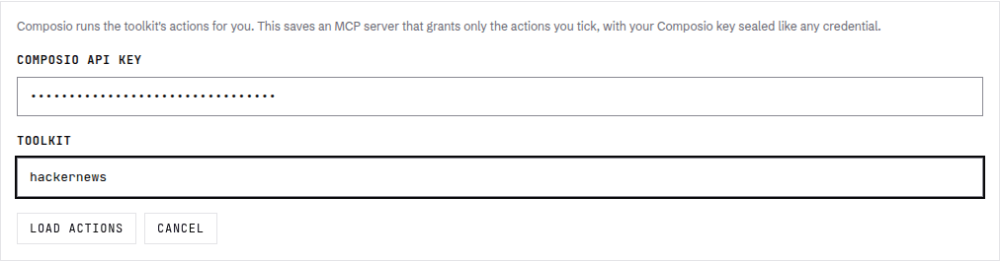
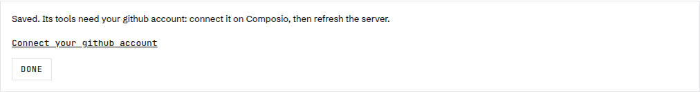
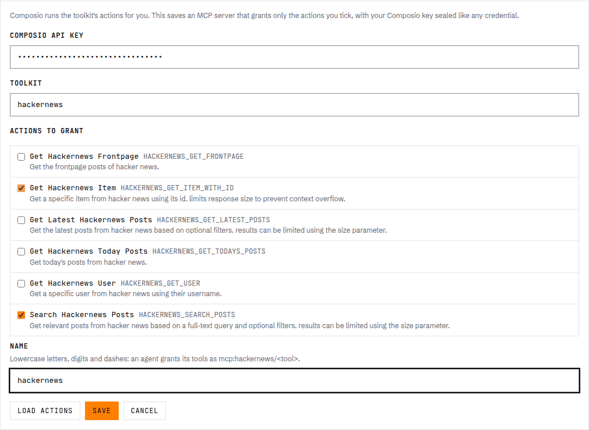
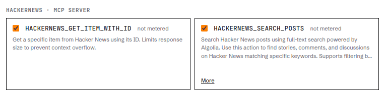
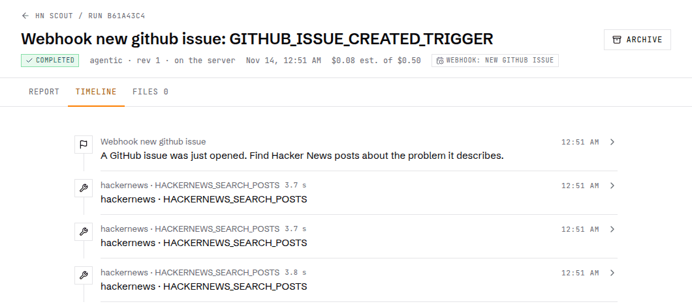

# Connect Composio tools and triggers

Composio runs actions in apps like GitHub, Slack and Gmail, and sends an event when something happens in one of them.
AgentRun takes both: a Composio toolkit becomes an MCP server your agents call, and a Composio event starts a run
through an app trigger. You need a Composio API key (from Composio's dashboard) and an AgentRun server where you can
sign in to the console.

This walk-through gives an agent the `hackernews` toolkit, which needs no account, so you see it work before you
connect anything. Then it starts that agent each time someone opens an issue in one of your GitHub repositories.

Each step is a click path in the console. The same step as an API call is in the collapsed block under it.

<details>
<summary>Before the API calls</summary>

The calls below use your server's address and token. The ones that send your Composio key take your signed-in
session instead, since the token can't write a secret. Sign in once and keep the cookie in `jar.txt`.

```sh
BASE=http://127.0.0.1:7340
TOKEN=$(cat ~/.agentrun/.token)
COMPOSIO_API_KEY=...                    # from Composio's dashboard
read -rs PASSWORD                       # your console password
umask 077
jq -n --arg p "$PASSWORD" '{password: $p}' | curl -sS -c jar.txt -X POST "$BASE/v2/auth/sign-in" \
  -H "origin: $BASE" -H "content-type: application/json" --data-binary @-
```

</details>

## 1. Add your key and pick a toolkit

In **Settings → MCP servers → Add from Composio**, paste your Composio API key, type a toolkit's slug (`hackernews`)
and press **Load actions**.

<p align="center">
  
</p>

<details>
<summary>The same with the API</summary>

```sh
curl -sS -b jar.txt -X POST "$BASE/v2/settings/mcp-servers/composio/tools" -H "origin: $BASE" -H "content-type: application/json" \
  -d "{\"api_key\": \"$COMPOSIO_API_KEY\", \"toolkit\": \"hackernews\"}"
```

The answer lists the toolkit's actions (`tools`, each with its `slug`) and `no_auth`, which is `true` when the toolkit
needs no account.

</details>

## 2. Connect the account

A toolkit that acts as you (`github`, `slack`, `gmail`) needs your account on Composio. When you save one, the console
gives you a link to Composio's page to connect it. `hackernews` skips this step. The GitHub trigger in step 4 needs a
connected GitHub account, so add `github` the same way now and open the link.

<p align="center">
  
</p>

<details>
<summary>The same with the API</summary>

```sh
curl -sS -b jar.txt -X PUT "$BASE/v2/settings/mcp-servers/github/composio" -H "origin: $BASE" -H "content-type: application/json" \
  -d "{\"api_key\": \"$COMPOSIO_API_KEY\", \"toolkit\": \"github\", \"tools\": [\"GITHUB_GET_AN_ISSUE\", \"GITHUB_LIST_REPOSITORY_ISSUES\"]}"
```

When the account isn't connected yet, the answer's `connect_url` is Composio's page to connect it. Composio keeps the
account under the user `agentrun`; send `user_id` to use another one.

</details>

## 3. Pick actions and grant them to an agent

Tick the actions the agent may use, name the server and press **Save**. A run can call only the actions you ticked.

<p align="center">
  
</p>

Then, in the agent's **Tools & skills** step, tick the server's tools. Each one asks you before it runs, until you set
it to allow under the same step.

<p align="center">
  
</p>

<details>
<summary>The same with the API</summary>

Save the server:

```sh
curl -sS -b jar.txt -X PUT "$BASE/v2/settings/mcp-servers/hackernews/composio" -H "origin: $BASE" -H "content-type: application/json" \
  -d "{\"api_key\": \"$COMPOSIO_API_KEY\", \"toolkit\": \"hackernews\", \"tools\": [\"HACKERNEWS_SEARCH_POSTS\", \"HACKERNEWS_GET_ITEM_WITH_ID\"]}"
```

Make an agent that grants its tools as `mcp:<server>/<action>`, and lets them run without asking:

```sh
curl -sS -X POST "$BASE/v2/agents" -H "authorization: Bearer $TOKEN" -H "content-type: application/json" -d '{"definition": {"id": "hn-scout", "version": 1, "name": "HN scout",
    "instructions": "Answer from Hacker News, using your Hacker News tools. Give titles and links.",
    "skills": [], "computer": {"kind": "none"},
    "tools": ["mcp:hackernews/HACKERNEWS_SEARCH_POSTS", "mcp:hackernews/HACKERNEWS_GET_ITEM_WITH_ID"],
    "tool_settings": {"mcp:hackernews/*": {"permission": "allow"}}}}'
```

Try it:

```sh
curl -sS -X POST "$BASE/v2/agents/hn-scout/runs" -H "authorization: Bearer $TOKEN" -H "content-type: application/json" \
  -d '{"input": {"content": "Find the most discussed Hacker News post about SQLite and give its title and link."}, "max_cost_usd": 0.5}'
```

The run's Timeline shows each call as `hackernews · HACKERNEWS_SEARCH_POSTS`.

</details>

## 4. Add a trigger

An app trigger needs your server's public address, since Composio sends each event to it
([Deploy it](../../README.md#deploy-it), or `AGENTRUN_PUBLIC_URL` behind your own proxy). Without one, **New app
trigger** is off, with the line "App triggers need this server's public address: set AGENTRUN_PUBLIC_URL and restart."

In **Triggers → New app trigger**, pick the saved `github` server and its event `GITHUB_ISSUE_CREATED_TRIGGER`, fill in
the event's config (your repository's `owner` and `repo`), then the agent, what each run is asked and a cost cap, and
press **Create app trigger**. This event polls GitHub, so it needs no webhook on the repository.

The server does the Composio side with the saved server's key:

- The project's webhook subscription, at this server's address, the first time a trigger needs one. Composio's secret
  for it is sealed here and never shown.
- The event's trigger instance, for the GitHub account you connected in step 2.

A Composio project has one webhook subscription. If it already sends its events somewhere else, the console asks
before it moves it: "Composio sends this project's events to <url> now. Moving them here stops them arriving there:
anything listening at <url> (another AgentRun server, or a tool of yours) gets no more events." **Move it here** moves
it; **Keep it there** leaves it and makes nothing.

The trigger's page shows whether its instance is on at Composio. Pausing, resuming and deleting the trigger do the same
to the instance on Composio.

<details>
<summary>The same with the API</summary>

The events a saved server's toolkit offers, each with its config's schema:

```sh
curl -sS "$BASE/v2/settings/mcp-servers/github/composio/events" -H "authorization: Bearer $TOKEN"
```

Then make the trigger:

```sh
curl -sS -X POST "$BASE/v2/triggers" -H "authorization: Bearer $TOKEN" -H "content-type: application/json" -d '{
  "name": "new github issue",
  "source": {"kind": "composio", "server": "github", "event": "GITHUB_ISSUE_CREATED_TRIGGER",
             "config": {"owner": "<owner>", "repo": "<repo>"}},
  "target": {"kind": "start_run", "agent_id": "hn-scout", "max_cost_usd": 0.5,
             "input": {"content": "A GitHub issue was just opened. Find Hacker News posts about the problem it describes."}}}'
```

The answer's `source` names what the server made: `instance_id`, Composio's id for the instance, and `hook`, the
project's route here. `TRIGGER=trg_...` (the answer's `id`) is used in step 5.

- `409 composio_no_public_url`: the server has no public address.
- `409 composio_subscription_elsewhere`: the project's subscription is at `details.webhook_url`. Send the same body
  with `"move_subscription": true` in `source` to move it here.
- `409 composio_not_connected`: the server's Composio user has no connected account; `details.connect_url` is Composio's
  page to connect it.
- `409 composio_account_ambiguous`: it has several, listed in `details.accounts`. Disconnect the others in Composio.

</details>

## 5. Watch a run start from an event

Open an issue in the repository. Composio sends the event, the server checks its signature and starts a run, and the
run's **Timeline** opens with the trigger's row. In our test, the run started 37 seconds after the issue was opened.

<p align="center">
  
</p>

The agent reads the event inside a tag that names its source, so it treats what the issue says as data, not as
instructions:

```text
A GitHub issue was just opened. Find Hacker News posts about the problem it describes.

<trigger-payload source="composio" scheme="composio" event="GITHUB_ISSUE_CREATED_TRIGGER" trigger_id="ti_..." user_id="..." untrusted>
{"id":"msg_...","type":"composio.trigger.message","metadata":{"trigger_slug":"GITHUB_ISSUE_CREATED_TRIGGER","toolkit_slug":"github",...},"data":{"number":9,"title":"...","html_url":"https://github.com/<owner>/<repo>/issues/9",...}}
</trigger-payload>

(From the Composio trigger "new github issue", received at <time>.)
```

<details>
<summary>The same with the API</summary>

```sh
curl -sS "$BASE/v2/triggers/$TRIGGER/firings" -H "authorization: Bearer $TOKEN"
RUN=...                                  # a firing's run_id
curl -sS "$BASE/v2/runs/$RUN/timeline" -H "authorization: Bearer $TOKEN"
```

</details>

## What else to know

- A saved Composio server is an MCP server like any other: each call passes the agent's approvals, shows on the
  Timeline, and reads "not metered" until you give it a price.
- Composio's meta tools, which run other actions by name, can't be granted. Grant the toolkit's own actions instead.
- One Composio project's webhook subscription posts every event to one address. Two AgentRun servers can't both take
  the same project's events: the one that moves the subscription to itself gets them.
- A webhook trigger takes no Composio signature: an app trigger is the one way Composio's events start runs.

The server's reference has the rest: [Composio MCP servers](../../packages/serve/README.md#composio) and
[Composio triggers](../../packages/serve/README.md#composio-triggers).
