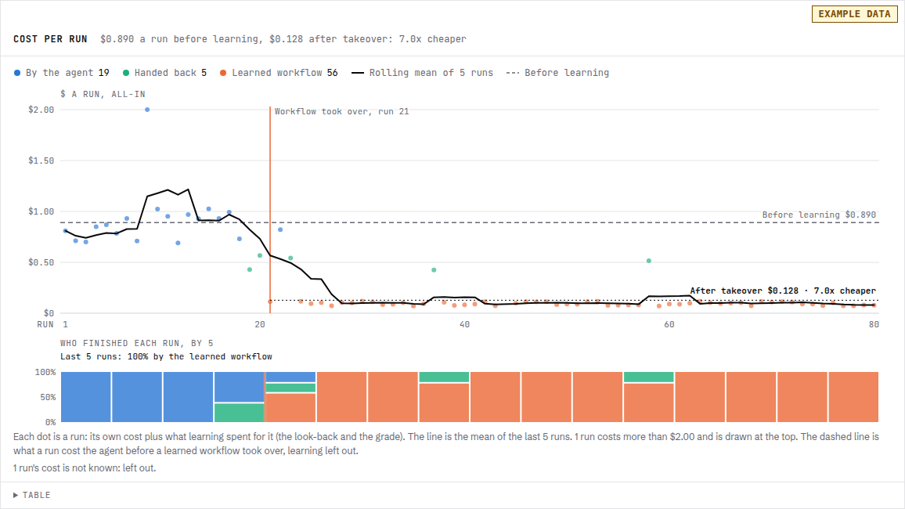

# Teach an expensive agent, run a cheap one

A strong model figures the job out and writes it down as a workflow. A cheap model runs the workflow. The strong model
only sees the hard cases. It's how we took [merchant codes from $0.89 to $0.12](../case-studies/merchant-classification.md).

## 1. Pick two models

The agent runs on the strong one. Workflow steps on the `fast` tier run on the cheap one.

```sh
AGENT_MODEL=openrouter/anthropic/claude-opus-5.5 \
AGENT_MODEL_FAST=openrouter/openai/gpt-6-luna \
npx @parcha/agentrun
```

## 2. Make the agent

```sh
cat > agent.json <<'EOF'
{"definition": {"id": "mcc", "version": 1, "name": "Merchant codes",
  "instructions": "Given a merchant's name and website, find the exact 4-digit MCC, with the URL and the quote that decided it. Before you finish, use ask_person to show your answer and ask if it's right. In a workflow you write, put judgment steps on the fast tier.",
  "skills": [], "tools": ["web_search", "web_fetch", "ask_person"], "learning": true}}
EOF
npx @parcha/agentrun agents create --body @agent.json
```

The last sentence of the instructions is what makes its workflows run cheap. The one before it is how you teach it.

## 3. Tell it how it did

Start a run on a real input. It stops before it finishes and asks you to check its answer (`--wait` exits 8 while it
waits on you):

```sh
npx @parcha/agentrun runs start mcc --wait \
  --body '{"input": {"content": "Merchant: Blue Fern Boutique, https://bluefern.example"}}' > out.json
run=$(node -p 'require("./out.json").run_id')
```

Answer it:

```sh
npx @parcha/agentrun runs message "$run" --content "Right answer: 5691. You said 5651. The site only sells women's clothing."
```

Then the run finishes, looks back at the whole conversation and keeps what helps, your answer included. Tell it when
it's right too, and cover every field you care about. The one you never mention is the one it gets sloppy on.

## 4. Watch it learn

Open the agent's **Learning** tab. Notes show up first, then a skill, then a workflow once that skill has done the job
a few times. From then on every run reaches for the workflow first.

## 5. Check the bill

Every run shows its cost, learning included. Ours dropped the run the workflow took over and stayed there.

The Learning tab's **Cost per run** chart draws it run after run: each run's all-in cost as a dot coloured by the path
it took (the agent by hand, a learned workflow that handed back, or the workflow alone), a rolling mean through them,
the agent's cost before learning as a dashed line, a marker at the first run the workflow finished alone, and the
level after it. Once 20 runs stand behind that level, it says how many times cheaper it is.



The chart above is an invented agent's runs. `agentrun learning cost <agent> --format csv` writes your agent's series as
CSV, to plot or check yourself (`GET /v2/agents/{id}/learning/cost` answers it as JSON).

If you already have the answers, teach it from them. On the Learning tab, **Learn from a CSV** takes a file of rows, the
column or columns to give the agent and the column that holds the reference answer, and a cap on the whole batch. The
server runs the agent on each row in order, and after each run tells it the reference answer beside its own, so it looks
back again. The page shows rows done, right or wrong, what it learned and what it has cost, and keeps showing it after a
reload: the batch is the server's (`POST /v2/agents/{id}/learning/batches`, read at `GET .../batches/{batch_id}`).

To prove it, keep some inputs it never learns on and compare learning off and on. The
[learning bench](../../packages/serve/learn-bench/README.md) does that for you.
