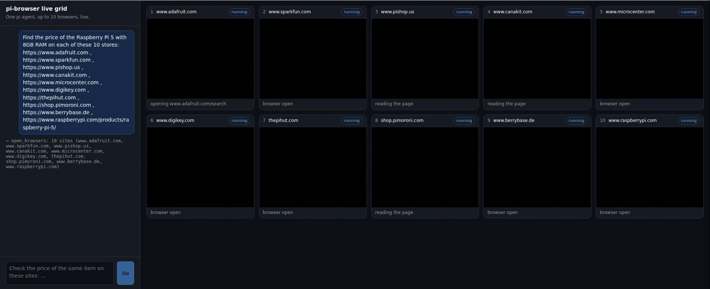

# Live grid: one pi agent, ten browsers

Type one task, for example "find the price of X on these ten stores". A pi agent splits it into one job per site and
starts a child agent for each. Every child gets its own pi-browser session, and you watch all of them work at once.



## Run it

From the repository root:

```sh
npm ci
npm run build -w @parcha/pi-browser
node packages/pi-browser/examples/live-grid/main.mjs
```

Open the URL it prints, type a task and press Go. Ctrl-C releases every browser and quits.

By default each child starts a headless local Chrome, and every agent uses `gpt-6-luna` on an OpenAI Responses
endpoint. Point `--base-url` and `--model` at the endpoint and model you have. The key is read from `LITELLM_API_KEY`
or `OPENAI_API_KEY`; a broker on your own machine (`--base-url http://127.0.0.1:...`) needs none.

| Flag | Default | |
|---|---|---|
| `--provider` | `cdp` | `cdp` starts a local Chrome per child. `browserbase` needs `BROWSERBASE_API_KEY`, `kernel` needs `KERNEL_API_KEY` |
| `--children` | `10` | the most browsers one task opens (1 to 10) |
| `--model` | `gpt-6-luna` | the model the parent and every child use |
| `--base-url` | `LITELLM_BASE_URL`, then `OPENAI_BASE_URL`, then OpenAI | the model endpoint |
| `--chrome` | found on the machine | the Chrome to start (`PI_BROWSER_CHROME` works too) |
| `--headed` | off | show the local Chrome windows |
| `--local-only` | off | local Chrome reaches only loopback sites, for trying it against a site on your machine |
| `--port` | any free port | the page's port on 127.0.0.1 |

A local Chrome visits each site from your own network. Use `--provider browserbase` or `--provider kernel` when the
browsers should run in the cloud.

## How it works

- **The page** (`page.html`) is served by `live-grid.mjs` on 127.0.0.1. It shows the parent's chat on the left and a
  tile per child on the right, all fed by one server-sent event stream.
- **The parent** is a pi agent session with one tool, `open_browsers` (`fanout.mjs`). It takes up to ten
  `{ site, task }` pairs and answers each child's report.
- **Each child** is a pi agent session started the same way, with pi-browser's extension and its own provider. All
  children run at once. A child's session is disposed when it finishes, which releases its browser; the grid then
  releases anything the child left open, so no browser outlives its task.
- **The tiles** come from the provider each child uses (`tiles.mjs`):
  - a local Chrome is shown through a CDP screencast of the page the child is using: JPEG frames into an ``,
    read-only;
  - Browserbase and Kernel give a live-view URL, shown in an `<iframe>`. Those URLs carry a token, so they go to the
    page's event stream only, never into a tool result, a prompt or a log. Kernel serves a live view for headful
    browsers, its default.

Every session starts the way pi's own runtime starts one:

```js
const runtime = await createAgentSessionRuntime(async ({ cwd, sessionManager, sessionStartEvent }) => {
  const services = await createAgentSessionServices({ cwd, agentDir, modelRuntime, resourceLoaderOptions: { extensionFactories: [createBrowserExtension({ provider })], noExtensions: true } });
  return { ...(await createAgentSessionFromServices({ services, sessionManager, sessionStartEvent, model, noTools: "builtin" })), services, diagnostics: services.diagnostics };
}, { cwd, agentDir, sessionManager: SessionManager.inMemory(cwd) });
await runtime.session.bindExtensions({});
await runtime.session.prompt(task);
await runtime.dispose(); // pi-browser releases the browser on this shutdown
```

`fanout.mjs` stands in for pi-browser's `use_website` tool; when that lands, it replaces this one file.

## Test

`test/live_grid_real_chrome.test.mjs` starts the grid with three children against a local test site, with a scripted
model in place of a real one. It checks that each tile streamed frames to the page, that the parent got all three
answers, and that every child's Chrome was released and exited.
